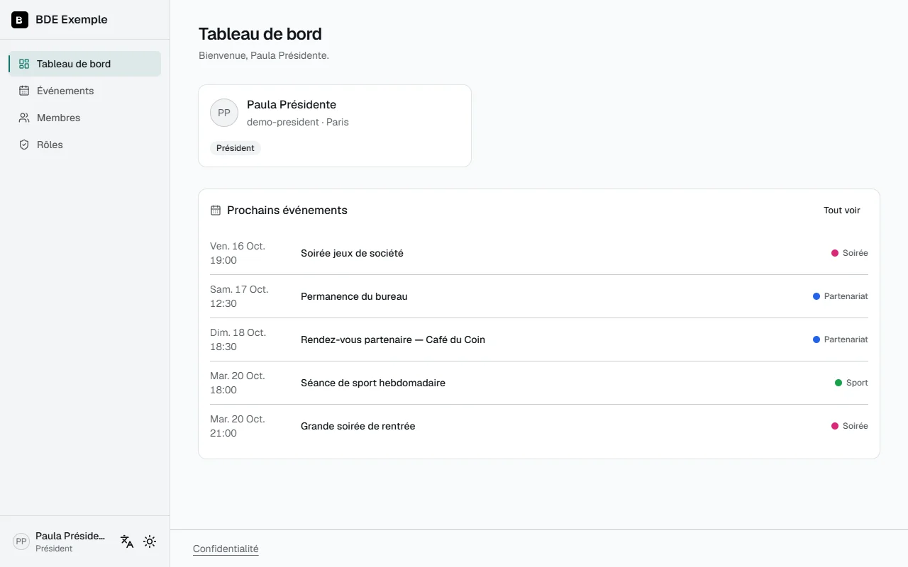
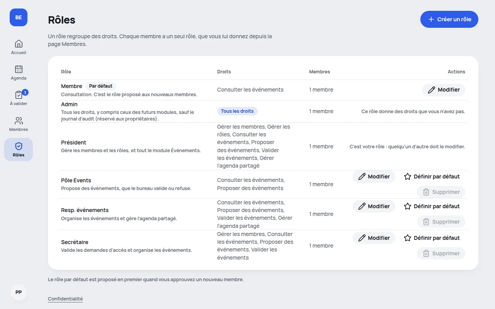
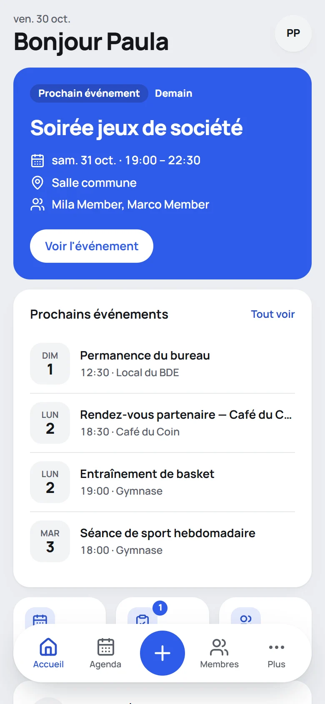

🇫🇷 Français · [🇬🇧 English](README.md)

# BDE_Network

[](https://github.com/edouardbautz/BDE_Network/actions/workflows/ci.yml)
[](LICENSE)
[](https://github.com/edouardbautz/BDE_Network/releases)

**Une plateforme libre, à héberger soi-même, pour gérer un BDE (_Bureau Des Étudiants_) d'une école 42 : les membres
se connectent avec leur compte 42, le bureau leur donne des rôles, et le calendrier des événements se synchronise
avec Google Agenda, Outlook et Apple Calendar.**


Chaque BDE fait tourner **sa propre instance** : sa base de données, ses réglages, son application 42. Rien n'est
partagé entre deux instances.

## Ce qu'elle fait

- **Connexion avec 42 uniquement.** Aucun mot de passe à gérer. Les nouveaux membres attendent une validation : le
  bureau les approuve et choisit leur rôle. La connexion peut être limitée à certains campus.
- **Installation dans le navigateur.** Une commande, puis une page vous guide pas à pas et vérifie vos réponses auprès
  de 42. Aucun fichier à modifier, puis une page **Paramètres** pour les propriétaires.
- **Rôles et droits personnalisés.** Chaque BDE crée ses rôles (Président, Trésorier…) et coche ce que chacun peut
  faire. Personne ne peut donner un droit qu'il n'a pas : le serveur l'empêche, et c'est testé.
- **Événements.** Un calendrier mensuel et une liste, des catégories en couleur, des événements qui se répètent, des
  brouillons privés jusqu'à leur confirmation, des membres en charge, une date d'une série modifiée ou annulée toute seule.
- **Synchronisation d'agenda.** Un lien personnel pour chaque membre, et **un lien pour tout le BDE** à coller une
  fois dans un agenda partagé.
- **Notifications** par e-mail, Discord ou Slack : un événement confirmé, un rappel la veille, une demande d'accès,
  une approbation, un retrait. Sur Discord et Slack, des cartes lisibles. **Chaque message est personnalisable** (mots,
  couleurs, informations montrées, bouton, mentions) depuis un éditeur avec aperçu en direct.
- **Journal d'audit** des actions sensibles, **export RGPD** de ses propres données, une page de confidentialité.
- **Français et anglais**, thèmes clair et sombre, votre couleur et votre logo, utilisable sur téléphone.
- **Simple à exploiter.** Docker seulement, migrations appliquées au démarrage, scripts de sauvegarde et de
  restauration, une vérification de santé, et un guide de mise à jour.

|                                                      |                                                     |
| ---------------------------------------------------- | --------------------------------------------------- |
|  |     |
|    |  |



## Démarrage rapide

Il vous faut [Docker](https://www.docker.com/products/docker-desktop/) et Git, sous Windows, Linux ou macOS. Pas de
Node.js.

1. **Récupérez le code** : `git clone https://github.com/edouardbautz/BDE_Network.git`, puis `cd BDE_Network`.
2. **Démarrez la plateforme** :

   ```text
   docker compose up
   ```

3. **Ouvrez** `http://localhost:3000` et entrez le **code d'installation** affiché dans le terminal. Suivez les étapes
   dans le navigateur.
4. **Une fois installée**, appuyez sur `Ctrl+C`, puis lancez `docker compose up -d`. C'est la commande à utiliser
   désormais.

Il vous faudra une application 42 (l'installateur explique comment) et, pour un vrai serveur, un nom de domaine et
HTTPS : voir le [guide de déploiement](docs/fr/deployment.md). **Sauvegardez le volume `secrets`** avec
`./scripts/backup.sh`.

## Documentation

La documentation est en français et en anglais, avec les mêmes pages.

| Je veux…                          | Lire                                                                                                               |
| --------------------------------- | ------------------------------------------------------------------------------------------------------------------ |
| Me repérer                        | [Le sommaire de la documentation](docs/fr/README.md), par profil de lecteur                                        |
| Installer la plateforme           | [Installation](docs/fr/installation.md) · [Déploiement](docs/fr/deployment.md)                                     |
| Passer à une nouvelle version     | [Mettre à jour](docs/fr/upgrading.md)                                                                              |
| L'utiliser, en membre du bureau   | [Guide utilisateur](docs/fr/user-guide.md) · [Rôles et droits](docs/fr/roles.md) · [Événements](docs/fr/events.md) |
| Régler Discord, Slack ou l'e-mail | [Notifications](docs/fr/notifications.md)                                                                          |
| Modifier un réglage               | [Configuration](docs/fr/configuration.md)                                                                          |
| Résoudre un problème              | [Problèmes fréquents](docs/fr/troubleshooting.md) · [FAQ](docs/fr/faq.md) · [Glossaire](docs/fr/glossary.md)       |
| Savoir comment c'est vérifié      | [Qualité](docs/fr/quality.md)                                                                                      |
| Contribuer                        | [Guide contributeur](docs/fr/contributing.md) · [Architecture](docs/architecture.md) (en anglais)                  |

## Feuille de route

Modules métier prévus, pas encore disponibles : **Finances** (budget et dépenses) et **Réunions** (ordres du jour et
comptes rendus). Un module apporte ses propres droits sans toucher au cœur
([comment](docs/architecture.md), en anglais).

## Construite avec

Next.js 16 (App Router) · TypeScript (strict) · PostgreSQL · Prisma 7 · Tailwind CSS v4 · shadcn/ui · NextAuth v5
(beta, version épinglée) · next-intl · Docker Compose

## Contribuer et sécurité

Voir [CONTRIBUTING.fr.md](CONTRIBUTING.fr.md) et le [code de conduite](CODE_OF_CONDUCT.fr.md). Pour signaler une
faille, lisez [SECURITY.md](SECURITY.md) : n'ouvrez pas d'issue publique. Les changements sont listés dans le
[CHANGELOG](CHANGELOG.md) (en anglais).

## Licence

[MIT](LICENSE)
