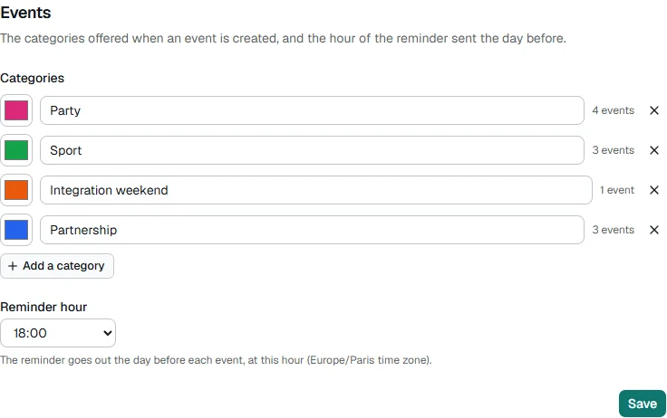

🇬🇧 English · [🇫🇷 Français](../fr/configuration.md)

# Configuration

The platform's settings are made **in the browser**: at [installation](installation.md), then on the **Settings**
page, which is for owners only. They are saved in the database, the secrets encrypted. You do not open any file.

This page has three parts:

1. [The Settings page](#the-settings-page): what you set, section by section.
2. [Where the settings are](#where-the-settings-are): the database, the keys, and how to start over from files.
3. [The settings reference](#settings-reference): the name and role of each setting, as they appear in the
   `bde.config.yml` and `.env` files (useful for a files-driven installation).

## The Settings page

**Owners** (and only owners) have a **Settings** entry in the menu.


Each section saves **on its own**. It is checked before it is written, it **applies at once** (no restart, no
rebuild) and it is written to the **audit log**. For a secret, the log only says that it changed, never its value.
The page never sends a secret back to the browser: leave the field empty to keep the saved one.

| Section                     | What you set there                                                                                                                                |
| --------------------------- | ------------------------------------------------------------------------------------------------------------------------------------------------- |
| **Your BDE**                | The name, the main color, the language of the messages sent (Discord, Slack, email) and the contact address shown on the privacy page (optional). |
| **Logo**                    | The BDE's logo: menu, sign-in page, messages.                                                                                                     |
| **Address of the platform** | The address your members type, and that 42 uses for signing in.                                                                                   |
| **42 application**          | The OAuth application's UID and secret.                                                                                                           |
| **Campuses**                | The allowed campuses, the BDE's campus and the time zone.                                                                                         |
| **Owners**                  | The owners' 42 logins.                                                                                                                            |
| **Modules**                 | Turn the Events module on or off.                                                                                                                 |
| **Events**                  | The categories and the hour of the day-before reminder (if the module is on).                                                                     |
| **Notifications**           | The channels (Discord, Slack, email), what goes through which, and a test message for each channel.                                               |
| **New versions**            | Whether owners are told when a new version of the platform is published (on by default).                                                          |



### The logo

The logo appears in the menu, on the sign-in page and in messages (Discord, Slack, email).

- Formats: PNG, JPEG, GIF or WebP. **No SVG**: Discord, Slack and mail apps do not display it.
- Size: 2 MB at most, 64 to 4096 pixels on a side. A square of at least 512 pixels is ideal.
- The format is read from the file itself, not from its name. A file that is not an image is refused.
- **Back to the default logo** deletes the uploaded file.

The file is kept in the `uploads` volume, and the backup includes it. For Discord, see also
[The sender's logo](notifications.md#the-senders-logo).

### The address of the platform

This is the address 42 knows (the redirect URL is this address followed by `/api/auth/callback/42-school`) and the
one used in **every** link sent: it must be the one your members type.

- `0.0.0.0` is refused. It is not a site address: it is the address the server listens on.
- `127.0.0.1` is written `localhost`.
- An `http://` address on a real domain asks for a confirmation: connections are not encrypted.
- The page warns you when the registered address is not the one of your browser: 42 sends the visitor back to the
  registered address, and signing in cannot succeed from another one.

If the address is wrong and nobody can sign in to fix it, see
[Troubleshooting](troubleshooting.md#sign-in-fails-invalid_grant-redirection-uri-address-0000).

### The 42 application

The platform checks the UID and the secret with 42 **before** saving them: a wrong key would stop everyone from
signing in. If 42 cannot be reached, you can save without the check, knowingly.

If 42 refuses the application (expired or regenerated key), nobody can sign in. The sign-in page says so, and a
signed-in owner sees an alert banner with a link to this section.

### Campuses

Only members whose 42 campus is in the list can sign in. **An empty list allows every campus.** The comparison
ignores case and extra spaces.

### Owners

Adding or removing an owner asks for a confirmation. The login is checked on the intra. A few rules:

- you cannot remove yourself;
- there is always at least one owner;
- you can name 30 at most.

A person removed from the list becomes a member with the **default role**.

### Events

- **Categories**: rename them, change their color, add some. Each new category gets an identifier made from its
  name, which never changes afterwards.
- **Removing a category** that events use asks you to choose a category to move them to. At least one category must
  stay.
- **Reminder hour**: the local hour (the BDE's time zone) at which the day-before reminder goes out. Default: 6 pm.
- **Publish events on the 42 intra**: when on, every event asks for the fields of the intra's form (see [the fields of the
  intra](events.md#the-fields-of-the-intra)) and none can be confirmed without them. **Off by default**: nothing changes for a
  platform until an owner turns it on.

### Notifications

In Settings, each channel (Discord, Slack, email) is set up in its own panel, with its own test message, then a
**table** says which notification goes through which channel: a row per notification, a column per channel, **none, one
or several boxes** per row. A box can only be ticked for a channel that is set up; removing a member never has an email
box. Removing a channel forgets its settings and clears its boxes. See [Notifications](notifications.md).

### New versions

When a newer version of the platform is published, **owners** (and only owners) see a banner at the top of the
**dashboard** and of this page: the new version, what it is about, a link to its notes, and the two commands that update
it (`git pull`, then `docker compose up -d`; see [Upgrading](upgrading.md)). **Hide until the next version** hides it in
that browser until a newer version comes out. Nothing is updated by itself: the platform never touches its own
installation.

To know it, the platform asks **GitHub** for the project's latest published version (a plain request to
`api.github.com`, answered from a cache for six hours, thirty minutes after a failure). The request is made by the
server, only when an owner opens the dashboard or this page, and carries **nothing about your BDE or its members**: no
address, no setting, no login. GitHub sees the server's address and the version it runs, as for any download. If GitHub
cannot be reached, nothing is shown and nothing is slowed down (the banner is loaded after the page).

The **New versions** section turns this off (`updates.check`): the platform then asks nobody.

### The backup reminder

At the top of the page, a reminder asks you to **back up the `secrets` volume**, with the command. It turns into a red
alert if the saved secrets cannot be read (volume lost or replaced).

### When the page is read-only

As long as the settings are still in the `bde.config.yml` and `.env` files (an installation made before the
installer, not copied into the database yet), the page says so and allows nothing. See [Upgrading](upgrading.md).

## Where the settings are

**At the first start**, the platform copies into its **database** what `bde.config.yml` and `.env` say, when those
files are complete. The secrets (the 42 application's key, the SMTP password, webhooks) are **encrypted** there. From
then on, **the database is the source of truth**: changing the files changes nothing any more.

The keys that sign sessions and encrypt secrets are created once, by themselves, in the Docker `secrets` volume.
**Back it up**: see [Backups](deployment.md#backups-and-restore). Without it, after a restore on another server, you
have to enter the secrets again in Settings.

A new installation therefore has no `.env`. Only `APP_BIND` and `APP_PORT`, which are Docker settings and not the
platform's, are still written there if needed.

### Replace the settings with files

For a files-driven deployment, or to start over from `bde.config.yml` and `.env`:

1. Edit `bde.config.yml` and `.env` (all the values), and add `BDE_REIMPORT=1` to `.env`.
2. [Build the image from your folder](deployment.md#build-the-image-yourself) (`docker compose -f docker-compose.yml -f docker-compose.build.yml up -d --build`): the files only enter an image when it is built. At start, the platform replaces the database's settings with those of the
   files (the log says so). If the files are incomplete, it ignores them and keeps the database.
3. **Remove `BDE_REIMPORT=1`**, then `docker compose up -d`. As long as it stays, every start overwrites what was
   changed from the application.

### Take only the values of `.env`

`BDE_REIMPORT=settings` takes only the values of `.env` (42 application, address, email, webhooks) into the
database and leaves everything else. It is the rescue when nobody can sign in: see
[Troubleshooting](troubleshooting.md#when-signing-in). Remove it once done.

## Settings reference

This part lists the settings with the names they have in the files. The platform validates them **at every
start**: a missing or malformed value stops it from starting, with a message (in French) that says what to fix
(`docker compose logs app`). A plain warning flags what is probably a mistake, for example the login
`votre-login-42` left in `auth.owners`, or an `http://` address on a public domain.

`bde.config.example.yml`, at the root of the project, is a fully commented example.

### `bde`

| Field           | Type              | Description                                                                                                                                  |
| --------------- | ----------------- | -------------------------------------------------------------------------------------------------------------------------------------------- |
| `name`          | text              | The BDE's name, shown in the interface and the tab title.                                                                                    |
| `campus`        | text              | The board's main campus (display).                                                                                                           |
| `timezone`      | text              | An IANA time zone, for example `"Europe/Paris"`.                                                                                             |
| `defaultLocale` | `"fr"` or `"en"`  | Language of the **messages sent** (email, Discord, Slack). The interface has its own language: everyone picks it with the language switcher. |
| `contactEmail`  | email, optional   | Address shown on the privacy page. Without it, the page points to an owner or an administrator.                                              |
| `accentColor`   | hexadecimal color | The interface's main color, for example `"#2F5BEA"` (the default of a new installation).                                                     |
| `logoPath`      | path              | The logo. `"/logo.svg"` (default) or `"/api/logo?v=…"` for a logo uploaded from Settings.                                                    |

### `auth`

| Field             | Type              | Description                                                                                                          |
| ----------------- | ----------------- | -------------------------------------------------------------------------------------------------------------------- |
| `owners`          | list of 42 logins | The owners. A listed login becomes an owner when it signs in. The comparison ignores case. At least one is required. |
| `allowedCampuses` | list of campuses  | Only logins whose campus is in the list can sign in. **An empty list (`[]`) means every campus.**                    |

### `modules`

| Field     | Type | Description                                                                                                            |
| --------- | ---- | ---------------------------------------------------------------------------------------------------------------------- |
| `enabled` | list | The modules that are on. Available: `events`. An unknown key (a typo) does not stop the start, but a warning flags it. |

A module that is off has no page, no link, no visible data. The rights of a module that is off stay in the roles,
with no effect.

### `events`

Required **only** if `events` is in `modules.enabled`. See the [Events module](events.md).

| Field              | Type                | Description                                                                                                                       |
| ------------------ | ------------------- | --------------------------------------------------------------------------------------------------------------------------------- |
| `categories`       | list (at least one) | Each entry: `key` (stable identifier, lowercase, digits and hyphens, unique), `label` (displayed name) and `color` (hexadecimal). |
| `reminderHour`     | integer, 0 to 23    | Local hour of the day-before reminder. Default: `18`.                                                                             |
| `intraPublication` | `true` or `false`   | The events are published on the intra by the school's staff: the form asks for the intra's fields. Default: `false`.              |

```yaml
events:
  categories:
    - { key: 'party', label: 'Party', color: '#db2777' }
    - { key: 'sport', label: 'Sport', color: '#16a34a' }
  reminderHour: 18
```

Do not change the `key` of an existing category: events refer to it. An event whose category has gone is still shown,
with no color.

### `notifications`

An **optional** section: a missing key means no notification. Each type of notification has a **list** of channels,
among `discord`, `slack` and `email`: `[]` sends nothing, `[discord]` posts in Discord, `[discord, email]` does both
(the channels are independent: one that is down does not stop the other). The Settings page writes these lists for you.

```yaml
notifications:
  memberPending: [email]
  eventConfirmed: [discord, slack, email]
  eventReminder: []
```

Before version 1.5.0 a notification had **one** channel (`"email"`, `"discord"`, `"slack"`) or `"none"`. That form is
**still read** (`"discord"` is `[discord]`, `"none"` is `[]`): no file and no stored setting needs editing.

| Notification     | When                         | Who is notified                                                                                  |
| ---------------- | ---------------------------- | ------------------------------------------------------------------------------------------------ |
| `memberPending`  | a new member asks for access | Email: the owners and the roles with the "Manage members" right. Discord or Slack: the channel.  |
| `memberApproved` | a request is approved        | Email: **the approved member** (their role, a sign-in link). Discord or Slack: the channel.      |
| `memberRemoved`  | a member is removed          | Discord or Slack: the channel. **Never an email**: the removed person receives nothing.          |
| `eventConfirmed` | an event is confirmed        | See [Events](events.md#notifications).                                                           |
| `eventReminder`  | the day before an event      | See [Events](events.md#notifications).                                                           |
| `eventProposed`  | an event is proposed         | Email: the owners and the roles with the "Validate events" right. Discord or Slack: the channel. |
| `eventApproved`  | a proposal is approved       | Email: **its author**. Discord or Slack: the channel.                                            |
| `eventRefused`   | a proposal is refused        | Email: **its author**, with the comment. Discord or Slack: the channel.                          |

Messages are sent **after** the action. A send that fails (webhook unavailable, mail server down) is written to the
logs and never blocks the approval or the removal. If a channel of the list is not set up (for example `email` without
an SMTP server), the platform still starts and warns: the alert will not go out on that channel.

**Message safety.** They contain text typed by members (42 profile name, event title…). `@everyone`, `@here`,
`@channel`, `<!channel>`, `<@…>` and `<url|text>` links are made harmless: they show as plain text and notify
nobody. On Discord, every send also forbids any mention.

### `updates`

An **optional** section.

| Key     | Type    | Default | Role                                                                                                                  |
| ------- | ------- | ------- | --------------------------------------------------------------------------------------------------------------------- |
| `check` | boolean | `true`  | Tell owners when a new version is published (see [New versions](#new-versions)). `false` stops the request to GitHub. |

### `.env`

In a new installation these variables are no longer needed: the platform keeps them in its database. They are still
read **once**, at the first start after an update, to be copied into the database.

| Variable                                                            | Role                                                                                                                                             |
| ------------------------------------------------------------------- | ------------------------------------------------------------------------------------------------------------------------------------------------ |
| `POSTGRES_USER`, `POSTGRES_DB`                                      | The database user and name (default `bde` and `bde_network`).                                                                                    |
| `POSTGRES_PASSWORD`                                                 | An installation that already has one keeps it (the database exists with it). Otherwise, the platform creates one.                                |
| `AUTH_SECRET`                                                       | The session signing key, 32 characters at least. An installation that already has one keeps it (sessions stay valid). Otherwise, one is created. |
| `FORTYTWO_CLIENT_ID`, `FORTYTWO_CLIENT_SECRET`                      | The 42 OAuth application.                                                                                                                        |
| `APP_URL`                                                           | The address of the platform.                                                                                                                     |
| `SMTP_HOST`, `SMTP_PORT`, `SMTP_USER`, `SMTP_PASSWORD`, `SMTP_FROM` | The mail server.                                                                                                                                 |
| `DISCORD_WEBHOOK_URL`, `SLACK_WEBHOOK_URL`                          | The webhooks.                                                                                                                                    |

These two variables are **always** read from `.env`, because they set Docker and not the platform:

| Variable   | Role                                                                                                                                                                                                                                                              |
| ---------- | ----------------------------------------------------------------------------------------------------------------------------------------------------------------------------------------------------------------------------------------------------------------- |
| `APP_BIND` | The address where Docker publishes the port. Default `127.0.0.1`: only the machine itself reaches it, behind an HTTPS proxy. `0.0.0.0` opens the port to the whole network, over plain HTTP: read [Without an HTTPS proxy](deployment.md#without-an-https-proxy). |
| `APP_PORT` | The port published on the machine (default `3000`). Change it only if another program uses it; the 42 redirect URL must then carry the same port.                                                                                                                 |

And for maintenance and development:

| Variable                                                                                | Role                                                                                         |
| --------------------------------------------------------------------------------------- | -------------------------------------------------------------------------------------------- |
| `BDE_REIMPORT`                                                                          | `1` replaces the settings with the files, `settings` takes only `.env`. Remove it once done. |
| `DATABASE_URL`                                                                          | Only for `npm run dev` outside Docker. With `docker compose`, it is built by itself.         |
| `ENABLE_DEV_IMPERSONATION`                                                              | Development only: see the [contributor guide](contributing.md).                              |
| `DEV_SMTP_HOST`, `DEV_SMTP_PORT`, `DEV_SMTP_FROM`, `DEV_SMTP_USER`, `DEV_SMTP_PASSWORD` | Development only: send through a real server instead of Mailpit.                             |

### Keeping your personal configuration out of Git

For `npm run dev`, a `bde.config.local.yml` file, ignored by Git, replaces `bde.config.yml` when it exists (the two
are not merged: the local file must be complete). The production image never includes it.
