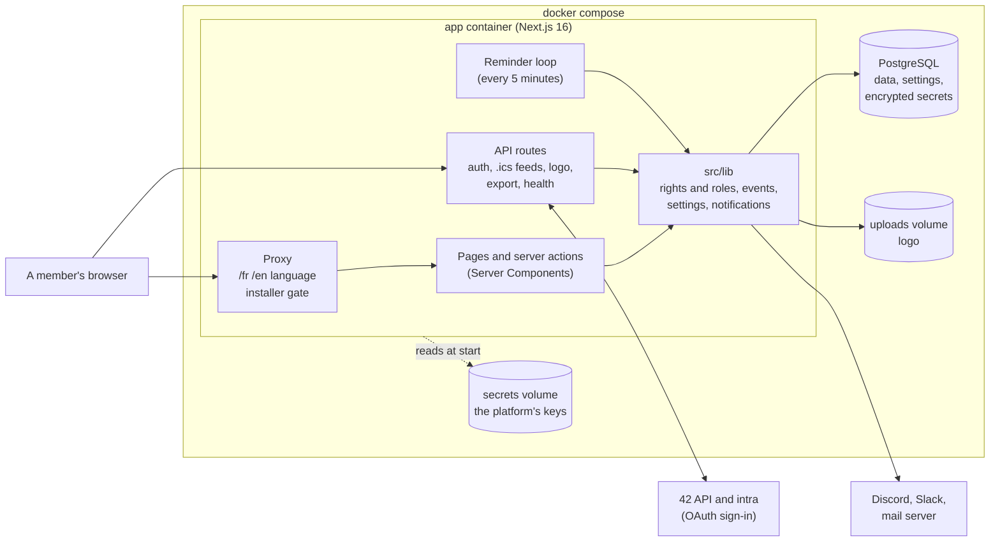
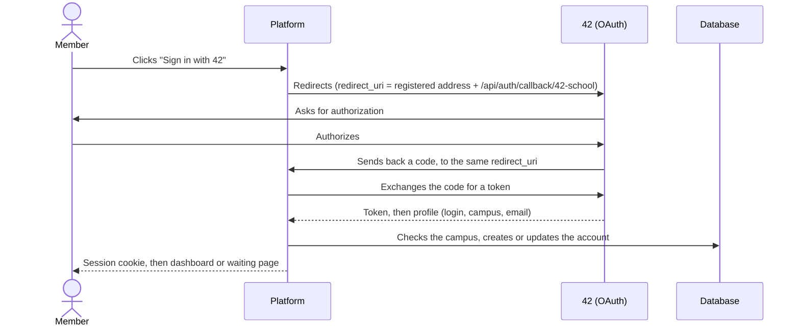

🇬🇧 English · [🇫🇷 Français](../fr/contributing.md)

# Contributor guide

This guide explains how to work on the code: how the platform is built, how to set up a development environment,
which commands to run, and how to keep the documentation up to date. The general rules (branches, pull requests,
commits) are in [CONTRIBUTING.md](../../CONTRIBUTING.md).

Two references complete this guide: [architecture and conventions](../architecture.md) (read it before any
structural change) and [the design system](../design.md).

## How it is built

A platform fits in three Docker containers: the Next.js application, PostgreSQL, and a small container that creates
the database password once. The application keeps its keys in the `secrets` volume, the uploaded logo in the
`uploads` volume, and all its settings in the database.



The points to remember:

- **Settings are in the database** (one `PlatformSettings` row). They are loaded into memory at start and at every
  change: a change applies at once. Secrets are encrypted with a key that is not in the database.
- **Signing in is 42 only.** NextAuth keeps a session token that holds only the login; rights are read again from the
  database at every request, which makes a removal effective immediately.
- **The platform's address comes from the settings**, never from the address the server listens on.
- **Rights are checked by the server** on every page and every action; hiding a button is never enough.

This is the path of a sign-in:



## Setting up the environment

### Option A: everything in Docker (recommended)

```text
cp .env.example .env      # Copy-Item in PowerShell
docker compose -f docker-compose.dev.yml up
```

This starts PostgreSQL, **Mailpit** (a test mailbox) and the application in development mode (`next dev`) in
containers, with the code mounted as a volume: your changes are picked up live. `node_modules` and `.next` stay in
named Docker volumes, to avoid native binaries that do not fit both your system and the Linux container. The Prisma
schema and the **demo accounts** are applied at every start: one command is enough.

On Windows, if hot reload does not react, check that `WATCHPACK_POLLING=true` is active (it is the default of
`docker-compose.dev.yml`).

### Option B: Node.js locally, PostgreSQL in Docker

Prerequisites: Node.js 22 or later, npm.

```text
cp .env.example .env
docker compose -f docker-compose.dev.yml up postgres mailpit -d
npm install
npm run db:migrate
npm run dev
```

The platform is at <http://localhost:3000>. To receive emails in Mailpit, put `SMTP_HOST=localhost`,
`SMTP_PORT=1025` and `SMTP_FROM=bde@localhost` in `.env` (in option A, it is already done).

### Development settings

Development behaves like a real server: the settings are in the database. At the first start, if `bde.config.yml`
(or `bde.config.local.yml`, ignored by Git, which replaces it entirely) and `.env` are complete, they are **copied
into the development database**. If they are not, the installer opens, with its code in the terminal.

For the copy, put your 42 login in `auth.owners` and, in `.env`, the credentials of a 42 application whose redirect
URL is `http://localhost:3000/api/auth/callback/42-school`. After that, editing the files changes nothing: add
`BDE_REIMPORT=1` to `.env` to read them again at every start, or start from a fresh database with
`docker compose -f docker-compose.dev.yml down -v`. See [Configuration](configuration.md).

### The demo accounts

`npm run seed:demo` creates fictional roles and accounts (`demo-owner`, `demo-admin`, `demo-president`,
`demo-secretary`, `demo-member1`, `demo-member2`, `demo-member3`, `demo-pending`) and, if the module is on, about fifteen events relative
to today's date (past, this week, series with different repeat rules, a multi-day weekend, drafts, and two events proposed by `demo-member3`, who
only proposes: one waits for validation, one was refused). Running it again rewrites the data with no
duplicates. `SEED_LOCALE=en` writes them in English.

### Trying roles

With `ENABLE_DEV_IMPERSONATION=true` in `.env`, sign in as the owner: a banner at the top of the page lets you see
the platform as "pending" or with any role. This function only exists in development, never in production.

### Seeing emails: Mailpit

In development, no email leaves your machine: the platform sends them to [Mailpit](https://mailpit.axllent.org),
which keeps them and shows them at <http://localhost:8025> (HTML rendering, text version, `.ics` file, mail app
compatibility test). Set a notification's channel to `email` in your `bde.config.local.yml`, restart, and trigger it
(confirm an event, approve a member…). `APP_URL=http://localhost:3000` in `.env` makes the logo appear.

To send through a real SMTP server, set `DEV_SMTP_HOST`, `DEV_SMTP_PORT`, `DEV_SMTP_FROM` (and `DEV_SMTP_USER`,
`DEV_SMTP_PASSWORD`) in `.env`: they replace Mailpit.

## Useful commands

| Command                                       | Effect                                                |
| --------------------------------------------- | ----------------------------------------------------- |
| `npm run dev`                                 | Next.js development server                            |
| `npm run build`                               | Production build                                      |
| `npm run lint` / `npm run lint:fix`           | ESLint                                                |
| `npm run format` / `npm run format:check`     | Prettier                                              |
| `npm run lint:md`                             | markdownlint on the documentation                     |
| `npm run docs:check`                          | Checks the documentation's internal links and anchors |
| `npm run typecheck`                           | TypeScript check                                      |
| `npm run test` / `npm run test:watch`         | Vitest tests                                          |
| `npm run db:migrate`                          | Creates and applies a Prisma migration (development)  |
| `npm run db:studio`                           | The database's graphical interface (Prisma Studio)    |
| `npm run seed:demo`                           | Writes the demo data                                  |
| `npm run audit:prod`                          | Security alerts of production dependencies            |
| `./scripts/backup.sh`, `./scripts/restore.sh` | Backup and restore (see [Deployment](deployment.md))  |

npm scripts are portable: no Unix- or Windows-specific operator. They work the same in PowerShell, cmd, bash and zsh.

## Before opening a pull request

```text
npm run lint
npm run format:check
npm run typecheck
npm run test
npm run build
```

If you touch the documentation, also run `npm run lint:md` and `npm run docs:check`. `npm run test:coverage` runs the tests
with their coverage: CI fails below the floors of `coverage-thresholds.json`, so a new feature comes with its tests. CI runs all of this
(`.github/workflows/ci.yml`), on Ubuntu and on Windows.

## The quality campaign

Beyond the unit tests, `qa/` holds the harness of the quality suites: nine **personas** (visitor, pending account, member,
proposer, validator, custom role, Admin, owner, removed member), a deterministic **dataset** of two school years (about 300
members and 600 events), the **invariants** every database must satisfy, and a script that starts the production image
with all of this. With Docker and Node, from the project folder:

```text
docker build -t bde-network .
sh qa/platform.sh up
eval "$(sh qa/platform.sh env)"
npx tsx qa/smoke.ts
sh qa/platform.sh down
```

The heavy suites run every night and on demand (**Actions → qa**), not on every pull request; a pull request can ask for them
with the label `full-qa`; the label `qa-mutations` plays the mutation check of the attacks (one image build per mutation, so never on your computer). The details are in the [architecture](../architecture.md#quality-campaign-qa-githubworkflowsqayml).

## Code conventions

See the [architecture](../architecture.md). In short:

- Strict TypeScript, no `any`.
- Atomic [Conventional Commits](https://www.conventionalcommits.org/).
- All visible text goes through next-intl (`messages/fr.json` and `messages/en.json`), never hardcoded in a component.
- The `src/components/ui/` components are generated by shadcn/ui: do not edit them by hand.
- A module that adds rights declares them in `src/lib/permissions/registry.ts` (see the architecture).

## The documentation

The documentation lives in `docs/fr/` and `docs/en/`, with **the same files in both languages**. A page changed in one
language is changed in the other, in the same pull request. Each page starts with a link to the other language.

- **The vocabulary is fixed** by the [glossary](glossary.md) and by the interface (`messages/*.json`). One word always
  means one thing.
- **Every claim is checked against the code.** Documentation that is wrong, even a little, makes people lose trust.
- **Short sentences**, "you", no unexplained jargon.
- `docs/architecture.md` and `docs/design.md` are technical references, in English only.
- **Screenshots** are redone with `node scripts/docs-screenshots.mjs` (see the script's header): they show the
  current interface, with demo data, in the light theme, in French and in English.
- Run `npm run lint:md` and `npm run docs:check`: CI checks the style, the internal links and the anchors on every
  pull request, and the external links every week.

## Dependencies

- **NextAuth v5 is in beta, and that is assumed.** v5 only exists under npm's `beta` tag. It brings the universal
  `auth()` helper that all authentication relies on. The version is **pinned exactly**: no update goes through unless
  chosen. To change it, read the release notes, run `npm test` (in particular `src/lib/auth/removed-account.test.ts`),
  then change `next-auth` and `@auth/core` **together**.
- **`next` and `eslint-config-next`** are pinned to the same version and updated together.
- **`nodemailer`**: NextAuth declares an optional dependency on nodemailer 7 or 8, which this project does not use.
  The `overrides` field of `package.json` aligns it with our version.
- **Security audit**: `npm run audit:prod` (run by CI) fails on a new high or critical advisory. The few advisories
  with no applicable fix are in `scripts/audit-allowlist.json`, with their reason.
- **Dependabot** proposes one batch of minor updates and fixes every Monday. Major versions are handled by hand, one
  by one.
- After touching `package-lock.json`, check it with `npx -y npm@10 ci --dry-run` (CI uses npm 10).

## Database: migrations

```text
npm run db:migrate       # creates and applies a migration from schema.prisma
npm run db:push          # applies the schema with no migration (prototyping)
npm run db:studio        # data explorer
```

Always commit the generated `prisma/migrations/` folder. Production applies migrations with `prisma migrate deploy`;
the development environment uses `prisma db push`.
