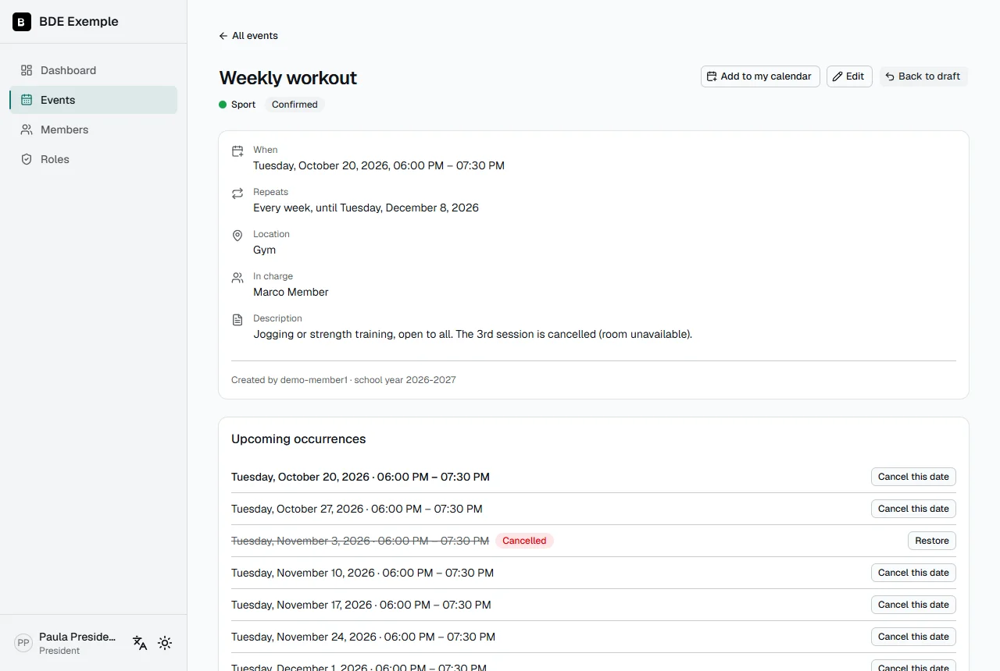
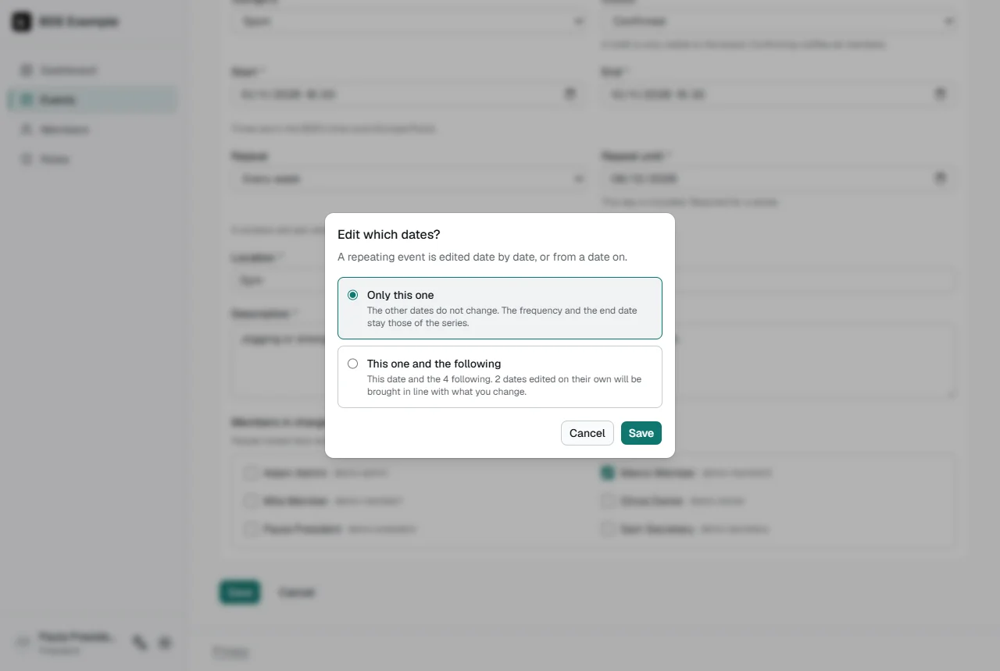

🇬🇧 English · [🇫🇷 Français](../fr/events.md)

# Events module

The board's **internal** calendar: this is where the BDE's events are planned and organized. The 42 intra remains
the public tool where students sign up, so this module has no registrations, no waiting list and no attendance
check.

## Turning the module on

The module is on by default at installation. To turn it on or off afterwards: **Settings**, **Modules** section. To
set its categories and the reminder hour: **Events** section ([details](configuration.md#events)).

While the module is off, it does not exist: no page, no link in the menu, no block on the dashboard, no reminder.

## Who can do what

Rights come from the member's **role** (see [Roles and rights](roles.md)). Four rights concern this module.

| Action                                               | View |               Propose                |          Validate           | Manage the shared calendar | Owner |
| ---------------------------------------------------- | :--: | :----------------------------------: | :-------------------------: | :------------------------: | :---: |
| See **confirmed** events                             | yes  |                 yes                  |             yes             |            yes             |  yes  |
| See **drafts** and **proposals**                     |  no  |          **their own** only          |         all of them         |             no             |  yes  |
| Create an event                                      |  no  |        yes, as a **proposal**        | yes, draft or **published** |             no             |  yes  |
| Edit or delete an event                              |  no  | **their own**, until it is published |             any             |             no             |  yes  |
| Approve or refuse a proposal                         |  no  |                  no                  |             yes             |             no             |  yes  |
| Confirm, put back to draft, cancel a date            |  no  |                  no                  |             yes             |             no             |  yes  |
| Add an event to your calendar, subscribe to the feed | yes  |                 yes                  |             yes             |            yes             |  yes  |
| Manage the **BDE** calendar link                     |  no  |                  no                  |             no              |            yes             |  yes  |

"Propose" includes "View"; "Validate" includes "Propose" and "View". The owner always has access to everything.
Every creation, edit or assignment of a role is written to the audit log.

These rules are checked **on the server**, on every page and every action: hiding a button is never the only
protection. A draft or a proposal you have no right to is not "forbidden": it is not found.

## Creating an event

**Events** → **New event**, or, faster, **from the calendar**:

- **On a computer**, a **+** appears in the corner of a day when you point at it (and when the keyboard reaches it: Tab,
  right after the day itself; on a touch screen it is always there). It opens the form **on that day**.
- **On a phone**, tap a day, then **Add on this day** under the calendar.

The form then starts from **6 pm to 8 pm** on that day (BDE time zone), which you adjust like any other date. Without
a day (the **New event** button), it starts from tomorrow, 6 pm to 8 pm. A day in the past is accepted, to record an
event after the fact. **Cancel** brings you back to that day of the calendar. These shortcuts only exist for those who
can create events (propose or validate): the others do not see them, and the form refuses them if they type its
address.

- **Title, start, end, location, description**: times are entered and shown in the BDE's time zone, whatever your
  browser's.
- **Category**: one of those the BDE defined in Settings.
- **Members in charge**: one or more members, **optional**. They are the ones who receive the day-before reminder by
  email. With nobody in charge, the reminder goes to the **owners and the members whose role allows validating
  events**: it is never sent to nobody.
- **Status**: a **draft** is only visible to its author and to those who can validate events. **Confirming** the event
  makes it visible to every member and triggers the confirmation notification. Those who can only propose choose
  between a draft and **awaiting validation**, see [below](#proposing-and-validating-events).

### Required fields

Six fields are required, marked with a `*`: **title, start, end, location, description and category**. For a series,
how it **ends** (an end date, or a number of dates) is required too. Only the members in charge are optional. A text made only of spaces
counts as empty.

The check is done twice, with the same rules: in the form (the message appears under the field concerned), then on
the server, before anything is saved.

Events created **before** this rule, with an empty location or description, are shown normally. They are only
blocked at their **next edit** in the form, which will ask you to fill in those fields. Confirming, going back to
draft and canceling a date remain possible.

### The description is written in Markdown

The description accepts the same Markdown as the intra's form: `# title`, `**bold**`, `*italic*`, `- list`, `1. numbered
list`, `> quote`, `[link](https://…)` and `code`. Beside the field (under it on a phone, behind the **Preview** tab) the
form draws what the description will look like. The text is kept **exactly as typed**, so it can be copied as it is. A
tag typed by hand, a picture or a link that is not `http`, `https` or `mailto` is shown as text and never run.

### The fields of the intra

When the platform **publishes the events on the intra** (an owner turns it on in Settings, section Events, see
[Configuration](configuration.md#events)), the form has a second block, **Publication on the 42 intra**: what the school's staff
copies into the intra's event form, under the same names. All seven are required:

- **Organizer's login**: filled in with the author's login, editable.
- **Available for**: students, pisciners or both.
- **Maximum number of people** and **waiting list** (yes or no).
- **Kind**: one of the intra's kinds (Pedago/Rush, Pedago/Piscine, Pedago/Partnership, Meet/Conference, Meet/meet_up,
  Meet/event, Association, Speed working/Hackathon, Speed working/Workshop, Speed working/Challenge, Extern).
- **Delay before unsubscribing is no longer possible**, in hours before the start.
- **Keywords**: at least one, added with Enter or a comma.

They belong to **the whole series**: on a series, they are saved with "this date and the following" (editing a single date
leaves them alone). Events written **before** this block keep working: the form asks for the fields at their next edit,
and **no event is confirmed without them**: confirming from the event page or from "To validate" shows a message
asking you to edit it first. Going back to draft, proposing and canceling a date stay possible. The fields are shown on the
page of the event to those who can create events and to those who follow the publications (see
[Publishing on the intra](#publishing-on-the-intra)).

The **school year** (for example `2025-2026`) is computed by itself: from September to August, from the start date.
A series belongs to the school year of its first date.

## Proposing and validating events

Some roles (an "Events team", for example) can **propose** events without being able to publish them; other roles
**validate**: they approve or refuse what is proposed. You choose who is who in [Roles and rights](roles.md): the
**Propose events** right and the **Validate events** right.

An event goes through three statuses:

| Status                  | What it means                                    | Who sees it                       |
| ----------------------- | ------------------------------------------------ | --------------------------------- |
| **Draft**               | Work in progress, or a proposal that was refused | Its author and those who validate |
| **Awaiting validation** | Proposed: a validator has to answer              | Its author and those who validate |
| **Confirmed**           | Published                                        | Every member                      |

### Proposing

- In the form of somebody who can only propose, the status is **Awaiting validation** (preselected) or **Draft**. There
  is no way to confirm: the server refuses it even if the request is forged.
- On the page of a draft, **Propose for validation**. On the page of a proposal, **Withdraw the proposal** (it goes
  back to draft).
- A proposer edits and deletes **their own events as long as they are not published**: a draft, a proposal, a refused
  event. For a series, always the series as a whole: there is no choice of dates.
- **Once an event is published, its proposer can no longer change it**, not even their own: instead of the **Edit**
  button, the page says so. A published event therefore never leaves the calendar without a validator doing it. To
  correct something, ask a validator: they edit freely, and the event stays published.

### Validating

- The **To validate** entry of the menu (only for those who validate) says how many proposals are waiting. The page
  lists them, the oldest first, each with **Approve** and **Refuse**.
- **Approve** publishes the event, as confirming it would: the members are notified once. The author is told too, if
  the `eventApproved` notification is on.
- **Refuse** asks for a **comment** (required, 1000 characters at most). The event goes back to draft; its author reads
  the comment on the event itself and receives it by notification (`eventRefused`). They edit the event, then propose it
  again: the refusal disappears. A series is refused as a whole.
- From the page of the event you can do the same. A proposal is not sent back to draft without a comment: you refuse
  it. If two validators answer the same proposal, the second is told that somebody else already did.
- A validator edits any event freely, drafts and proposals of others included.

### Series and drafts

A proposal is **the whole event**, a series included. Once it is approved, the dates of a series are handled as
usual (see below). A date of a series confirmed on its own makes the event partly published: its proposer can no longer
edit it either.

## Publishing on the intra

When the platform publishes the events on the intra, the school's **staff** puts each confirmed event on the intra 42 by hand:
the platform tells them what to publish, they copy it into the intra's form, then answer. The staff has a 42 account like
any member, approved by the BDE, with a role that holds the right **Publish on the intra** (see [Roles and rights](roles.md)).

### The request

- **Confirming an event sends the request.** A series is **one request** with the list of its dates (a date confirmed on its
  own makes a request for that date only, until the rest is confirmed too). Going back to draft, deleting the event or
  cancelling every date takes the request back.
- An event confirmed **before** the platform published on the intra, or whose request was taken back, has none. On its page,
  **Publication on the intra** says so and offers **Ask for publication** to those who hold the right to (validating events
  already does).
- Where it stands is shown as a status, on the event's page and in the staff's list:

| Status         | What it means                                                                 |
| -------------- | ----------------------------------------------------------------------------- |
| **To publish** | Sent, waiting for the staff.                                                  |
| **Published**  | On the intra, and the event has not changed since.                            |
| **To update**  | On the intra, but the event changed since: the staff has to update the intra. |
| **Refused**    | The staff refused it, with a reason; it can be sent again.                    |

### What the staff does

The entry **To publish on the intra** of the menu counts what waits (a first publication, or an update). The list shows what
waits first, the oldest first, then what was answered. The page of a request gives the event **in the order of the intra's
form**, each field with a **Copy** button: the organizer's login, the name, who it is available for, the start date, the start
time, the end date, the end time, the description (as typed, in Markdown), the place, the maximum number of people, the waiting
list, the kind, the delay before unsubscribing and the keywords. Dates are written **DD/MM/YYYY** and times **HH:mm**, in the
BDE's time zone, whatever the language of the interface. A series lists its dates one after the other, each with its four
values to copy.

Then the staff answers:

- **Published on the intra**, with the address of the event on the intra if they want to keep it (an `https` address of
  `intra.42.fr`: any other is refused);
- **Refuse**, with a reason (required, 1000 characters at most): the author reads it on the page of the event, and the request
  can be **sent again** by whoever holds the right to ask once the event is corrected.

The first answer wins: if somebody answered before, the page says so and nothing is changed. An answer is also refused when the
event changed while the page was open (the page checked that you saw the latest version): look at the new values, then answer
again.

### Who is told

The page and the counter of the menu are always right; **messages** come on top when the BDE ticked them (see [Messages about
publishing on the intra](notifications.md#messages-about-publishing-on-the-intra)): the staff is told of a request, of a change
and of an event taken back; the author and the BDE's room are told that it was published or refused.

### When the event changes

An event that is on the intra and then changes (title, description, place, dates, or any intra field) becomes **To update**. The
page of the request then shows **what the intra holds and what the event is now**, field by field, with the dates to remove
and to add. Once the intra is up to date, **Intra updated** brings the request back to _Published_. A change that is undone
needs nothing: the request goes back to _Published_ by itself. Changes that are not on the intra (the category, the members in
charge) change nothing.

A series cut in two ("this date and the following") continues the request on the new row: both are _To update_ if what
the intra holds is no longer what they say.

Everything is in the [audit log](#audit-log): who asked, who answered, and, for an event that changed, that its request is
_To update_.

## Events that repeat

In the form, **Repeat** offers the usual choices, **worded from the start date** you typed. For an event that starts on
Saturday, October 10:

- _Does not repeat_ (the default)
- _Every day_
- _Every weekday (Monday to Friday)_
- _Every week on Saturday_
- _Every month on the 10th_
- _Every month on the 2nd Saturday_ (when the start date is a fifth Saturday, which not every month has, it says
  _on the last Saturday_)
- _Every year on October 10th_
- _Custom…_

Change the start date and the wording follows. Anything else is **Custom**.

### Custom repetition

_Custom…_ opens a panel: **Repeat every** a number (1 to 99) of days, weeks, months or years.

- For **weeks**, tick the **days of the week**: _every 2 weeks on Monday and Wednesday_. At least one is needed. The
  panel starts from the weekday of the start date.
- For **months** and **years**, choose **which day**: the day of the month (_the 10th_), the same weekday of the month
  (_the 2nd Saturday_, not offered when the start date is a fifth one), the last such weekday (_the last Saturday_), or
  _the last day of the month_. A yearly series falls in the month of the start date.

### How a series ends

Under _End of the repetition_, choose one of two ways:

- **On** a date: that day is included, a date starting that day still counts.
- **After** a number of occurrences (1 to 400): _every 2 weeks on Monday and Wednesday, 10 times_.

### The preview

As soon as a repetition is chosen, the form shows, under the fields, **what it will do** before anything is saved: the
rule in a sentence (_Every 2 weeks on Monday and Wednesday, 10 times_), the **next three dates** and the **number of
dates** in total. When the start date you typed is not one of the days of the rule, a notice above it says on which
day the series will start (see below). The same sentence is on the page of the event, in the proposals to validate and in the
notifications. If something is wrong (an end before the first date, no day ticked…), the preview says what, in the
same words as the message under the field.

### Rules worth knowing

- **The series starts on the first day that fits the rule.** An event typed on Friday, October 23 and repeated
  _every 2 weeks on Monday and Wednesday_ starts on **Monday, October 26**. The form says so in a blue notice above the
  preview (_October 23 does not match this rule: the series will start on Monday, October 26._), with a button
  (_Start on October 26_) that changes the start date for you, keeping its time and its duration; if you do not use it,
  the event is saved with that Monday all the same. The same goes for a monthly or a yearly rule (_the 15th_ typed on
  the 20th starts on the 15th of the next month).
- **Weeks start on Monday, and the interval is counted from the first date of the series.** With _every 2 weeks_,
  the week of the first date is the first of them. The Friday series above gives October 26 and 28, then November 9
  and 11, then November 23 and 25… Likewise _every 2 months_ counts the months from the first month that has the day,
  and _every 2 years_ the years from the first year that has it. A series whose start date already is a day of the
  rule is not affected: it keeps the dates it has always had.
- **A day the month does not have is its last day.** An event on the 31st falls on April 30, February 28… and on the
  29th of February it falls on the 28th the years that have none. A series cut on one of those days keeps its day:
  the following dates are back on the 31st.
- **Local time is kept through daylight saving changes**: a "every Tuesday at 6 pm" session stays at 6 pm all year.
  When a date falls on an hour that does not exist (2:30 the night the clocks go forward), that date is shown an hour
  later, like in every calendar; if the series is cut exactly on that date, the dates that follow keep that hour.
- **An event holds 400 dates at most**, and the form says so (_At most 400 dates for one event: beyond that, cut the
  series in two_). A series that was cut in two, see below, counts each part on its own.
- **A series that ends after some dates** ends where its last date starts.

Series created before the repeat rules were not touched: every _Every week_, _Every 2 weeks_ and _Every month_ became
the equivalent rule, and **no date moved**: the calendars that already have them do not see any change.

### One date, or this date and the following

On the page of a series, pick a date in the list of dates (the one shown is in bold). Then **every action asks which
dates it is for**, in a window, with two choices:

- **Only this one**: this date changes, the others do not. It is the choice already selected.
- **This one and the following**: this date and all those after it. **On the first date, that is the whole
  series.** The window says how many dates that is.

It is the same window for **editing** (time, place, description, category, members in charge…), **confirming**,
**putting back to draft** and **deleting**. An event that does not repeat has no such question.

| Action            | Only this one                                                                                                                                                                                  | This one and the following                                                                                                                                                         |
| ----------------- | ---------------------------------------------------------------------------------------------------------------------------------------------------------------------------------------------- | ---------------------------------------------------------------------------------------------------------------------------------------------------------------------------------- |
| **Edit**          | The date gets **its own values**: only what you changed, the rest keeps following the series. You can move it to another hour or day. The frequency and the end date stay those of the series. | The series is **cut in two** at this date: the dates before it stay as they were, this date and the following get your changes, and you can change the repetition and its end too. |
| **Confirm**       | This date is confirmed on its own and announced to the members, once.                                                                                                                          | This date and the following are confirmed, **including those that had been put back to draft** (the window says how many), and announced in **a single message**.                  |
| **Back to draft** | This date disappears for the members and from the BDE calendar link. The others stay.                                                                                                          | This date and the following go back to draft.                                                                                                                                      |
| **Delete**        | The date is **canceled**: it stays in the list, crossed out, and you can **restore** it.                                                                                                       | The series **stops at the date before**. This is final: the following dates, with what had been edited on them, are deleted. On the first date, the whole event is deleted.        |

In the list, a date that has its own values shows **Edited**, a date that is a draft shows **Draft**, a canceled date
is crossed out.

### What happens to the dates edited on their own

You edit "this one and the following" while some of the following dates had been edited on their own. The rule is the
one of Google Calendar: **what you change replaces what those dates had for that field, what you do not touch stays.**

- You change the place: every following date takes the new place, even those that had their own. A date that also
  had its own title keeps its title.
- You confirm the following: the dates that were draft are confirmed too.
- You change only the **hour**: the dates edited on their own, canceled dates and reminders already sent follow
  the new hour, day by day.
- You change the **day** or the **frequency** (every Tuesday instead of every Monday, every 2 weeks instead of every
  week): the dates are no longer the same, so what had been edited on them, and the canceled dates, cannot follow and
  are dropped.

The window shows how many dates will be brought in line.

### A series cut in two

"This one and the following" on a date that is not the first **cuts the series in two parts**. The first part stops
at the date before; the second starts at this date, with its own page. For the members and for the calendars it is
still **one series**: every date keeps its identifier, so a calendar that already has the dates updates them,
without duplicates.

A series that ends after some dates **shares them**: _10 times_ cut on the 5th date gives 4 dates to the first part
and 6 to the second. For that reason, the form of a later date says **how many dates are left** (here 6), not the
whole number again.

The second part keeps the author, the members in charge and the fact that the series was announced (it is not
announced a second time because it was cut). Its school year is the one of its first date.

## Deleting an event

The **Delete** button on a page that is not a series deletes the event, for good. For a series, it asks which dates
(see above): deleting "this one and the following" from the first date deletes the whole series.

## Views

- **Monthly calendar**: the default view on a computer. Each event is colored by its category, drafts and
  proposals are dashed.
  Click a day to select it, an event to open it.
- **List**: the default view on a phone. Upcoming events, in order.
- **On a phone**, if you choose the **Calendar** view, the grid shows a colored dot per day, and the chosen day is
  detailed below.
- **Filters**: category, member in charge, school year. They are in the page's address, so they can be shared.
- **Detail page**: all the information of the date shown, the dates of a series and the actions.

## Adding it to your calendar

- **One event**: the **Add to my calendar** button on its page downloads an `.ics` file, which every calendar can
  read. For a series: the displayed date, or the whole series. A date edited or moved shows up as the
  same entry, updated; a canceled date, or one put back to draft for the BDE link, disappears.
- **Automatic sync**: the menu of your name → **My profile** → **Sync with my calendar**. Copy the personal link and
  add it to Google Calendar, Outlook or Apple Calendar (see [step by step](#adding-a-link-to-your-calendar-step-by-step)).
  Changes then show up by themselves, at the refresh rhythm of your calendar app.
- **One link for the whole BDE**: see [below](#the-bde-link-shared-calendar).

The link contains a **secret token specific to each member**:

- it only exposes what you are allowed to see (never a draft without the right), checked at every request: a right
  taken away applies at once;
- it stops working **immediately** if you are removed from the BDE;
- you can **regenerate** it from your profile (the old link stops working);
- do not share it: anyone who has it can read your calendar.

## The BDE link (shared calendar)

Personal links ask each member to subscribe themselves. To simplify, a member who has the **Manage the shared
calendar** right (or an owner) can create **a single link for the whole BDE**, to paste **once** into the board's
shared calendar. It then updates by itself. Personal links do not change.

- **Where**: **Events** → **Shared calendar** button. It is only visible to those who have the "Manage the shared
  calendar" right and to owners, even without the right to validate events.
- **What it contains**: only **confirmed** and **non-cancelled** dates. Never a draft: a date put back to draft
  disappears from it.
- **What you can do**: show the link, copy it, **regenerate** it (the old link stops working at once), **turn it
  off**. Each action is written to the audit log. The link itself is never in it, nor in the server's logs.
- **If the link is regenerated or turned off**, the subscribed calendar stops updating: paste the new link and delete
  the old subscription.

### When a member leaves the BDE

The link is a shared secret: anyone who copied it can read the calendar. When you remove a member while a BDE link is
active, the **Members** page immediately offers to **generate a new link**, with a sentence that explains why. It is
**not automatic**: regenerating forces you to paste the link again into the shared calendar, and it is up to you to
pick the right moment.

> **A limit to know.** The link _feeds_ a calendar; it does not decide **who can see that calendar**. If you paste it
> into a shared calendar (a BDE Google Calendar, for example), former members' access to **that calendar** is managed
> **in Google** (or Outlook, Apple), not in the platform: remove them from the sharing. Regenerating the link only
> stops the old link from working. What was already copied into the subscribed calendar is not erased by the
> platform.

## Adding a link to your calendar, step by step

This is valid for **the BDE link** as well as for **your personal link**. Copy the link first: it ends with `.ics`.

> **Be patient.** A subscribed calendar is not instant. **Google can take several hours** to refresh it, sometimes up
> to a day, and so can Outlook. This is normal: an event created or edited does not show up right away.

### Google Calendar

Do it **on a computer**: the mobile app does not offer this option.

1. Open Google Calendar on a computer, with the Google account concerned.
2. On the left, next to "Other calendars", click the **+**.
3. Click **From URL**.
4. Paste the link.
5. Click **Add calendar**.

The calendar appears under "Other calendars", visible in the account that added it. For a shared board calendar, use a
shared BDE Google account, or have each person add the link.

### Outlook

On Outlook.com or the new Outlook:

1. Open **Calendar**.
2. Click **Add calendar**.
3. Choose **Subscribe from web**.
4. Paste the link, give it a name (for example "BDE"), then click **Import**.

On classic Outlook for Windows: **File** → **Account Settings** → **Account Settings…** → **Internet Calendars** tab →
**New…**, then paste the link.

### Apple Calendar

On a Mac:

1. Open **Calendar**.
2. **File** menu → **New Calendar Subscription…**
3. Paste the link, then click **Subscribe**.
4. Choose the update frequency, then **OK**.

On an iPhone or iPad: **Settings** → **Calendar** → **Accounts** → **Add Account** → **Other** → **Add Subscribed
Calendar**, then paste the link.

## Notifications

The channels (email, Discord, Slack: none, one or several for each notification) and their settings are chosen in
**Settings**, **Notifications** section, with a test message for each channel. For messages to contain a link to the event, set the address of the platform (**Address of the
platform** section): without it, messages go out without a link.

| Notification                        | When                                                                                                                           | Who receives it                                                                        |
| ----------------------------------- | ------------------------------------------------------------------------------------------------------------------------------ | -------------------------------------------------------------------------------------- |
| **Confirmation** (`eventConfirmed`) | an event goes from draft to **confirmed**, once; for a series, once for the confirmed part, or once for a date confirmed alone | every approved member (email: one message per person), or the Discord or Slack channel |
| **Reminder** (`eventReminder`)      | the day before each confirmed occurrence, at the **reminder hour** (6 pm by default, BDE time)                                 | the **members in charge** (email), otherwise those who validate events; or the channel |
| **Proposal** (`eventProposed`)      | an event is proposed (or proposed again after a refusal)                                                                       | the owners and those who validate events (email), or the channel                       |
| **Approval** (`eventApproved`)      | a validator approves a proposal                                                                                                | its author (email), or the channel                                                     |
| **Refusal** (`eventRefused`)        | a validator refuses a proposal                                                                                                 | its author, with the comment (email), or the channel                                   |

The rendering on Discord, Slack and by email is described in [Notifications](notifications.md). On a Discord or Slack
channel the card is read by the whole team: the refusal comment is in it, and the card names the author.

Sending happens **after** the response: a failed send never prevents saving an event. By email, a failure for one
recipient does not prevent sending to the others. It is written in the server's logs (`[events] …`).

### How the day-before reminder works

There is nothing to install: no cron, no scheduled task, no external service. At start, the server launches a small
internal loop that checks **every 5 minutes** whether a reminder is due. It works the same on Windows, Linux, macOS
and Docker.

A reminder is **due** from the reminder hour, the day before the occurrence, and stays sendable as long as the event
has not started. The message says "tomorrow". When it goes out on the same day (catching up after an outage), it says
"today".

**It is never sent twice**, even after a restart or with two instances: before sending, the server records in the
database that this reminder is "claimed" for this precise occurrence. Only the one whose record succeeds sends.
Consequences:

- if the server was off at the reminder hour, the reminder goes out as soon as it restarts, as long as the event has
  not started;
- if the server crashes _exactly_ between the record and the send, that reminder is lost rather than doubled: a rare
  miss is preferred to a duplicate;
- no reminder for a draft, for a cancelled date, nor for an event confirmed _after_ the reminder hour (the members
  were just notified);
- if the server stays off all day until after the event starts, the reminder is lost: the platform must run
  continuously.

Events that repeat are reminded date by date, **once per date**, whatever happens to the series: a date moved
after its reminder was sent is not reminded again, and a series cut in two keeps the reminders already sent. The
reminder shows the time, place and members in charge of that date.

## Audit log

Owners see there the creation, the edit (with the list of fields changed), the deletion, the status change, the
**proposal** (`event.propose`), its **withdrawal**, its **approval** and its **refusal** (with the comment), the
cancelation and restoration of a date, and the actions on the BDE link (never the link itself). For a series, every
entry says whether the action was for **one date** or for **this date and the following**, and which date (for
the first date: that it was the whole series). The author is the
real account, written as text: it stays readable even if the member is removed afterwards.

## A problem?

A reminder did not go out, a calendar does not update, the BDE link answers "Not found": see
[Troubleshooting](troubleshooting.md#events-and-calendars).
