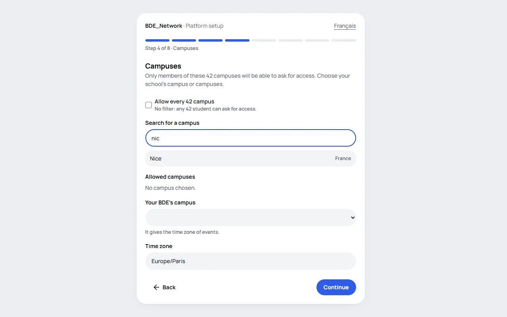
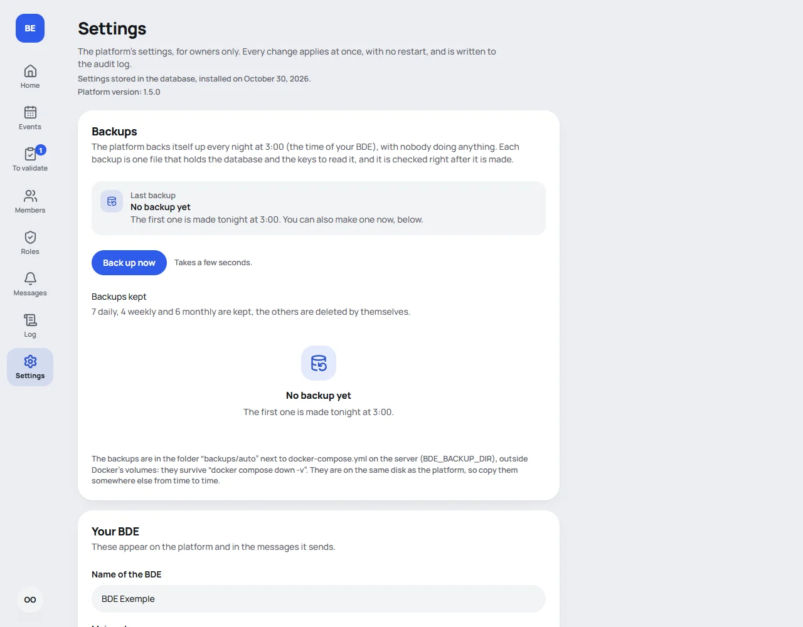

🇬🇧 English · [🇫🇷 Français](../fr/installation.md)

# Installation

You install the platform **in your browser**. You run one command, you open an address, and a page guides you step
by step. You do not open any configuration file and you have nothing to create beforehand.

The only prerequisite is **Docker**. The command is the same on Windows, Linux and macOS, including on a computer
where Docker runs without administrator rights (like the school's computers).



For a try-out on your computer, allow ten minutes. For a real server, also follow the
[deployment guide](deployment.md).

## What to prepare

- An account on the **42 intra**, to create the BDE's OAuth application (see
  [below](#create-the-application-on-the-42-intra)).
- The **42 logins** of the owners: the people who will have every right.
- Optional: the address of a Discord or Slack **webhook**, or the settings of a mail server (SMTP), for
  [notifications](notifications.md). All of this can also be set later, in **Settings**.

## 1. Install Docker and Git

| Tool   | Windows                                                                      | Linux                                                           | macOS                                                             |
| ------ | ---------------------------------------------------------------------------- | --------------------------------------------------------------- | ----------------------------------------------------------------- |
| Docker | [Docker Desktop](https://www.docker.com/products/docker-desktop/), with WSL2 | `docker` and `docker compose` (package `docker-compose-plugin`) | [Docker Desktop](https://www.docker.com/products/docker-desktop/) |
| Git    | [git-scm.com](https://git-scm.com/) or `winget install Git.Git`              | your distribution's package manager                             | `brew install git` or the Xcode Command Line Tools                |

On Windows and macOS, **start Docker Desktop** and wait until it says it is running. On Windows, if Docker Desktop
asks for it, turn on WSL2 (`wsl --install` in an administrator PowerShell, then restart).

Check:

```text
git --version
docker compose version
```

You do not need Node.js.

## 2. Get the code

```text
git clone https://github.com/edouardbautz/BDE_Network.git
cd BDE_Network
```

Did you fork the project? Clone your fork instead. See [Upgrading](upgrading.md) for what comes next.

## 3. Start the platform

From the `BDE_Network` folder (PowerShell, macOS Terminal or Linux: it is the same):

```text
docker compose up
```

**Without `-d` the first time.** The terminal stays open and shows what the platform is doing: that is where the
setup code appears. The first time, Docker downloads the platform's image, which takes a minute or two. Then the terminal shows a box:

```text
╔════════════════════════════════════════════════════════════════════════════╗
║  INSTALLATION DE LA PLATEFORME  ·  PLATFORM SETUP                          ║
║                                                                            ║
║  1. Ouvrez / Open :              http://localhost:3000                     ║
║  2. Code d'installation / Code : K7QM-4XPD                                 ║
║                                                                            ║
║  (Ce code change à chaque démarrage. / This code changes at every start.)  ║
╚════════════════════════════════════════════════════════════════════════════╝
```

Closed the terminal, or started with `-d`? Find the box again:

- in **Docker Desktop**, **Containers** tab: click the `app` container, then **Logs**;
- or with `docker compose logs app`.

## 4. Open the page and follow the steps

Open the address in the box, **exactly as shown**: `http://localhost:3000`, not `127.0.0.1`, not `0.0.0.0`. Enter
the **setup code**. It changes every time the platform restarts: always use the latest one.

A language switcher lets you go from English to French. Each step has a progress bar and a **Back** button.

| Step              | What you enter                                                                       | What the page does                                                                                                                                                                                                  |
| ----------------- | ------------------------------------------------------------------------------------ | ------------------------------------------------------------------------------------------------------------------------------------------------------------------------------------------------------------------- |
| 1. Your BDE       | The name, the color, the language of the messages sent, a contact address (optional) | Shows what the color looks like, in the light and the dark theme.                                                                                                                                                   |
| 2. Address        | The address of the platform                                                          | Suggests the one you are using. Gives the exact redirect URL to register on the intra. Warns you if the address is not the one of your browser, or if it starts with `http://` on a real domain. Refuses `0.0.0.0`. |
| 3. 42 application | The **UID** and the **secret**                                                       | Gives the step by step and the URL to copy. Checks the credentials with 42 right away.                                                                                                                              |
| 4. Campuses       | The allowed campuses                                                                 | Offers the list of 42 campuses with a search. Works out the time zone.                                                                                                                                              |
| 5. Owners         | The owners' 42 logins                                                                | Checks that each login exists on the intra.                                                                                                                                                                         |
| 6. Modules        | The Events module (on by default)                                                    |                                                                                                                                                                                                                     |
| 7. Notifications  | The channels you use (Discord, Slack, email), then what goes through which           | With a webhook or an SMTP server, a button sends a test message.                                                                                                                                                    |
| 8. Summary        |                                                                                      | Shows everything (secrets stay hidden). **Install the platform** saves.                                                                                                                                             |

Your answers stay in memory during the installation: reloading the page loses nothing. Secrets (42 secret, SMTP
password, webhooks) **never go back to the browser** and are **encrypted** in the database. The session key and the
database password are **created automatically**: you never see them.

At step 7, set up the channels you use (each has its own test), then tick, in a table, which notification goes
through which channel: none, one or several. Nothing ticked sends nothing, and you can change it all later in Settings.
See [Notifications](notifications.md#one-notification-several-channels).

### Create the application on the 42 intra

Signing in works with 42 accounts only. The platform needs an "application" registered on the intra, which gives a
**UID** and a **secret**. Step 3 shows the redirect URL to copy; here is the form in detail.

1. Sign in to the 42 intra, open <https://profile.intra.42.fr/oauth/applications> and click **Register a new App**.
2. Fill in the form. The intra may change its look: what matters is the name, the redirect URL and the scope.

   | Field        | Value                                                                     |
   | ------------ | ------------------------------------------------------------------------- |
   | Name         | Your BDE's name (it is shown to members when they authorize the sign-in). |
   | Redirect URI | **`https://bde.example.org/api/auth/callback/42-school`**                 |
   | Scopes       | **`public`** only (it is the default).                                    |

   Leave the other fields as they are, or fill them as you like (a website, a description).

3. **The redirect URL must be exact**, to the character: the platform's address (same `http` or `https`, same
   domain, same port) followed by `/api/auth/callback/42-school`, with no trailing slash. For a try-out:
   `http://localhost:3000/api/auth/callback/42-school`.
4. Validate with **Submit**. On the application's page, copy the **UID** and the **SECRET** into step 3.

> **The secret can expire or be regenerated.** The day 42 refuses it, nobody can sign in any more. A signed-in owner
> then sees an alert banner. Create a new secret on the application's page, and paste it in **Settings**, 42
> application section.

## 5. Finish

The "Platform installed" page appears. Two things are left.

1. **Move to the background.** If you ran `docker compose up` without `-d`, press `Ctrl+C` in the terminal, then run:

   ```text
   docker compose up -d
   ```

   The platform now runs without an open terminal, and restarts with the computer. This is the command to use from
   now on.

2. **Sign in with 42.** The owners on the list have every right from their first sign-in. Everyone else asks for
   access, and an owner approves them.

**Back up the `secrets` volume** with `./scripts/backup.sh` (see [Backups](deployment.md#backups-and-restore)). It
holds the key that decrypts the saved secrets. Without it, after a restore on another server, you have to enter
them again.

### Why a setup code?

As long as the platform is not installed, anyone who could reach the address could install it and name themselves
owner. Three protections prevent that.

- **The code**, shown in the server's logs, where only the person who starts the platform looks. It has 8
  unambiguous characters (no `0`/`O`, no `1`/`I`/`L`), changes at every start and is only kept in memory.
- **A lock.** Five wrong tries block the entry for 30 seconds, then longer and longer, up to 15 minutes. Restarting
  the platform gives a new code.
- **Nothing is shown without the code.** Before it, the rest of the site answers "not installed".

Once the installation is finished, **the installer disappears for good** and no button reopens it.

## After the installation

Sign in with 42. Since your login is in the owners' list, you have every right.

1. **Settings** (the menu, owners only): everything the installer asked can be changed here, section by section,
   and applies at once. See [Configuration](configuration.md).

   

2. **Roles**: two roles exist, _Admin_ and _Membre_. Create your own (President, Treasurer…) by ticking what each
   one may do. See [Roles and rights](roles.md).
3. **Members**: everyone who signs in for the first time arrives "pending"; you approve them and choose their role.
4. **Events**: create the first event and invite everyone to sync their calendar. See [Events module](events.md).

## Going to production

For members to reach it, you need a server, a domain name and an HTTPS proxy (Caddy, Nginx…). The platform
deliberately only listens on the machine itself; the proxy shows it to the world. It is all in the
[deployment guide](deployment.md).

## Stop or reset

```text
docker compose down          # stops the platform, keeps the data
docker compose down -v       # stops it and DELETES the data: the database AND the keys
```

After `docker compose down -v`, everything is erased. At the next `docker compose up`, the installer comes back with
a new code.

## Did you have an installation made with files?

A platform installed with `.env` and `bde.config.yml` (before the installer) has nothing to redo. At the first start
after the update, those two files are **copied into the database**, secrets encrypted, and the **Settings** page
becomes usable. See [Upgrading](upgrading.md).

## A problem?

See [Troubleshooting](troubleshooting.md): a refused setup code, refused 42 credentials, a 503 error page, a port
already in use, a sign-in that fails.
