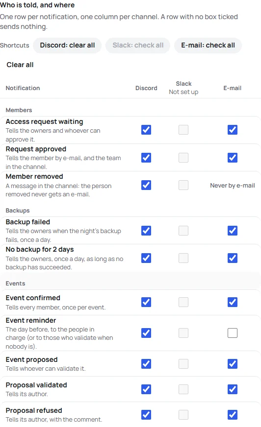
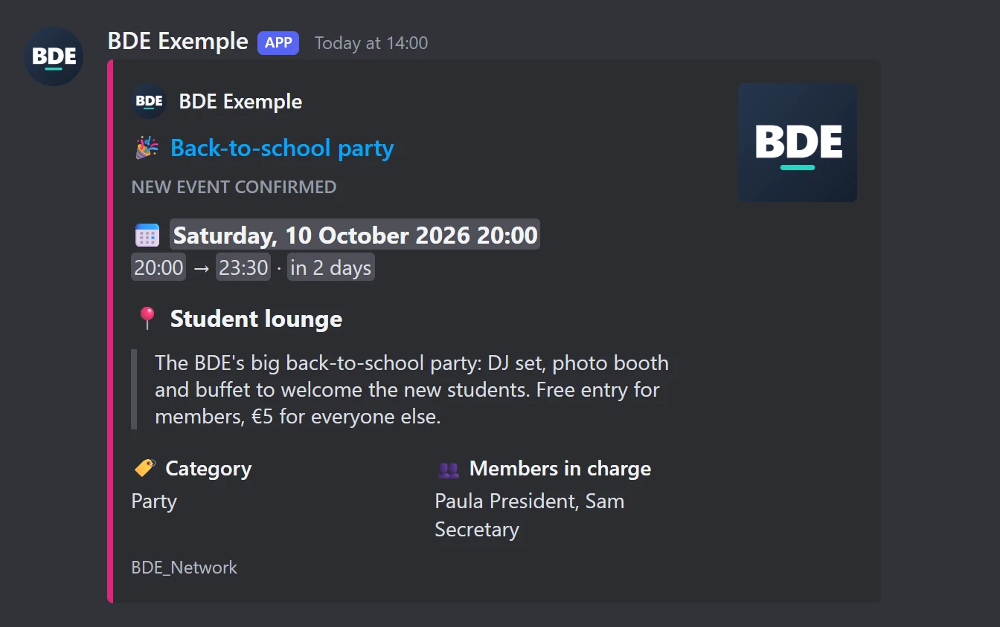
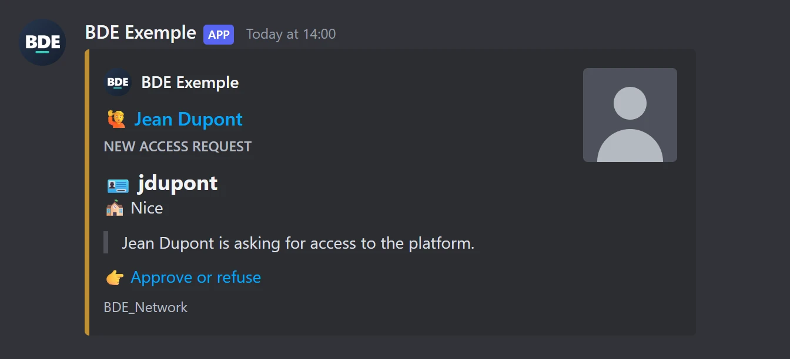
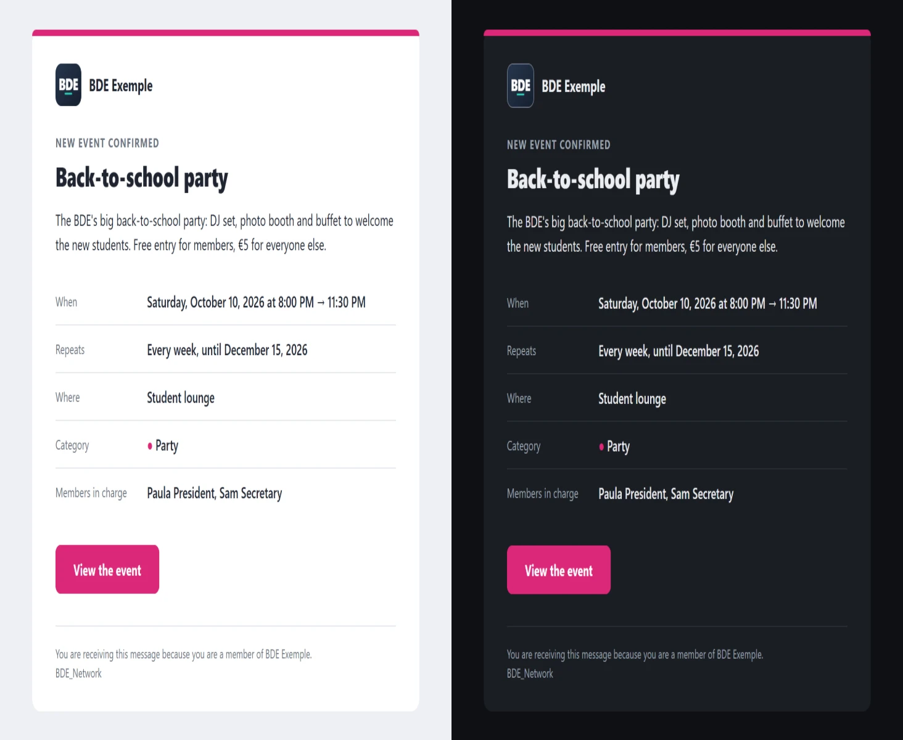

🇬🇧 English · [🇫🇷 Français](../fr/notifications.md)

# Notifications

The platform can notify the BDE by **email**, through a **Discord** channel, through a **Slack** channel, or not at
all, and **each type of notification can go through several of them at once** (for example Discord and email).
**Discord is the easiest to set up.**

The channels (webhook address, mail server) and **what goes through which** are chosen in **Settings**,
**Notifications** section, and in the installer, step 7. They apply at once. See
[One notification, several channels](#one-notification-several-channels).

| Notification                            | When                             | Who is notified                                                                              |
| --------------------------------------- | -------------------------------- | -------------------------------------------------------------------------------------------- |
| **Access request** (`memberPending`)    | a new member asks for access     | Email: the owners and those with the "Manage members" right. Discord or Slack: the channel.  |
| **Member approved** (`memberApproved`)  | a request is approved            | Email: the approved member (their role, a sign-in link). Discord or Slack: the channel.      |
| **Member removed** (`memberRemoved`)    | a member is removed from the BDE | Discord or Slack: the channel. **Never an email**: the removed person receives nothing.      |
| **Event confirmed** (`eventConfirmed`)  | an event is confirmed            | Every approved member (email: one message per person), or the channel.                       |
| **Reminder** (`eventReminder`)          | the day before an event          | The members in charge (email), otherwise those who validate events; or the channel.          |
| **Event proposed** (`eventProposed`)    | an event is proposed             | Email: the owners and those with the "Validate events" right. Discord or Slack: the channel. |
| **Proposal approved** (`eventApproved`) | a proposal is approved           | Email: its author. Discord or Slack: the channel.                                            |
| **Proposal refused** (`eventRefused`)   | a proposal is refused            | Email: its author, with the validator's comment. Discord or Slack: the channel.              |

On every channel ticked, the notification goes out the way the table above says: email to the people concerned,
Discord or Slack as one message in the channel.

Messages are sent **after** the action. **Each channel is sent on its own**: a Discord channel that is down never
holds back the emails or the Slack message, and cancels nothing that already went. A send that fails never prevents
the action either: it is written to the server's logs (`docker compose logs app`), with the name of the channel.

## One notification, several channels

In **Settings**, **Notifications** section (and in the installer), two blocks:

1. **Channels.** One panel for each of Discord, Slack and email, with what it needs (the webhook address, the mail
   server), a **Set up** or **Not set up** badge and its own **test**. The test sends the **real card or email**, with
   an invented event ("Game night (example)") marked "Test message", through what is typed in the panel, saved or
   not: you see how your channel will look, with your BDE's name, logo and color. **Remove** forgets a channel's
   settings and clears its boxes (when you press Save).
2. **Who is told, and where.** A table with **a row per notification** and **a column per channel**. Tick a box to
   send that notification through that channel; tick several in a row to send it through several. A row with **no
   box ticked sends nothing**.
   - A box can only be ticked when its **channel is set up**. Until then its column is greyed and says "Not set up".
   - The **shortcuts** above the table tick (or clear) a whole column in one click: "Discord: check all". "Clear all"
     empties the table.
   - **Member removed** has no box for email: the removed person is never written to.
   - The rows of the Events module only show when the module is on (what they hold is kept).
   - On a phone, each notification is a block with its boxes one under the other, each at least 44 px high: nothing
     scrolls sideways.

A configuration written before version 1.5.0, with **one channel per notification**, is read as it was meant:
`discord` becomes the Discord box ticked, `none` no box. Nothing is lost, and nothing changes until you save from
Settings (see [Configuration](configuration.md#notifications-1)).

Texts are written in the language of the messages chosen in **Settings**, Your BDE section.

## Setting up Discord

1. In Discord, open the channel's settings: **Integrations** → **Webhooks** → **New webhook**.
2. Choose the channel, then **Copy webhook URL**.
3. In the platform: **Settings** → **Notifications** → **Discord**, paste the address, then use **Send a test
   message**.

The webhook address is a secret: never publish it. The platform keeps it encrypted and does not show it again.

> **The BDE's name.** Discord refuses a sender name that contains "discord" or "clyde". In that case the message goes
> out under the webhook's name (the one set in the channel's settings).

## How Discord looks

On Discord, each notification is a **card** (an _embed_), built the same way for events, reminders and members:
**the essentials as large headings, the secondary details as small fields**.

_Illustrations drawn from the real cards the platform sends. Discord shows them with its own font, according to each
reader's theme._

- **The essentials, as headings, with an icon in front of each and a blank line between them**: the type of card in
  small capitals ("NEW EVENT CONFIRMED"), then 📅 _when_ (the date, the start and end times, the countdown), 📍
  _where_, and the event's description as a quote. For a member: 🪪 the 42 login, 🏫 the campus, and what happened as
  a quote.
- **The secondary details, as fields side by side**: 🏷️ _Category_ and 👥 _Members in charge_ (a series adds a 🔁
  _Repeats_ line). For an approved or removed member: 🎭 _Role_ and **who** did the action (🤝 "Approved by…", 🚪
  "Removed by…").
- **The proposal cards** (📝 event proposed, ✅ approved, ⛔ refused) say **who proposed** the event and, for an answer, **who gave it**; a refusal opens with 💬 the validator's **comment**, as a quote. A channel is read by the whole team: write the comment knowing so.
- **An icon in the title** by type: 🎉 event confirmed, ⏰ reminder for tomorrow, 🔔 reminder for today, 🙋 access
  request, ✅ member approved, 👋 member removed.
- **A color bar**: the category's for an event; amber, green or red for a request, an approval, a removal. These
  three shades stay readable on Discord's light and dark themes.
- **A clickable title** to the page concerned (the event, or the _Members_ page), with no duplicate preview card.
  Without the address of the platform, the title is simply not a link.
- **An access request ends with "👉 Approve or refuse"**, a link to the _Members_ page (only when the address of the
  platform is set).
- **Discord-format dates**: each reader sees them **in their own time zone and language**, with a countdown ("in 3
  days") that updates by itself.
- **The BDE's signature**: the message arrives under the BDE's name with its logo as the avatar, and the card carries
  its name and logo above the title. The logo is also the **thumbnail** of events; for a member, it is their **42
  photo** (the logo if there is none). If the logo is not public, there is no icon and no thumbnail: the name alone,
  never a broken image.
- **A discreet card footer**: `BDE_Network`.
- **The reminder** says "Reminder · tomorrow" normally, and "Reminder · today" when it goes out on the day of the
  event (see [the day-before reminder](events.md#how-the-day-before-reminder-works)).

An event's description is taken **up to 350 characters**, cut cleanly with "…": the card is a notice, the event's
page has the detail. More generally, any text too long for Discord is cut rather than making the message refused.

### Text safety

A title, a location or a name come from members: `@everyone`, `@here`, `<@123…>` or `<!channel>` in them are made
**harmless**. They show as text and nobody is notified, in the card (the BDE line included) as in the sender's name.
Every send also forbids any mention. A location or a login fits on **one line**: it cannot open a fake heading.

## The sender's logo

Discord **fetches the image itself**: it must therefore be public and in a format it accepts.

|                      |                                                                                       |
| -------------------- | ------------------------------------------------------------------------------------- |
| **Accepted formats** | PNG, JPEG, GIF, WebP. **No SVG.**                                                     |
| **Advised size**     | A square of 512 × 512 pixels (128 at least), under 2 MB.                              |
| **Shape**            | Discord shows it **round**: keep the essentials in the center, away from the corners. |

To set your BDE's logo: **Settings** → **Logo**. The platform picks the image like this:

1. the logo you uploaded in Settings, if there is one;
2. otherwise, the logo that ships with the platform (a neutral "BDE" monogram).

If Discord cannot fetch the image, **the message still goes out**, under the BDE's name and without an avatar: never a
broken image. This happens when:

- the address of the platform is not set, or not public (`localhost`, a private network: Discord cannot see them).
  Set it in **Settings**, Address of the platform section;
- the server does not answer, or does not serve the file as an image.

The platform checks the image (a quick request, remembered for ten minutes) before sending, so as not to show a broken
avatar.

The **same logo** is used in the header of emails. There, the address does not need to be public: it is the reader's
mail app that loads the image.

## Slack

> **Discord is simpler**: a webhook takes two clicks, with no application. Slack asks you to create a small
> application, which the step by step below pre-fills. Choose it if your BDE already lives on Slack.

### Setting up Slack, step by step

1. Open this link, signed in to your Slack workspace:
   **[Create the BDE_Network application](<https://api.slack.com/apps?new_app=1&manifest_yaml=display_information%3A%0A%20%20name%3A%20BDE_Network%0A%20%20description%3A%20Notifications%20du%20BDE%20(%C3%A9v%C3%A9nements%2C%20rappels%2C%20nouveaux%20membres)%0A%20%20background_color%3A%20'%231e293b'%0Afeatures%3A%0A%20%20bot_user%3A%0A%20%20%20%20display_name%3A%20BDE_Network%0A%20%20%20%20always_online%3A%20false%0Aoauth_config%3A%0A%20%20scopes%3A%0A%20%20%20%20bot%3A%0A%20%20%20%20%20%20-%20incoming-webhook%0Asettings%3A%0A%20%20org_deploy_enabled%3A%20false%0A%20%20socket_mode_enabled%3A%20false%0A%20%20token_rotation_enabled%3A%20false%0A>)**
   It pre-fills everything (name `BDE_Network`, incoming webhooks on, **no other permission**) from
   [`slack-app-manifest.yml`](../slack-app-manifest.yml). Choose your workspace, check the summary, click **Create**.
2. In the left menu, open **Incoming Webhooks**, then **Add New Webhook to Workspace**, choose the channel where
   messages should arrive, and **Allow**.
3. Copy the **webhook URL** (it starts with `https://hooks.slack.com/services/`). In the platform: **Settings** →
   **Notifications** → **Slack**, paste it, then **Send a test message**. This address is a secret: never publish it.

Optional: in the Slack application's **Basic Information**, you can upload your BDE's logo as its icon.

The link is the same for every BDE: the manifest contains nothing personal. If it does not open, go to
<https://api.slack.com/apps>, **Create New App**, **From a manifest**, and paste the content of
[`slack-app-manifest.yml`](../slack-app-manifest.yml).

### How Slack looks

Like Discord, each notification is a **card** (Block Kit).

- **A color bar**: the category's for an event; amber, green or red for a request, an approval, a removal (as on
  Discord).
- **A header title**, then the description (350 characters at most), _When_ on the full width, and _Where_,
  _Category_, _Members in charge_, _Repeats_ in columns.
- **Slack-format dates**: each reader sees them in their own time zone, with "today" or "tomorrow" when it applies.
  Slack has no countdown.
- **A button** "View the event" (or "Approve or refuse" for an access request).
- **A footer** with the BDE's logo (if it is public, as for Discord), its name and `BDE_Network`.
- **For a member**: the 42 photo next to the message, the role, and **who** approved or removed.
- **A readable phone notification**: a summary ("New event confirmed: Back-to-school party — Saturday, October 10,
  2026 at 8:00 PM · Student lounge"). It never appears in the channel, above the card.

Mentions are made harmless in every text, and each message respects Slack's size limits. The sender's name and icon
are those of **the Slack application** (`BDE_Network`): a webhook cannot change them message by message.

## Emails

An email is a real formatted page, with a **text version** for mail apps that do not show HTML.

_An event confirmation. On the left in light mode, on the right the same email in dark mode._

- **The header**: the BDE's logo and name (the name alone if no logo can be reached).
- **A bar in the category's color** (amber, green or red for a request, an approval, a removal) and **a rounded button in your
  BDE's color**, as on the platform; the button's text is black or white depending on the color, to stay readable. The page,
  the card and the text follow the light or the dark palette of the platform.
- **The lines** _When_, _Repeats_, _Where_, _Category_ (with its color dot) and _Members in charge_, then **a
  button** to the page concerned (the event, or the _Members_ page). Without the address of the platform, there is no
  button.
- **The preview text**, which the inbox shows next to the subject.
- **A discreet footer**: why the person receives this message, and `BDE_Network`.
- **An event confirmation attaches an `.ics` file**: mail apps then offer "Add to calendar". It contains every
  upcoming date of a series, with the same identifiers as the subscription calendars: nothing is added twice. The
  reminder attaches none.
- **For a member**: the access request (with the 42 photo) and the approval (a welcome message with their role and a
  button to sign in). A removal **never sends an email**.

Everything a member typed is **escaped** before it enters the page: it shows as text, never as code. The layout is
made for the most difficult mail apps: tables, styles written into each element, a button adapted to Outlook on
Windows, dark mode for Apple Mail, Gmail and Outlook, and a small-screen layout.

### Setting up email

In **Settings** → **Notifications** → **E-mail**, enter the SMTP server (server, port, username and password if
needed) and the sender address. The password is encrypted and never shown again. Use the test message.

## A problem?

A message does not arrive, no avatar, a title that is not a link: see
[Troubleshooting](troubleshooting.md#notifications).
