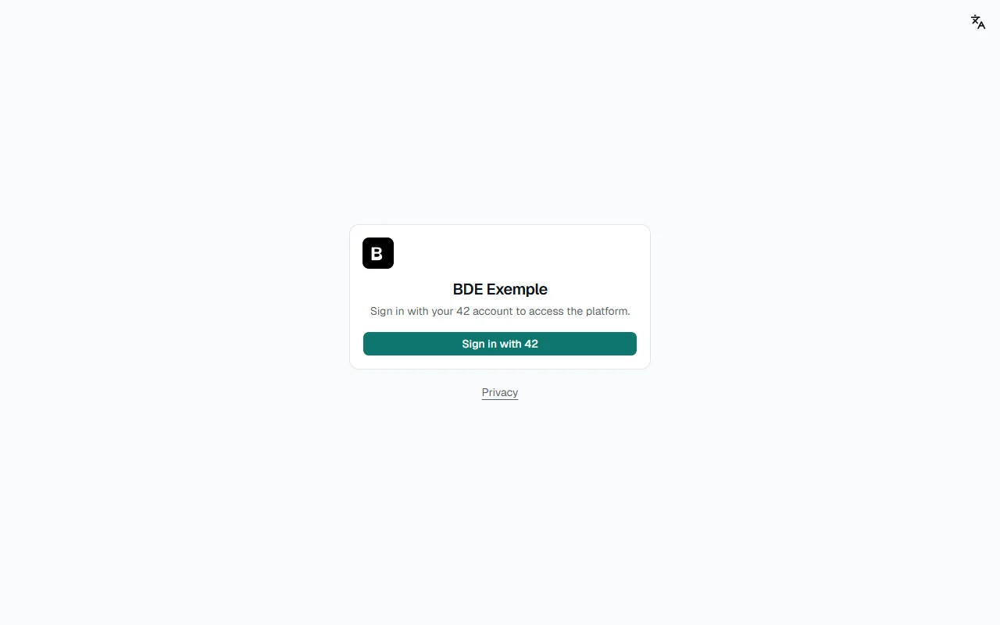
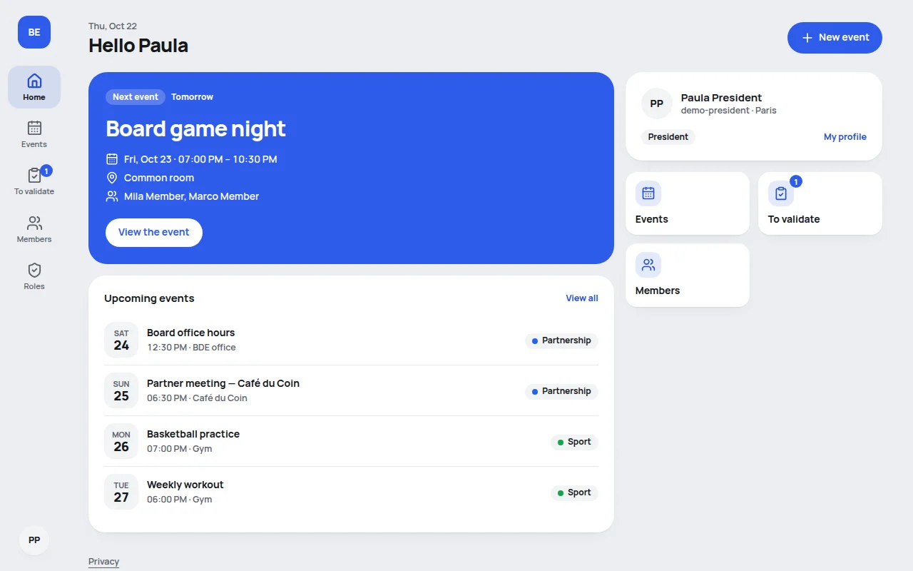
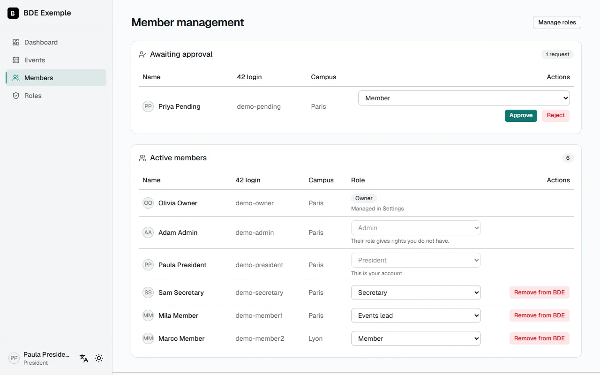
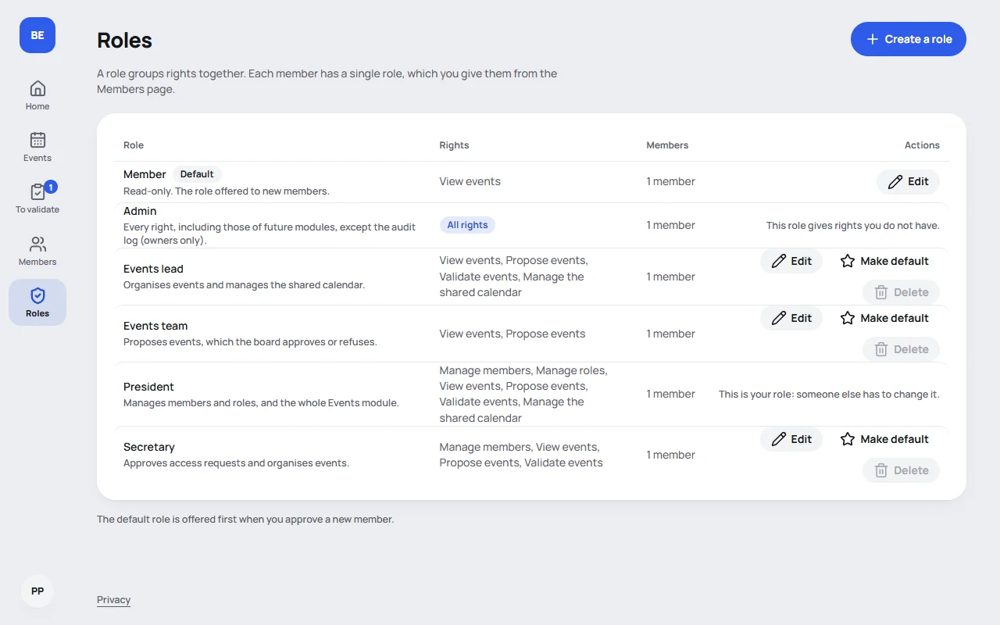
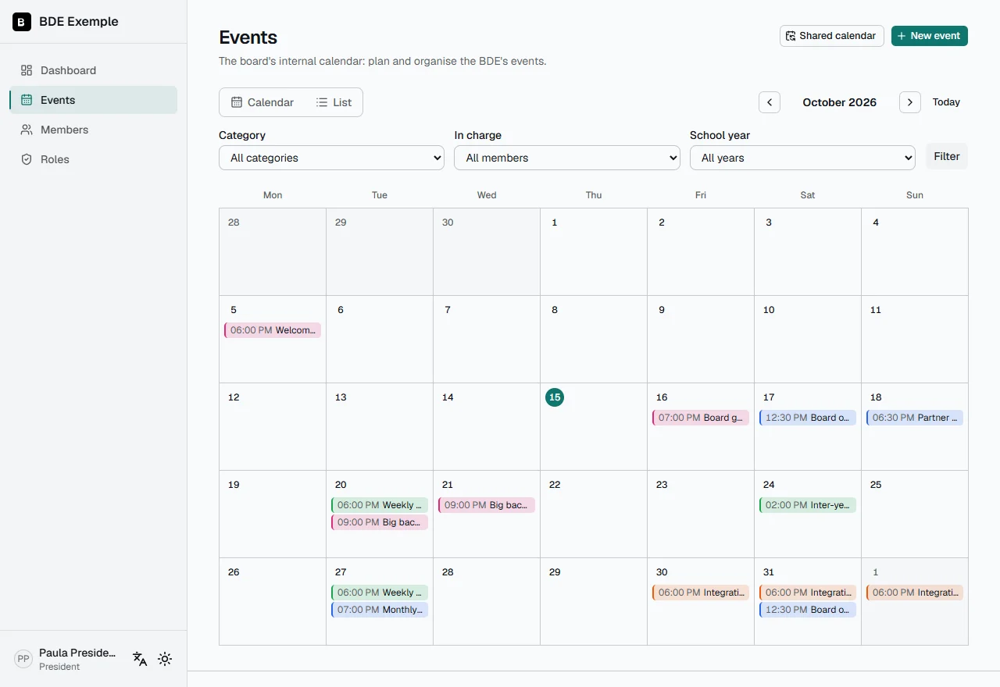
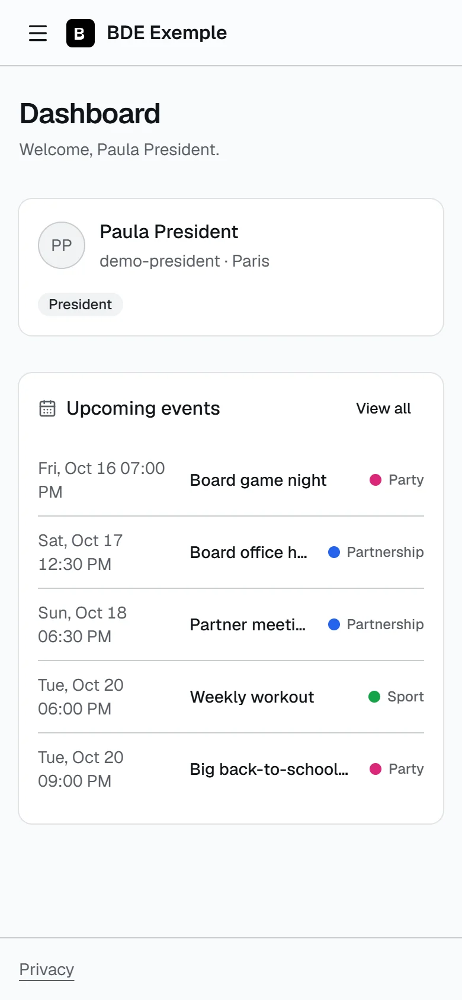

🇬🇧 English · [🇫🇷 Français](../fr/user-guide.md)

# User guide

This guide is for the board members who use the platform. No technical knowledge is needed.

## Signing in

Go to your platform's address (given by your board) and click **Sign in with 42**. You land on the 42 intra:
authorize the access, and you come back to the platform automatically.

There is no password to remember: signing in goes through your 42 account only.

## First sign-in: the waiting page

The first time you sign in, your account is **awaiting approval**. A board member who has the "Manage members" right
(an owner, or a role such as President or Secretary) must approve your access and give you a role.

Come back a little later, or contact someone in charge of your BDE. Until then you cannot do anything else: that is
normal.

## Once your account is approved

You land on the **dashboard**: the next event, the ones after it, shortcuts and your account.

### Finding your way around

On a computer or a tablet, the menu is a **column of icons on the left**, each with its name under it. On a phone it
is a **bar at the bottom of the screen**: Home, Calendar, a round **Create** button, Members and **More** (the rest of the
platform, your profile, the theme, the language and sign-out). It only shows what **your role** allows:

| Entry               | Who sees it                                     |
| ------------------- | ----------------------------------------------- |
| **Home**            | Everyone.                                       |
| **Calendar**        | Those who can view events, if the module is on. |
| **To validate**     | Those who can validate events (it counts them). |
| **Members**         | Those who have the "Manage members" right.      |
| **Roles**           | Those who have the "Manage roles" right.        |
| **Log** (audit log) | Owners.                                         |
| **Settings**        | Owners.                                         |

At the foot of the column, your **round picture or initials** open the menu of your account: your name and role,
**My profile**, the theme, the language and **Sign out**. On a phone the same picture is at the top right of the page,
and everything is also behind **More**. The **Privacy** link is at the bottom of the page.

### Changing the language

The interface exists in French and in English. Open the menu of your account (and use the language icon on public
pages, such as the sign-in page), then choose **Français** or **English**. You stay on the same page, and your choice
is remembered for your next visit.

### Changing the theme

The menu of your account chooses between the **light** theme, the **dark** theme, or your device's setting.

### Confirmation dialogs

Anything that cannot be undone (removing a member, rejecting a request, deleting a role or an event, canceling a
date, replacing a calendar link) first opens **a dialog in the middle of the screen** that explains what is going to
happen. The **Cancel** button is selected by default: `Esc`, a click outside or **Cancel** close the dialog without
doing anything. Changing a member's role and confirming an event also ask for confirmation, but the button is not
red: it is reversible.

## My profile

In the menu of your name, **My profile** shows your account information and your **personal calendar link**, to add
to Google Calendar, Outlook or Apple Calendar. See [Events module](events.md#adding-it-to-your-calendar).

When the platform publishes events on the intra, the profile also lets you give your **Discord id** and/or **Slack id** (optional):
they are used only to mention you in the messages for the school's staff. The page says where to find them. A mention, a name or
anything that is not an id is refused, and nobody else sees what you enter.

## For those who run the board

### Managing members

You need the **Manage members** right. The **Members** page shows two lists.

- **Awaiting approval**: new accounts. Next to each request, a menu offers the **role to give** (the default role
  is picked in advance), then **Approve** or **Reject**.
- **Active members**: all the members. The menu in the **Role** column changes a member's role, after a
  confirmation that recalls the old and the new role.

**Approve** gives access with the chosen role. **Reject** deletes the request. **Remove from BDE** deletes a
member's account, and they can ask for access again by signing in. These actions ask for confirmation. If someone
else has already handled the request, a message explains it and the list updates.

Owners have no role menu: they are managed in **Settings**.

You only act within your own rights. A role that gives a right you do not have is greyed out, and you cannot change
your own role, nor that of a member who has more rights than you. The message shown says why. See
[Roles and rights](roles.md).

### Managing roles

You need the **Manage roles** right. The **Roles** page lists the BDE's roles.

**Create a role**: give it a name (Treasurer, Secretary…) and tick what its members will be able to do. Each box has
a sentence of explanation. Two roles exist from the installation, and you can edit them: **Admin** (all rights,
except the audit log and Settings, which are for owners only) and **Membre** (view events).

A role that is still given to members cannot be deleted: give those members another role first.

### Being told about new requests

The BDE can receive an alert when someone asks for access, when a request is approved (the member then receives an
email) and when a member is removed (a message in the Discord or Slack channel, never an email). An owner sets this up
in **Settings**, Notifications section. See [Notifications](notifications.md). Owners, and members whose role allows it,
can also change what the messages say and how they look, from the **Notifications** page
([Customising the messages](notifications.md#customising-the-messages)).

### The audit log (owners)

**Audit log** lists, read-only, the sensitive actions: who approved whom, who was removed, which role changed,
which setting was modified… Each line has the date, the author, the action and the target. It cannot be edited or
deleted from the interface.

### The platform's settings (owners)

**Settings** gathers everything the installer asked, plus the logo, the event categories and the reminder hour. Each
section has its own **Save** button and applies at once. See [Configuration](configuration.md#the-settings-page).

## Events

If the module is on, **Events** shows the board's calendar, as a calendar or a list, with filters. You can add an
event to your calendar or subscribe to a feed that updates by itself. If your role allows proposing or validating
events, you create and edit them here (a proposal waits for a validator). See [Events module](events.md).

## On a phone

The platform works on a phone. The menu is the bar at the bottom of the screen. Events open as a list; the Calendar
view shows a colored dot for each day.

## Your personal data

The **Privacy** page (a link at the bottom of the sign-in page and of the platform's pages) explains what data is
collected and why. Once signed in, you can **download a copy of all your data** there, as JSON.

## Signing out

Open the menu of your account, then click **Sign out**.

## If something does not work

- **"Page not found"**: the address does not exist, or the item was deleted. The _Back to the dashboard_ button takes
  you home.
- **"Something went wrong"**: an error occurred on the server. Your data is not lost. Try _Try again_. If it
  continues, give the person who runs the server the **error reference** shown under the message: it helps find the
  cause in the logs.
- For everything else, see the [FAQ](faq.md).
