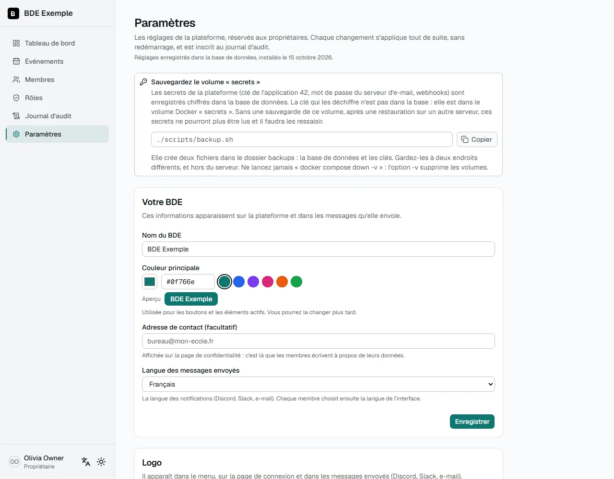
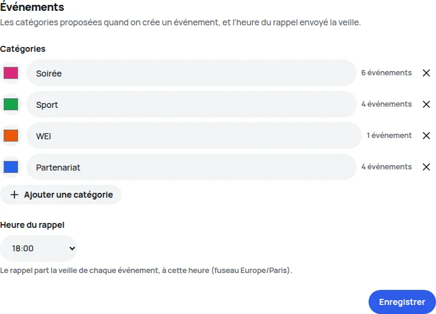

🇫🇷 Français · [🇬🇧 English](../en/configuration.md)

# Configuration

Les réglages de la plateforme se font **dans le navigateur** : à l'[installation](installation.md), puis dans la
page **Paramètres**, réservée aux propriétaires. Ils sont enregistrés dans la base de données, les secrets
chiffrés. Vous n'ouvrez aucun fichier.

Cette page a trois parties :

1. [La page Paramètres](#la-page-paramètres) : ce que l'on règle, section par section.
2. [Où sont les réglages](#où-sont-les-réglages) : la base, les clés, et comment repartir de fichiers.
3. [La référence des réglages](#référence-des-réglages) : le nom et le rôle de chaque réglage, tels qu'ils figurent
   dans les fichiers `bde.config.yml` et `.env` (utiles pour une installation par fichiers).

## La page Paramètres

Les **propriétaires** (et eux seuls) ont une entrée **Paramètres** dans le menu.



Chaque section s'enregistre **à part**. Elle est vérifiée avant d'être écrite, elle **s'applique tout de suite**
(sans redémarrer ni reconstruire) et elle est inscrite au **journal d'audit**. Pour un secret, le journal dit
seulement qu'il a changé, jamais sa valeur. La page ne renvoie jamais un secret au navigateur : laissez le champ
vide pour garder celui qui est enregistré.

| Section                      | Ce qu'on y règle                                                                                                                                                      |
| ---------------------------- | --------------------------------------------------------------------------------------------------------------------------------------------------------------------- |
| **Votre BDE**                | Le nom, la couleur principale, la langue des messages envoyés (Discord, Slack, e-mail) et l'adresse de contact affichée sur la page de confidentialité (facultative). |
| **Logo**                     | Le logo du BDE : menu, page de connexion, messages.                                                                                                                   |
| **Adresse de la plateforme** | L'adresse que vos membres tapent, et que 42 utilise pour la connexion.                                                                                                |
| **Application 42**           | L'UID et la clé secrète de l'application OAuth.                                                                                                                       |
| **Campus**                   | Les campus autorisés, le campus du BDE et le fuseau horaire.                                                                                                          |
| **Propriétaires**            | Les logins 42 des propriétaires.                                                                                                                                      |
| **Modules**                  | Activer ou désactiver le module Événements.                                                                                                                           |
| **Événements**               | Les catégories et l'heure du rappel de la veille (si le module est activé).                                                                                           |
| **Notifications**            | Les canaux (Discord, Slack, e-mail), ce qui passe par lequel, et un message de test pour chaque canal.                                                                |
| **Nouvelles versions**       | Prévenir ou non les propriétaires quand une nouvelle version de la plateforme est publiée (activé par défaut).                                                        |



### Le logo

Le logo apparaît dans le menu, sur la page de connexion et dans les messages (Discord, Slack, e-mail).

- Formats : PNG, JPEG, GIF ou WebP. **Pas de SVG** : Discord, Slack et les messageries ne l'affichent pas.
- Taille : 2 Mo au plus, de 64 à 4096 pixels de côté. Un carré d'au moins 512 pixels est idéal.
- Le format est lu dans le fichier lui-même, pas d'après son nom. Un fichier qui n'est pas une image est refusé.
- **Revenir au logo par défaut** supprime le fichier envoyé.

Le fichier est gardé dans le volume `uploads`, et la sauvegarde l'inclut. Pour Discord, voir aussi
[Le logo de l'expéditeur](notifications.md#le-logo-de-lexpéditeur).

### L'adresse de la plateforme

C'est l'adresse que 42 connaît (l'URL de redirection est cette adresse suivie de `/api/auth/callback/42-school`) et
celle de **tous** les liens envoyés : elle doit être celle que vos membres tapent.

- `0.0.0.0` est refusée. Ce n'est pas une adresse de site : c'est celle sur laquelle le serveur écoute.
- `127.0.0.1` est écrite `localhost`.
- Une adresse en `http://` sur un vrai domaine demande une confirmation : les connexions ne sont pas chiffrées.
- La page vous avertit quand l'adresse enregistrée n'est pas celle de votre navigateur : 42 renvoie le visiteur vers
  l'adresse enregistrée, et la connexion ne peut pas aboutir depuis une autre.

Si l'adresse est fausse et que plus personne ne peut se connecter pour la corriger, voir
[Problèmes fréquents](troubleshooting.md#la-connexion-avec-42-échoue-invalid_grant-redirection-uri-adresse-0000).

### L'application 42

La plateforme vérifie l'UID et la clé secrète auprès de 42 **avant** de les enregistrer : une clé fausse
empêcherait tout le monde de se connecter. Si 42 est injoignable, vous pouvez enregistrer sans vérification, en
connaissance de cause.

Si 42 refuse l'application (clé expirée ou régénérée), plus personne ne peut se connecter. La page de connexion le
dit, et un propriétaire connecté voit un bandeau d'alerte avec un lien vers cette section.

### Les campus

Seuls les membres dont le campus 42 est dans la liste peuvent se connecter. **Une liste vide autorise tous les
campus.** La comparaison ignore la casse et les espaces en trop.

### Les propriétaires

Ajouter ou retirer un propriétaire demande une confirmation. Le login est vérifié sur l'intra. Quelques règles :

- vous ne pouvez pas vous retirer vous-même ;
- il reste toujours au moins un propriétaire ;
- vous pouvez en nommer au plus 30.

Une personne retirée de la liste devient un membre avec le **rôle par défaut**.

### Les événements

- **Catégories** : renommez-les, changez leur couleur, ajoutez-en. Chaque nouvelle catégorie reçoit un identifiant
  tiré de son nom, qui ne change plus ensuite.
- **Retirer une catégorie** utilisée par des événements demande de choisir une catégorie où les déplacer. Il faut
  garder au moins une catégorie.
- **Heure du rappel** : l'heure locale (fuseau du BDE) à laquelle part le rappel de la veille. Par défaut : 18 h.
- **Publier les événements sur l'intra 42** : activé, chaque événement demande les champs du formulaire de l'intra (voir [les champs de
  l'intra](events.md#les-champs-de-lintra)) et aucun ne peut être confirmé sans eux. **Désactivé par défaut** : rien ne change pour une
  plateforme tant qu'un propriétaire ne l'active pas.
- **Salon du staff** (affiché quand la publication sur l'intra est activée) : le staff de l'école n'est pas forcément sur le Discord ou le
  Slack du BDE, alors les messages sur la publication des événements peuvent aller dans un salon à lui, avec son propre webhook (Discord
  et/ou Slack, chacun avec un message de test). Laissé vide, ils vont dans le salon du BDE, avec les mentions. Les adresses sont des
  secrets, comme celles du BDE : elles ne sont jamais réaffichées, un champ vide garde l'adresse enregistrée, et elles sont conservées
  chiffrées dans les réglages.

### Les notifications

Dans Paramètres, chaque canal (Discord, Slack, e-mail) se configure dans son panneau, avec son message de test, puis
un **tableau** dit quelle notification passe par quel canal : une ligne par notification, une colonne par canal,
**aucune, une ou plusieurs cases** par ligne. Une case ne se coche que pour un canal configuré ; le retrait d'un membre
n'a jamais de case e-mail. Retirer un canal oublie ses réglages et décoche ses cases. Voir
[Notifications](notifications.md).

### Nouvelles versions

Quand une version plus récente de la plateforme est publiée, les **propriétaires** (et eux seuls) voient un bandeau en
haut du **tableau de bord** et de cette page : la nouvelle version, de quoi il s'agit, un lien vers ses notes, et les
deux commandes qui la mettent en place (`git pull`, puis `docker compose up -d` ; voir [Mettre à jour](upgrading.md)).
**Masquer jusqu'à la prochaine version** le cache dans ce navigateur jusqu'à la sortie d'une version plus récente. Rien
ne se met à jour tout seul : la plateforme ne touche jamais à sa propre installation.

Pour le savoir, la plateforme demande à **GitHub** la dernière version publiée du projet (une simple requête vers
`api.github.com`, répondue depuis une mémoire de six heures, trente minutes après un échec). La requête est faite par le
serveur, seulement quand un propriétaire ouvre le tableau de bord ou cette page, et ne transporte **rien de votre BDE
ni de ses membres** : ni adresse, ni réglage, ni login. GitHub voit l'adresse du serveur et la version qu'il fait
tourner, comme pour n'importe quel téléchargement. Si GitHub est injoignable, rien n'est affiché et rien n'est ralenti
(le bandeau se charge après la page).

La section **Nouvelles versions** le désactive (`updates.check`) : la plateforme ne demande alors rien à personne.

### Le rappel de sauvegarde

En haut de la page, un rappel invite à **sauvegarder le volume `secrets`**, avec la commande. Il devient une alerte
rouge si les secrets enregistrés sont illisibles (volume perdu ou remplacé).

### Quand la page est en lecture seule

Tant que les réglages sont encore dans les fichiers `bde.config.yml` et `.env` (une installation faite avant
l'installateur, pas encore copiée dans la base), la page le dit et ne permet rien. Voir
[Mettre à jour](upgrading.md).

## Où sont les réglages

**Au premier démarrage**, la plateforme copie dans sa **base de données** ce que disent `bde.config.yml` et `.env`,
quand ces fichiers sont complets. Les secrets (clé de l'application 42, mot de passe SMTP, webhooks) y sont
**chiffrés**. À partir de là, **la base fait foi** : modifier les fichiers ne change plus rien.

Les clés qui signent les sessions et chiffrent les secrets sont créées une fois, toutes seules, dans le volume
Docker `secrets`. **Sauvegardez-le** : voir [Sauvegardes](deployment.md#sauvegardes-et-restauration). Sans lui,
après une restauration sur un autre serveur, il faut ressaisir les secrets dans Paramètres.

Une installation neuve n'a donc pas de `.env`. Seuls `APP_BIND` et `APP_PORT`, qui sont des réglages de Docker et
non de la plateforme, s'y écrivent encore si besoin.

### Remplacer les réglages par les fichiers

Pour un déploiement piloté par des fichiers, ou pour repartir de `bde.config.yml` et `.env` :

1. Modifiez `bde.config.yml` et `.env` (toutes les valeurs), et ajoutez `BDE_REIMPORT=1` dans `.env`.
2. [Construisez l'image depuis votre dossier](deployment.md#construire-limage-vous-même) (`docker compose -f docker-compose.yml -f docker-compose.build.yml up -d --build`) : les fichiers n'entrent dans une image que quand elle est construite. Au démarrage, la plateforme remplace les réglages de la base par ceux des
   fichiers (le journal le dit). Si les fichiers sont incomplets, elle l'ignore et garde la base.
3. **Retirez `BDE_REIMPORT=1`**, puis `docker compose up -d`. Tant qu'il reste, chaque démarrage écrase ce qui a été
   modifié depuis l'application.

### Reprendre seulement les valeurs de `.env`

`BDE_REIMPORT=settings` reprend dans la base uniquement les valeurs de `.env` (application 42, adresse, e-mail,
webhooks) et laisse tout le reste. C'est le moyen de secours quand plus personne ne peut se connecter : voir
[Problèmes fréquents](troubleshooting.md#à-la-connexion). Retirez-le une fois fini.

## Référence des réglages

Cette partie liste les réglages avec les noms qu'ils ont dans les fichiers. La plateforme les valide **à chaque
démarrage** : une valeur manquante ou mal formée empêche de démarrer, avec un message en français qui dit quoi
corriger (`docker compose logs app`). Un simple avertissement signale ce qui est probablement une erreur, par
exemple le login `votre-login-42` resté dans `auth.owners`, ou une adresse en `http://` sur un domaine public.

`bde.config.example.yml`, à la racine du projet, est un exemple entièrement commenté.

### `bde`

| Champ           | Type                 | Description                                                                                                                               |
| --------------- | -------------------- | ----------------------------------------------------------------------------------------------------------------------------------------- |
| `name`          | texte                | Nom du BDE, affiché dans l'interface et le titre de l'onglet.                                                                             |
| `campus`        | texte                | Campus principal du bureau (affichage).                                                                                                   |
| `timezone`      | texte                | Fuseau horaire IANA, par exemple `"Europe/Paris"`.                                                                                        |
| `defaultLocale` | `"fr"` ou `"en"`     | Langue des **messages envoyés** (e-mail, Discord, Slack). L'interface a sa propre langue : chacun la choisit avec le sélecteur de langue. |
| `contactEmail`  | e-mail, facultatif   | Adresse affichée sur la page de confidentialité. Sans elle, la page renvoie vers un propriétaire ou un administrateur.                    |
| `accentColor`   | couleur hexadécimale | Couleur principale de l'interface, par exemple `"#2F5BEA"` (le défaut d'une nouvelle installation).                                       |
| `logoPath`      | chemin               | Le logo. `"/logo.svg"` (par défaut) ou `"/api/logo?v=…"` pour un logo envoyé depuis Paramètres.                                           |

### `auth`

| Champ             | Type               | Description                                                                                                                    |
| ----------------- | ------------------ | ------------------------------------------------------------------------------------------------------------------------------ |
| `owners`          | liste de logins 42 | Les propriétaires. Un login listé devient propriétaire à sa connexion. La comparaison ignore la casse. Il en faut au moins un. |
| `allowedCampuses` | liste de campus    | Seuls les logins dont le campus est dans la liste peuvent se connecter. **Liste vide (`[]`) : tous les campus.**               |

### `modules`

| Champ     | Type  | Description                                                                                                                                  |
| --------- | ----- | -------------------------------------------------------------------------------------------------------------------------------------------- |
| `enabled` | liste | Les modules activés. Disponible : `events`. Une clé inconnue (faute de frappe) ne bloque pas le démarrage, mais un avertissement la signale. |

Un module désactivé n'a ni page, ni lien, ni donnée visible. Les droits d'un module désactivé restent dans les
rôles, sans effet.

### `events`

Obligatoire **uniquement** si `events` est dans `modules.enabled`. Voir le [module Événements](events.md).

| Champ              | Type                 | Description                                                                                                                          |
| ------------------ | -------------------- | ------------------------------------------------------------------------------------------------------------------------------------ |
| `categories`       | liste (au moins une) | Chaque entrée : `key` (identifiant stable, minuscules, chiffres et tirets, unique), `label` (nom affiché) et `color` (hexadécimal).  |
| `reminderHour`     | entier de 0 à 23     | Heure locale du rappel de la veille. Par défaut : `18`.                                                                              |
| `intraPublication` | `true` ou `false`    | Les événements sont publiés sur l'intra par le staff de l'école : le formulaire demande les champs de l'intra. Par défaut : `false`. |

```yaml
events:
  categories:
    - { key: 'soiree', label: 'Soirée', color: '#db2777' }
    - { key: 'sport', label: 'Sport', color: '#16a34a' }
  reminderHour: 18
```

Ne changez pas la `key` d'une catégorie existante : les événements la référencent. Un événement dont la catégorie a
disparu s'affiche quand même, sans couleur.

### `notifications`

Section **facultative** : une clé absente ne prévient personne. Chaque type de notification a une **liste** de canaux,
parmi `discord`, `slack` et `email` : `[]` n'envoie rien, `[discord]` publie dans Discord, `[discord, email]` fait les deux
(les canaux sont indépendants : l'un en panne n'arrête pas l'autre). La page Paramètres écrit ces listes pour vous.

```yaml
notifications:
  memberPending: [email]
  eventConfirmed: [discord, slack, email]
  eventReminder: []
```

Avant la version 1.5.0, une notification avait **un seul** canal (`"email"`, `"discord"`, `"slack"`) ou `"none"`. Cette forme
est **toujours lue** (`"discord"` vaut `[discord]`, `"none"` vaut `[]`) : aucun fichier ni réglage enregistré n'est à modifier.

| Notification     | Quand                             | Qui est prévenu                                                                                                                       |
| ---------------- | --------------------------------- | ------------------------------------------------------------------------------------------------------------------------------------- |
| `memberPending`  | un nouveau membre demande l'accès | E-mail : les propriétaires et les rôles qui ont le droit « Gérer les membres ». Discord ou Slack : le salon.                          |
| `memberApproved` | une demande est approuvée         | E-mail : **le membre approuvé** (son rôle, un lien de connexion). Discord ou Slack : le salon.                                        |
| `memberRemoved`  | un membre est retiré              | Discord ou Slack : le salon. **Jamais d'e-mail** : la personne retirée ne reçoit rien.                                                |
| `eventConfirmed` | un événement est confirmé         | Voir [Événements](events.md#notifications).                                                                                           |
| `eventReminder`  | la veille d'un événement          | Voir [Événements](events.md#notifications).                                                                                           |
| `eventProposed`  | un événement est proposé          | E-mail : les propriétaires et les rôles qui ont le droit « Valider les événements ». Discord ou Slack : le salon.                     |
| `eventApproved`  | une proposition est validée       | E-mail : **son auteur**. Discord ou Slack : le salon.                                                                                 |
| `eventRefused`   | une proposition est refusée       | E-mail : **son auteur**, avec le commentaire. Discord ou Slack : le salon.                                                            |
| `intraRequested` | publication demandée              | Voir [Notifications](notifications.md#messages-sur-la-publication-sur-lintra) ; seulement quand `events.intraPublication` est activé. |
| `intraChanged`   | un événement sur l'intra change   | Voir [Notifications](notifications.md#messages-sur-la-publication-sur-lintra) ; seulement quand `events.intraPublication` est activé. |
| `intraCancelled` | un événement est retiré           | Voir [Notifications](notifications.md#messages-sur-la-publication-sur-lintra) ; seulement quand `events.intraPublication` est activé. |
| `intraPublished` | publié sur l'intra                | Voir [Notifications](notifications.md#messages-sur-la-publication-sur-lintra) ; seulement quand `events.intraPublication` est activé. |
| `intraRefused`   | publication refusée               | Voir [Notifications](notifications.md#messages-sur-la-publication-sur-lintra) ; seulement quand `events.intraPublication` est activé. |
| `backupFailed`   | la sauvegarde de la nuit échoue   | E-mail : chaque propriétaire. Discord ou Slack : le salon. Voir [Notifications](notifications.md#messages-sur-les-sauvegardes).       |
| `backupStale`    | aucune sauvegarde depuis 2 jours  | Les mêmes, une fois par jour. Voir [Notifications](notifications.md#messages-sur-les-sauvegardes).                                    |

Les messages sont envoyés **après** l'action. Un envoi qui échoue (webhook indisponible, serveur SMTP en panne)
est écrit dans les journaux et ne bloque jamais l'approbation ni le retrait. Si un canal de la liste n'est pas
configuré (par exemple `email` sans serveur SMTP), la plateforme démarre quand même et l'avertit : l'alerte ne
partira pas.

**Sécurité des messages.** Ils contiennent des textes saisis par des membres (nom du profil 42, titre d'un
événement…). `@everyone`, `@here`, `@channel`, `<!channel>`, `<@…>` et les liens `<url|texte>` sont rendus
inoffensifs : ils s'affichent comme du texte et ne notifient personne. Sur Discord, chaque envoi interdit aussi
toute mention.

### `updates`

Section **facultative**.

| Clé     | Type    | Défaut | Rôle                                                                                                                                       |
| ------- | ------- | ------ | ------------------------------------------------------------------------------------------------------------------------------------------ |
| `check` | booléen | `true` | Prévenir les propriétaires d'une nouvelle version (voir [Nouvelles versions](#nouvelles-versions)). `false` arrête la requête vers GitHub. |

### `.env`

Dans une installation neuve, ces variables ne sont plus nécessaires : la plateforme les garde dans sa base. Elles
restent lues **une seule fois**, au premier démarrage après une mise à jour, pour être copiées dans la base.

| Variable                                                            | Rôle                                                                                                                                                       |
| ------------------------------------------------------------------- | ---------------------------------------------------------------------------------------------------------------------------------------------------------- |
| `POSTGRES_USER`, `POSTGRES_DB`                                      | Utilisateur et nom de la base (par défaut `bde` et `bde_network`).                                                                                         |
| `POSTGRES_PASSWORD`                                                 | Une installation qui en a déjà un le garde (la base existe avec lui). Sinon, la plateforme en crée un.                                                     |
| `AUTH_SECRET`                                                       | Clé de signature des sessions, 32 caractères au moins. Une installation qui en a déjà une la garde (les sessions restent valables). Sinon, elle est créée. |
| `FORTYTWO_CLIENT_ID`, `FORTYTWO_CLIENT_SECRET`                      | L'application OAuth 42.                                                                                                                                    |
| `APP_URL`                                                           | L'adresse de la plateforme.                                                                                                                                |
| `SMTP_HOST`, `SMTP_PORT`, `SMTP_USER`, `SMTP_PASSWORD`, `SMTP_FROM` | Le serveur e-mail.                                                                                                                                         |
| `DISCORD_WEBHOOK_URL`, `SLACK_WEBHOOK_URL`                          | Les webhooks.                                                                                                                                              |

Ces variables-ci sont **toujours** lues dans `.env`, parce qu'elles règlent Docker et non la plateforme :

| Variable         | Rôle                                                                                                                                                                                                                                           |
| ---------------- | ---------------------------------------------------------------------------------------------------------------------------------------------------------------------------------------------------------------------------------------------- |
| `APP_BIND`       | L'adresse où Docker publie le port. Par défaut `127.0.0.1` : seule la machine elle-même y accède, derrière un proxy HTTPS. `0.0.0.0` ouvre le port à tout le réseau, en HTTP clair : lisez [Sans proxy HTTPS](deployment.md#sans-proxy-https). |
| `APP_PORT`       | Le port publié sur la machine (par défaut `3000`). À changer seulement si un autre programme l'utilise ; l'URL de redirection 42 doit alors porter le même port.                                                                               |
| `APP_MEMORY`     | La mémoire maximale que Docker donne à l'application (par défaut `768m`). Node.js garde son tas sous 384 Mo ; augmentez les deux sur un serveur plus grand (voir [Quelle taille de serveur](deployment.md#quelle-taille-de-serveur)).          |
| `DB_MEMORY`      | La mémoire maximale que Docker donne à PostgreSQL (par défaut `384m` ; il en utilise environ 40 Mo).                                                                                                                                           |
| `BDE_BACKUP_DIR` | Le dossier de l'hôte où sont gardées les sauvegardes de chaque nuit (par défaut `./backups/auto`, à côté de `docker-compose.yml`). Voir [Sauvegardes automatiques](backups.md).                                                                |

Et pour la maintenance et le développement :

| Variable                                                                                | Rôle                                                                                                      |
| --------------------------------------------------------------------------------------- | --------------------------------------------------------------------------------------------------------- |
| `BDE_REIMPORT`                                                                          | `1` remplace les réglages par les fichiers, `settings` reprend seulement `.env`. À retirer une fois fini. |
| `DATABASE_URL`                                                                          | Seulement pour `npm run dev` hors Docker. Avec `docker compose`, elle est construite toute seule.         |
| `ENABLE_DEV_IMPERSONATION`                                                              | Développement seulement : voir [Guide contributeur](contributing.md).                                     |
| `DEV_SMTP_HOST`, `DEV_SMTP_PORT`, `DEV_SMTP_FROM`, `DEV_SMTP_USER`, `DEV_SMTP_PASSWORD` | Développement seulement : envoyer par un vrai serveur plutôt que vers Mailpit.                            |

### Garder sa configuration personnelle hors de Git

Pour `npm run dev`, un fichier `bde.config.local.yml`, ignoré par Git, remplace `bde.config.yml` quand il existe
(les deux ne sont pas fusionnés : le fichier local doit être complet). L'image de production ne l'embarque jamais.
