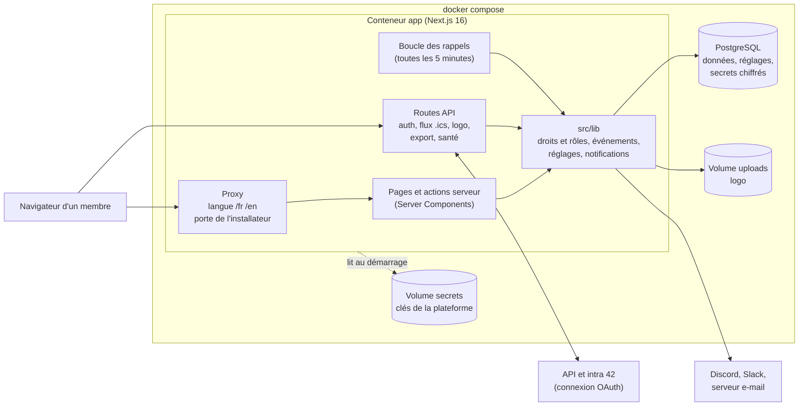
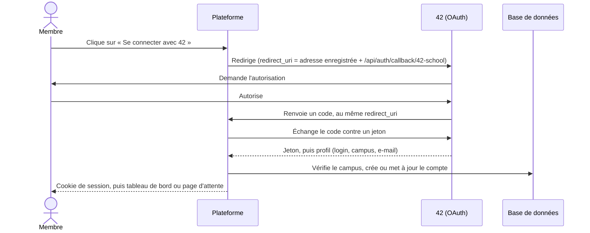

🇫🇷 Français · [🇬🇧 English](../en/contributing.md)

# Guide contributeur

Ce guide explique comment travailler sur le code : comment est construite la plateforme, comment monter un
environnement de développement, quelles commandes lancer, et comment mettre la documentation à jour. Les règles
générales (branches, pull requests, commits) sont dans [CONTRIBUTING.fr.md](../../CONTRIBUTING.fr.md).

Deux références complètent ce guide, en anglais : [l'architecture et les conventions](../architecture.md) (à lire
avant toute modification structurelle) et [le système de design](../design.md).

## Comment c'est construit

Une plateforme tient dans trois conteneurs Docker : l'application Next.js, PostgreSQL, et un petit conteneur qui
crée une fois le mot de passe de la base. L'application garde ses clés dans le volume `secrets`, le logo envoyé dans
le volume `uploads`, et tous ses réglages dans la base.



Les points à retenir :

- **Les réglages sont dans la base** (une ligne `PlatformSettings`). Ils sont chargés en mémoire au démarrage et à
  chaque modification : un changement s'applique tout de suite. Les secrets sont chiffrés avec une clé qui n'est pas
  dans la base.
- **La connexion est 42 seulement.** NextAuth garde un jeton de session qui ne contient que le login ; les droits
  sont relus dans la base à chaque requête, ce qui rend un retrait effectif immédiatement.
- **L'adresse de la plateforme vient des réglages**, jamais de l'adresse d'écoute du serveur.
- **Les droits sont vérifiés par le serveur** à chaque page et à chaque action ; masquer un bouton ne suffit jamais.

Voici le chemin d'une connexion :



## Mettre en place l'environnement

### Option A : tout dans Docker (recommandée)

```text
cp .env.example .env      # Copy-Item sous PowerShell
docker compose -f docker-compose.dev.yml up
```

Cela lance PostgreSQL, **Mailpit** (une boîte e-mail de test) et l'application en mode développement (`next dev`)
dans des conteneurs, avec le code monté en volume : vos modifications sont reprises à chaud. `node_modules` et
`.next` restent dans des volumes Docker nommés, pour éviter les binaires natifs incompatibles entre votre système et
le conteneur Linux. Le schéma Prisma et les **comptes de démonstration** sont appliqués à chaque démarrage : une seule
commande suffit.

Sous Windows, si le rechargement à chaud ne réagit pas, vérifiez que `WATCHPACK_POLLING=true` est actif (c'est la
valeur par défaut de `docker-compose.dev.yml`).

### Option B : Node.js en local, PostgreSQL dans Docker

Prérequis : Node.js 22 ou plus, npm.

```text
cp .env.example .env
docker compose -f docker-compose.dev.yml up postgres mailpit -d
npm install
npm run db:migrate
npm run dev
```

La plateforme est sur <http://localhost:3000>. Pour recevoir les e-mails dans Mailpit, mettez dans `.env`
`SMTP_HOST=localhost`, `SMTP_PORT=1025` et `SMTP_FROM=bde@localhost` (dans l'option A, c'est déjà fait).

### Réglages de développement

Le développement se comporte comme un vrai serveur : les réglages sont dans la base. Au premier démarrage, si
`bde.config.yml` (ou `bde.config.local.yml`, ignoré par Git, qui le remplace en entier) et `.env` sont complets, ils
sont **copiés dans la base de développement**. S'ils ne le sont pas, l'installateur s'ouvre, avec son code dans le
terminal.

Pour la copie, mettez votre login 42 dans `auth.owners` et, dans `.env`, les identifiants d'une application 42 dont
l'URL de redirection est `http://localhost:3000/api/auth/callback/42-school`. Ensuite, modifier les fichiers ne
change plus rien : ajoutez `BDE_REIMPORT=1` dans `.env` pour les relire à chaque démarrage, ou repartez d'une base
neuve avec `docker compose -f docker-compose.dev.yml down -v`. Voir [Configuration](configuration.md).

### Les comptes de démonstration

`npm run seed:demo` crée des rôles et des comptes fictifs (`demo-owner`, `demo-admin`, `demo-president`,
`demo-secretary`, `demo-member1`, `demo-member2`, `demo-member3`, `demo-pending`) et, si le module est activé, une
quinzaine d'événements relatifs à la date du jour (passé, semaine en cours, séries aux règles de répétition variées, week-end sur plusieurs jours,
brouillons, et deux événements proposés par `demo-member3`, qui ne fait que proposer : l'un attend sa validation,
l'autre a été refusé).
Le relancer réécrit les données sans doublon. `SEED_LOCALE=en` les écrit en anglais.

### Essayer les rôles

Avec `ENABLE_DEV_IMPERSONATION=true` dans `.env`, connectez-vous avec le propriétaire : un bandeau en haut de page
permet de voir la plateforme comme « en attente » ou avec n'importe quel rôle. Cette fonction n'existe qu'en
développement, jamais en production.

### Voir les e-mails : Mailpit

En développement, aucun e-mail ne sort de votre machine : la plateforme les envoie à
[Mailpit](https://mailpit.axllent.org), qui les garde et les affiche sur <http://localhost:8025> (rendu HTML, version
texte, fichier `.ics`, test de compatibilité des messageries). Mettez le canal d'une notification sur `email` dans
votre `bde.config.local.yml`, puis redémarrez, et déclenchez-la (confirmez un événement, approuvez un membre…).
`APP_URL=http://localhost:3000` dans `.env` fait apparaître le logo.

Pour envoyer par un vrai serveur SMTP, renseignez `DEV_SMTP_HOST`, `DEV_SMTP_PORT`, `DEV_SMTP_FROM` (et
`DEV_SMTP_USER`, `DEV_SMTP_PASSWORD`) dans `.env` : ils remplacent Mailpit.

## Commandes utiles

| Commande                                      | Effet                                                          |
| --------------------------------------------- | -------------------------------------------------------------- |
| `npm run dev`                                 | Serveur de développement Next.js                               |
| `npm run build`                               | Construction de production                                     |
| `npm run lint` / `npm run lint:fix`           | ESLint                                                         |
| `npm run format` / `npm run format:check`     | Prettier                                                       |
| `npm run lint:md`                             | markdownlint sur la documentation                              |
| `npm run docs:check`                          | Vérifie les liens internes et les ancres de la documentation   |
| `npm run typecheck`                           | Vérification TypeScript                                        |
| `npm run test` / `npm run test:watch`         | Tests Vitest                                                   |
| `npm run db:migrate`                          | Crée et applique une migration Prisma (développement)          |
| `npm run db:studio`                           | Interface graphique de la base (Prisma Studio)                 |
| `npm run seed:demo`                           | Écrit les données de démonstration                             |
| `npm run audit:prod`                          | Alertes de sécurité des dépendances de production              |
| `./scripts/backup.sh`, `./scripts/restore.sh` | Sauvegarde et restauration (voir [Déploiement](deployment.md)) |

Les scripts npm sont portables : aucun opérateur propre à Unix ou à Windows. Ils marchent à l'identique dans
PowerShell, cmd, bash et zsh.

## Avant d'ouvrir une pull request

```text
npm run lint
npm run format:check
npm run typecheck
npm run test
npm run build
```

Si vous touchez à la documentation, lancez aussi `npm run lint:md` et `npm run docs:check`. `npm run test:coverage` lance les
tests avec leur couverture : la CI échoue sous les seuils de `coverage-thresholds.json`, donc une nouvelle fonctionnalité
arrive avec ses tests. La CI lance tout cela
(`.github/workflows/ci.yml`), sur Ubuntu et sur Windows.

## La campagne qualité

Au-delà des tests unitaires, `qa/` contient le socle des suites de qualité : neuf **profils** (visiteur, compte en attente,
membre, proposeur, validateur, rôle personnalisé, Admin, propriétaire, membre retiré), un **jeu de données** déterministe de
deux années scolaires (environ 300 membres et 600 événements), les **invariants** que toute base de données doit respecter,
et un script qui démarre l'image de production avec tout cela. Avec Docker et Node, depuis le dossier du projet :

```text
docker build -t bde-network .
sh qa/platform.sh up
eval "$(sh qa/platform.sh env)"
npx tsx qa/smoke.ts
sh qa/platform.sh down
```

Les suites lourdes tournent toutes les nuits et à la demande (**Actions → qa**), pas à chaque pull request ; une pull request
peut les demander avec l'étiquette `full-qa` ; l'étiquette `qa-mutations` joue le contrôle par mutation des attaques (une construction d'image par mutation, donc jamais sur votre ordinateur). L'apparence des pages est comparée à des images de référence (`visual references` dans le workflow `qa` ; les références sont faites par le workflow `qa visual references`, que vous lancez à la main ou avec l'étiquette `visual-references`, et sont sur la branche `qa/visual-baselines`). Les parcours de la plateforme, et son accessibilité (axe sur chaque page, puis le clavier), sont joués dans Chromium, Firefox et WebKit par `qa/browsers` (Playwright) : après `sh qa/platform.sh up` et `eval "$(sh qa/platform.sh env)"`, `npx playwright install firefox` puis `npx playwright test -c qa/browsers --project=firefox` joue un moteur sur votre ordinateur. Le détail est dans l'[architecture](../architecture.md#quality-campaign-qa-githubworkflowsqayml).

## Conventions de code

Voir [l'architecture](../architecture.md). En résumé :

- TypeScript strict, aucun `any`.
- Commits [Conventional Commits](https://www.conventionalcommits.org/fr/), atomiques.
- Tout texte visible passe par next-intl (`messages/fr.json` et `messages/en.json`), jamais en dur dans un composant.
- Les composants `src/components/ui/` sont générés par shadcn/ui : ne les modifiez pas à la main.
- Un module qui ajoute des droits les déclare dans `src/lib/permissions/registry.ts` (voir l'architecture).

## La documentation

La documentation vit dans `docs/fr/` et `docs/en/`, avec **les mêmes fichiers dans les deux langues**. Une page
modifiée dans une langue se modifie dans l'autre, dans la même pull request. Chaque page commence par un lien vers
l'autre langue.

- **Le vocabulaire est fixé** par le [glossaire](glossary.md) et par l'interface (`messages/*.json`). Un même mot
  désigne toujours la même chose.
- **Chaque affirmation se vérifie dans le code.** Une documentation qui se trompe, même un peu, fait perdre
  confiance.
- **Phrases courtes**, « vous », pas de jargon sans explication.
- `docs/architecture.md` et `docs/design.md` sont des références techniques, en anglais seulement.
- **Les captures** se refont avec `node scripts/docs-screenshots.mjs` (voir l'en-tête du script) : elles montrent
  l'interface actuelle, avec des données de démonstration, en thème clair, en français et en anglais.
- Lancez `npm run lint:md` et `npm run docs:check` : la CI vérifie le style, les liens internes et les ancres à
  chaque pull request, et les liens externes toutes les semaines.

## Dépendances

- **NextAuth v5 est en beta, et c'est assumé.** La v5 n'existe que sous le tag `beta` de npm. Elle apporte l'aide
  universelle `auth()`, sur laquelle repose toute l'authentification. La version est **épinglée exactement** : aucune
  mise à jour ne passe sans qu'on l'ait choisie. Pour la changer, lisez les notes de version, lancez `npm test` (en
  particulier `src/lib/auth/removed-account.test.ts`), puis changez **ensemble** `next-auth` et `@auth/core`.
- **`next` et `eslint-config-next`** sont épinglés à la même version et se mettent à jour ensemble.
- **`nodemailer`** : NextAuth déclare une dépendance optionnelle sur nodemailer 7 ou 8, que ce projet n'utilise pas.
  Le champ `overrides` de `package.json` l'aligne sur notre version.
- **Audit de sécurité** : `npm run audit:prod` (lancé par la CI) échoue sur une nouvelle alerte haute ou critique. Les
  rares alertes sans correctif applicable sont dans `scripts/audit-allowlist.json`, avec leur raison.
- **Dependabot** propose chaque lundi un seul lot de mises à jour mineures et de correctifs. Les versions majeures
  se traitent à la main, une par une.
- Après avoir touché à `package-lock.json`, vérifiez-le avec `npx -y npm@10 ci --dry-run` (la CI utilise npm 10).

## Base de données : les migrations

```text
npm run db:migrate       # crée et applique une migration à partir de schema.prisma
npm run db:push          # applique le schéma sans migration (prototypage)
npm run db:studio        # explorateur de données
```

Commitez toujours le dossier `prisma/migrations/` généré. La production applique les migrations avec
`prisma migrate deploy` ; l'environnement de développement utilise `prisma db push`.
