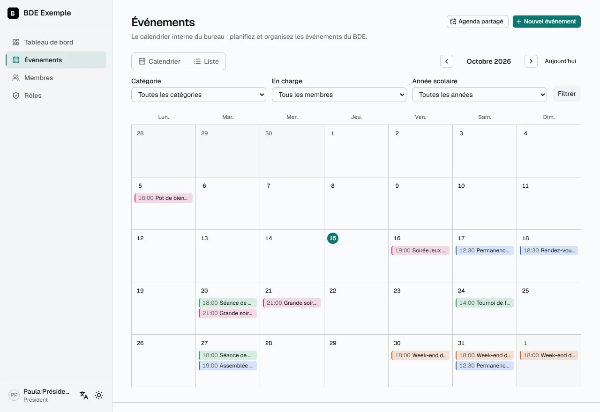
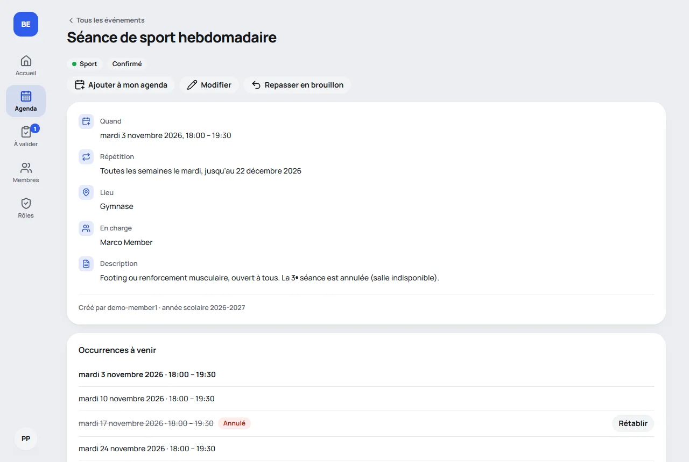
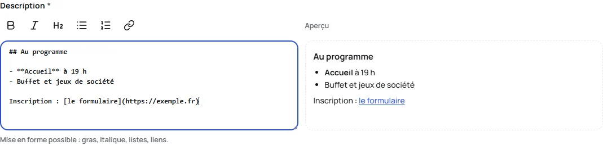
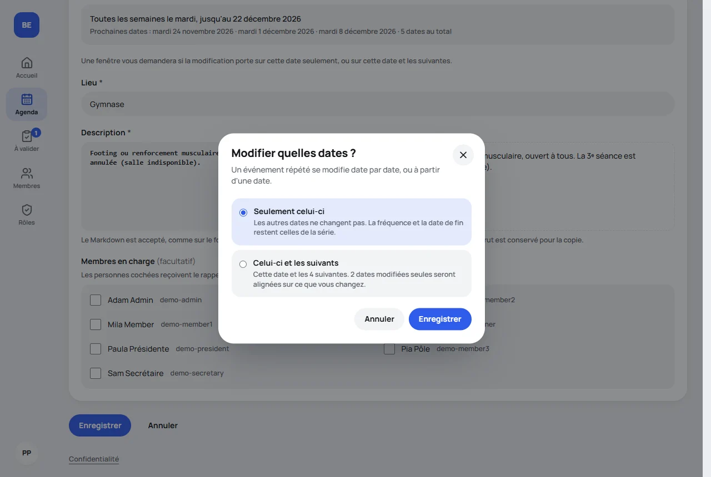

🇫🇷 Français · [🇬🇧 English](../en/events.md)

# Module Événements

Le calendrier **interne** du bureau : on y planifie et on y organise les événements du BDE. L'intra 42 reste l'outil
public où les étudiants s'inscrivent : ce module n'a donc ni inscriptions, ni liste d'attente, ni pointage.

## Activer le module

Le module est activé par défaut à l'installation. Pour l'activer ou le désactiver ensuite : **Paramètres**, section
**Modules**. Pour régler ses catégories et l'heure du rappel : section **Événements**
([détails](configuration.md#les-événements)).

Tant que le module est désactivé, il n'existe pas : aucune page, aucun lien dans le menu, aucun bloc sur le tableau
de bord, aucun rappel.

## Qui peut faire quoi

Les droits viennent du **rôle** du membre (voir [Rôles et droits](roles.md)). Quatre droits concernent ce module.

| Action                                               | Consulter |                  Proposer                  |           Valider            | Gérer l'agenda partagé | Propriétaire |
| ---------------------------------------------------- | :-------: | :----------------------------------------: | :--------------------------: | :--------------------: | :----------: |
| Voir les événements **confirmés**                    |    oui    |                    oui                     |             oui              |          oui           |     oui      |
| Voir les **brouillons** et les **propositions**      |    non    |          **les siens** seulement           |             tous             |          non           |     oui      |
| Créer un événement                                   |    non    |         oui, comme **proposition**         | oui, brouillon ou **publié** |          non           |     oui      |
| Modifier ou supprimer un événement                   |    non    | **les siens**, tant qu'il n'est pas publié |             tous             |          non           |     oui      |
| Valider ou refuser une proposition                   |    non    |                    non                     |             oui              |          non           |     oui      |
| Confirmer, repasser en brouillon, annuler une date   |    non    |                    non                     |             oui              |          non           |     oui      |
| Ajouter un événement à son agenda, s'abonner au flux |    oui    |                    oui                     |             oui              |          oui           |     oui      |
| Gérer le lien d'agenda du **BDE**                    |    non    |                    non                     |             non              |          oui           |     oui      |

« Proposer » inclut « Consulter » ; « Valider » inclut « Proposer » et « Consulter ». Le propriétaire a toujours accès
à tout. Chaque création, modification ou attribution de rôle est inscrite au journal d'audit.

Ces règles sont vérifiées **côté serveur**, sur chaque page et chaque action : masquer un bouton n'est jamais la
seule protection. Un brouillon ou une proposition auxquels vous n'avez pas droit ne sont pas « interdits » : ils sont
introuvables.

## Créer un événement

**Événements** → **Nouvel événement**, ou, plus vite, **depuis le calendrier** :

- **Sur ordinateur**, un **+** apparaît dans le coin d'un jour quand vous le survolez (et quand le clavier l'atteint :
  Tab, juste après le jour lui-même ; sur un écran tactile, il est toujours là). Il ouvre le formulaire **sur ce
  jour-là**.
- **Sur téléphone**, touchez un jour, puis **Ajouter ce jour-là** sous le calendrier.

Le formulaire démarre alors de **18 h à 20 h** ce jour-là (fuseau du BDE), que vous ajustez comme n'importe quelle
date. Sans jour (le bouton **Nouvel événement**), il démarre de demain, 18 h à 20 h. Un jour passé est accepté, pour
enregistrer un événement après coup. **Annuler** ramène à ce jour du calendrier. Ces raccourcis n'existent que pour
ceux qui peuvent créer des événements (proposer ou valider) : les autres ne les voient pas, et le formulaire leur est
refusé s'ils en tapent l'adresse.

- **Titre, début, fin, lieu, description** : les heures sont saisies et affichées dans le fuseau du BDE, quel que
  soit celui de votre navigateur.
- **Catégorie** : une de celles que le BDE a définies dans Paramètres.
- **Membres en charge** : un ou plusieurs membres, **facultatif**. Ce sont eux qui reçoivent le rappel de la veille
  par e-mail. Sans personne en charge, le rappel part aux **propriétaires et aux membres dont le rôle permet de
  valider les événements** : il n'est jamais envoyé à personne.
- **Statut** : un **brouillon** n'est visible que de son auteur et de ceux qui peuvent valider les événements.
  **Confirmer** l'événement le rend visible de tous les membres et déclenche la notification de confirmation. Ceux qui
  peuvent seulement proposer choisissent entre un brouillon et **en attente de validation**, voir
  [plus bas](#proposer-et-valider-des-événements).

### Les champs obligatoires

Six champs sont obligatoires, repérés par un `*` : **titre, début, fin, lieu, description et catégorie**. Pour une
série, la **fin** (une date de fin, ou un nombre de dates) l'est aussi. Seuls les membres en charge sont facultatifs. Un texte fait
uniquement d'espaces compte comme vide.

La vérification se fait deux fois, avec les mêmes règles : dans le formulaire (le message s'affiche sous le champ
concerné) puis sur le serveur, avant tout enregistrement.

Les événements créés **avant** cette règle, avec un lieu ou une description vide, s'affichent normalement. Ils ne
sont bloqués qu'à leur **prochaine modification** dans le formulaire, qui demandera de remplir ces champs.
Confirmer, repasser en brouillon et annuler une date restent possibles.

### Mettre en forme la description

La description peut être mise en forme : une barre de boutons au-dessus du champ donne le **gras**, l'_italique_, un titre, une liste à puces, une liste numérotée et un lien ; sélectionnez du texte puis appuyez sur le bouton, ou faites **Ctrl** (**Cmd** sur Mac) + **B** ou **I**. Le bouton agit sur la sélection, un second appui enlève la mise en forme, et l'annulation (**Ctrl+Z**) reprend le travail d'un bouton. À côté du champ (sous le champ sur téléphone, derrière l'onglet **Aperçu**), le formulaire dessine ce que la description donnera. Derrière les boutons, le texte est du Markdown (`# titre`, `**gras**`, `*italique*`, `- liste`, `1. liste numérotée`, `> citation`, `[lien](https://…)` et `code`), que l'on peut aussi taper à la main, et il est conservé **exactement comme tapé** : il se copie tel quel.
Une balise écrite à la main, une image ou un lien qui n'est pas `http`, `https` ou `mailto` s'affiche comme du texte et ne s'exécute jamais.

### Les champs de l'intra

Quand la plateforme **publie les événements sur l'intra** (un propriétaire l'active dans Paramètres, section Événements, voir
[Configuration](configuration.md#les-événements)), le formulaire a un second bloc, **Publication sur l'intra 42** : ce que le staff de l'école
copie dans le formulaire d'événement de l'intra, sous les mêmes noms. Les sept champs sont obligatoires :

- **Login de l'organisateur** : prérempli avec le login de l'auteur, modifiable.
- **Disponible pour** : étudiants, piscineux ou les deux.
- **Nombre maximum de personnes** et **liste d'attente** (oui ou non).
- **Genre** : un de ceux de l'intra (Pedago/Rush, Pedago/Piscine, Pedago/Partnership, Meet/Conference, Meet/meet_up,
  Meet/event, Association, Speed working/Hackathon, Speed working/Workshop, Speed working/Challenge, Extern).
- **Délai avant de ne plus pouvoir se désinscrire**, en heures avant le début.
- **Mots-clés** : au moins un, ajoutés avec Entrée ou une virgule.

Ils appartiennent à **toute la série** : sur une série, ils sont enregistrés avec « celui-ci et les suivants » (modifier une seule
date ne les touche pas). Les événements écrits **avant** ce bloc continuent de fonctionner : le formulaire demande les champs à leur
prochaine modification, et **aucun événement n'est confirmé sans eux** : confirmer depuis la page de l'événement ou depuis « À valider » affiche
un message qui demande de le modifier d'abord. Repasser en brouillon, proposer et annuler une date restent possibles. Les champs
s'affichent sur la page de l'événement pour ceux qui peuvent créer des événements et pour ceux qui suivent les publications (voir
[Publier sur l'intra](#publier-sur-lintra)).

L'**année scolaire** (par exemple `2025-2026`) est calculée toute seule : de septembre à août, d'après la date de
début. Une série appartient à l'année scolaire de sa première date.

## Proposer et valider des événements

Certains rôles (un « Pôle Events », par exemple) peuvent **proposer** des événements sans pouvoir les publier ; d'autres
rôles **valident** : ils valident ou refusent ce qui est proposé. Vous choisissez qui est qui dans
[Rôles et droits](roles.md) : le droit **Proposer des événements** et le droit **Valider les événements**.

Un événement passe par trois statuts :

| Statut                       | Ce que cela veut dire                                 | Qui le voit                     |
| ---------------------------- | ----------------------------------------------------- | ------------------------------- |
| **Brouillon**                | En cours de travail, ou proposition qui a été refusée | Son auteur et ceux qui valident |
| **En attente de validation** | Proposé : un validateur doit répondre                 | Son auteur et ceux qui valident |
| **Confirmé**                 | Publié                                                | Tous les membres                |

### Proposer

- Dans le formulaire de quelqu'un qui peut seulement proposer, le statut est **En attente de validation** (présélectionné)
  ou **Brouillon**. Il n'y a aucun moyen de confirmer : le serveur le refuse même si la requête est falsifiée.
- Sur la page d'un brouillon, **Proposer à la validation**. Sur la page d'une proposition, **Retirer la proposition**
  (elle repasse en brouillon).
- Un proposeur modifie et supprime **ses propres événements tant qu'ils ne sont pas publiés** : un brouillon, une
  proposition, un événement refusé. Pour une série, toujours la série entière : il n'y a pas de choix de dates.
- **Une fois l'événement publié, son proposeur ne peut plus le modifier**, pas même le sien : à la place du bouton
  **Modifier**, la page l'explique. Un événement publié ne disparaît donc jamais du calendrier sans l'action d'un
  validateur. Pour corriger quelque chose, demandez à un validateur : il modifie librement, et l'événement reste publié.

### Valider

- L'entrée **À valider** du menu (réservée à ceux qui valident) indique combien de propositions attendent. La page les
  liste, les plus anciennes d'abord, chacune avec **Valider** et **Refuser**.
- **Valider** publie l'événement, comme le ferait une confirmation : les membres sont prévenus une seule fois.
  L'auteur l'est aussi, si la notification `eventApproved` est activée.
- **Refuser** demande un **commentaire** (obligatoire, 1000 caractères au plus). L'événement repasse en brouillon ; son
  auteur lit le commentaire sur l'événement lui-même et le reçoit en notification (`eventRefused`). Il modifie
  l'événement, puis le propose de nouveau : le refus disparaît. Une série est refusée en entier.
- Depuis la page de l'événement, vous pouvez faire la même chose. Une proposition ne repasse pas en brouillon sans
  commentaire : on la refuse. Si deux validateurs répondent à la même proposition, le second est prévenu que quelqu'un
  d'autre l'a déjà fait.
- Un validateur modifie librement tout événement, brouillons et propositions des autres compris.

### Séries et brouillons

Une proposition est **l'événement entier**, série comprise. Une fois validée, les dates d'une série se gèrent comme
d'habitude (voir plus bas). Une date de série confirmée toute seule rend l'événement en partie publié : son proposeur ne
peut plus le modifier non plus.

## Publier sur l'intra

Quand la plateforme publie les événements sur l'intra, le **staff** de l'école met chaque événement confirmé sur l'intra 42 à la
main : la plateforme lui dit quoi publier, il le recopie sur l'intra, puis répond. Le staff a un compte 42 comme
n'importe quel membre, approuvé par le BDE, avec un rôle qui détient le droit **Publier sur l'intra** (voir
[Rôles et droits](roles.md)).

### La demande

- **Confirmer un événement envoie la demande.** Une série est **une seule demande** avec la liste de ses dates (une date
  confirmée toute seule fait une demande pour cette date seulement, jusqu'à ce que le reste soit confirmé aussi). Repasser en
  brouillon, supprimer l'événement ou annuler toutes ses dates retire la demande.
- Un événement confirmé **avant** que la plateforme publie sur l'intra, ou dont la demande a été retirée, n'en a pas. Sur sa page,
  **Publication sur l'intra** le dit et propose **Demander la publication** à ceux qui en ont le droit (valider les événements
  le donne déjà).
- Où elle en est s'affiche sous forme de statut, sur la page de l'événement et dans la liste du staff :

| Statut              | Ce que ça veut dire                                                                  |
| ------------------- | ------------------------------------------------------------------------------------ |
| **À publier**       | Envoyée, en attente du staff.                                                        |
| **Publié**          | Sur l'intra, et l'événement n'a pas changé depuis.                                   |
| **À mettre à jour** | Sur l'intra, mais l'événement a changé depuis : le staff doit mettre l'intra à jour. |
| **Refusé**          | Le staff l'a refusée, avec une raison ; elle peut être renvoyée.                     |

### Ce que fait le staff

L'entrée **À publier sur l'intra** du menu compte ce qui attend (une première publication, ou une mise à jour). La liste montre
d'abord ce qui attend, le plus ancien en premier, puis ce qui a reçu une réponse. La page d'une demande donne l'événement
**dans un ordre fixe**, chaque champ avec un bouton **Copier** : le login de l'organisateur, le nom, à qui il
est ouvert, la date de début, l'heure de début, la date de fin, l'heure de fin, la description (telle que tapée, en Markdown),
le lieu, le nombre maximum de personnes, la liste d'attente, le genre, le délai de désinscription et les mots-clés. Les dates
s'écrivent **JJ/MM/AAAA** et les heures **HH:mm**, dans le fuseau horaire du BDE, quelle que soit la langue de l'interface. Une
série liste ses dates l'une après l'autre, chacune avec ses quatre valeurs à copier.

Puis le staff répond :

- **Publié sur l'intra**, avec l'adresse de l'événement sur l'intra s'il veut la garder (une adresse `https` de `intra.42.fr` :
  toute autre est refusée) ;
- **Refuser**, avec une raison (obligatoire, 1000 caractères au plus) : l'auteur la lit sur la page de l'événement, et la demande
  peut être **renvoyée** par ceux qui ont le droit d'en demander, une fois l'événement corrigé.

La première réponse l'emporte : si quelqu'un a répondu avant, la page le dit et rien n'est modifié. Une réponse est aussi refusée
quand l'événement a changé pendant que la page était ouverte (la page vérifie que vous avez vu la dernière version) : regardez
les nouvelles valeurs, puis répondez de nouveau.

### Qui est prévenu

La page et le compteur du menu sont toujours justes ; les **messages** s'y ajoutent quand le BDE les a cochés (voir [Messages sur la
publication sur l'intra](notifications.md#messages-sur-la-publication-sur-lintra)) : le staff est prévenu d'une demande, d'un changement
et d'un événement retiré ; l'auteur et le salon du BDE sont prévenus que l'événement est publié ou refusé.

### Quand l'événement change

Un événement qui est sur l'intra puis change (titre, description, lieu, dates, ou n'importe quel champ de l'intra) passe à
**À mettre à jour**. La page de la demande montre alors **ce que l'intra contient et ce que l'événement est devenu**, champ par
champ, avec les dates à retirer et à ajouter. Une fois l'intra à jour, **Intra mis à jour** remet la demande à _Publié_. Un
changement qu'on annule ne demande rien : la demande revient à _Publié_ toute seule. Ce qui n'est pas sur l'intra (la
catégorie, les membres en charge) ne change rien.

Une série coupée en deux (« celle-ci et les suivantes ») poursuit la demande sur la nouvelle ligne : les deux sont _À mettre à jour_
si ce que contient l'intra n'est plus ce qu'elles disent.

Tout est dans le [journal d'audit](#journal-daudit) : qui a demandé, qui a répondu, et, pour un événement qui a changé, que sa
demande est _À mettre à jour_.

## Les événements qui se répètent

Dans le formulaire, **Répétition** propose les choix usuels, **formulés d'après la date de début** saisie. Pour un
événement qui commence le samedi 10 octobre :

- _Ne se répète pas_ (par défaut)
- _Tous les jours_
- _Tous les jours de la semaine (du lundi au vendredi)_
- _Toutes les semaines le samedi_
- _Tous les mois le 10_
- _Tous les mois le 2ᵉ samedi_ (quand la date de début est un cinquième samedi, que tous les mois n'ont pas, il est
  écrit _le dernier samedi_)
- _Tous les ans le 10 octobre_
- _Personnalisée…_

Changez la date de début et les formulations suivent. Tout le reste est **Personnalisée**.

### La répétition personnalisée

_Personnalisée…_ ouvre un panneau : **Répéter tous les** un nombre (de 1 à 99) de jours, de semaines, de mois ou d'ans.

- Pour les **semaines**, cochez les **jours de la semaine** : _toutes les 2 semaines le lundi et le mercredi_. Il en
  faut au moins un. Le panneau part du jour de la semaine de la date de début.
- Pour les **mois** et les **ans**, choisissez **quel jour** : le jour du mois (_le 10_), le même jour de la semaine
  du mois (_le 2ᵉ samedi_, non proposé quand la date de début est un cinquième), le dernier de ces jours (_le dernier
  samedi_), ou _le dernier jour du mois_. Une série annuelle tombe dans le mois de la date de début.

### La fin d'une série

Sous _Fin de la répétition_, choisissez l'une des deux façons :

- **Le** une date : ce jour est inclus, une date qui commence ce jour-là compte encore.
- **Après** un nombre d'occurrences (de 1 à 400) : _toutes les 2 semaines le lundi et le mercredi, 10 fois_.

### L'aperçu

Dès qu'une répétition est choisie, le formulaire montre, sous les champs, **ce qu'elle va faire** avant tout
enregistrement : la règle en une phrase (_Toutes les 2 semaines le lundi et le mercredi, 10 fois_), les **trois
prochaines dates** et le **nombre de dates** au total. Quand la date de début saisie n'est pas un des jours de la règle,
un encadré au-dessus dit quel jour la série commencera (voir plus bas). La même phrase figure sur la page de l'événement, dans les
propositions à valider et dans les notifications. Si quelque chose ne va pas (une fin avant la première date, aucun
jour coché…), l'aperçu dit quoi, avec les mêmes mots que le message sous le champ.

### Les règles à connaître

- **La série commence au premier jour qui correspond à la règle.** Un événement saisi le vendredi 23 octobre et
  répété _toutes les 2 semaines le lundi et le mercredi_ commence le **lundi 26 octobre**. Le formulaire le dit dans un
  encadré d'information au-dessus de l'aperçu (_Le 23 octobre ne correspond pas à cette règle : la série commencera le
  lundi 26 octobre._), avec un bouton (_Commencer le 26 octobre_) qui change la date de début à votre place en gardant
  l'heure et la durée ; si vous ne l'utilisez pas, l'événement est enregistré avec ce lundi quand même. Il en va de
  même pour une règle mensuelle ou annuelle (_le 15_ saisi le 20 commence le 15 du mois suivant).
- **Les semaines commencent le lundi, et l'intervalle se compte à partir de la première date de la série.** Avec
  _toutes les 2 semaines_, la semaine de la première date est la première d'entre elles. La série du vendredi
  ci-dessus donne les 26 et 28 octobre, puis les 9 et 11 novembre, puis les 23 et 25 novembre… De même, _tous les
  2 mois_ compte les mois à partir du premier mois qui a ce jour, et _tous les 2 ans_ les années à partir de la
  première année qui l'a. Une série dont la date de début est déjà un jour de la règle n'est pas touchée : elle garde
  les dates qu'elle a toujours eues.
- **Un jour que le mois n'a pas devient son dernier jour.** Un événement le 31 tombe le 30 avril, le 28 février… et le
  29 février il tombe le 28 les années qui n'en ont pas. Une série coupée un de ces jours garde son jour : les dates
  suivantes retombent le 31.
- **L'heure locale est conservée à travers les changements d'heure** : une séance « chaque mardi à 18 h » reste à
  18 h toute l'année. Quand une date tombe à une heure qui n'existe pas (2 h 30 la nuit du passage à l'heure d'été),
  elle s'affiche une heure plus tard, comme dans tous les agendas ; si la série est coupée exactement à cette date,
  les dates suivantes gardent cette heure.
- **Un événement compte 400 dates au plus**, et le formulaire le dit (_Au plus 400 dates pour un événement : au-delà,
  coupez la série en deux_). Une série coupée en deux, voir plus bas, compte chaque partie séparément.
- **Une série qui se termine après un nombre de dates** s'arrête là où commence sa dernière date.

Les séries créées avant les règles de répétition n'ont pas été touchées : chaque _Chaque semaine_, _Toutes les 2
semaines_ et _Chaque mois_ est devenu la règle équivalente, et **aucune date n'a bougé** : les agendas qui les ont
déjà ne voient aucun changement.

### Une date, ou cette date et les suivantes

Sur la page d'une série, choisissez une date dans la liste des dates (celle qui est affichée est en gras). Ensuite,
**chaque action demande quelles dates elle concerne**, dans une fenêtre, avec deux choix :

- **Seulement celui-ci** : cette date change, les autres non. C'est le choix déjà sélectionné.
- **Celui-ci et les suivants** : cette date et toutes celles qui viennent après. **Sur la première date, c'est toute
  la série.** La fenêtre dit combien de dates cela représente.

C'est la même fenêtre pour **modifier** (heure, lieu, description, catégorie, membres en charge…), **confirmer**,
**repasser en brouillon** et **supprimer**. Un événement qui ne se répète pas n'a pas cette question.

| Action                    | Seulement celui-ci                                                                                                                                                                                                                       | Celui-ci et les suivants                                                                                                                                                                                          |
| ------------------------- | ---------------------------------------------------------------------------------------------------------------------------------------------------------------------------------------------------------------------------------------- | ----------------------------------------------------------------------------------------------------------------------------------------------------------------------------------------------------------------- |
| **Modifier**              | La date reçoit **ses propres valeurs** : seulement ce que vous avez changé, le reste continue de suivre la série. Vous pouvez la déplacer à une autre heure ou un autre jour. La fréquence et la date de fin restent celles de la série. | La série est **coupée en deux** à cette date : les dates d'avant restent comme elles étaient, cette date et les suivantes reçoivent vos changements, et vous pouvez changer aussi la fréquence et la date de fin. |
| **Confirmer**             | Cette date est confirmée toute seule et annoncée aux membres, une fois.                                                                                                                                                                  | Cette date et les suivantes sont confirmées, **y compris celles qui étaient repassées en brouillon** (la fenêtre dit combien), et annoncées en **un seul message**.                                               |
| **Repasser en brouillon** | Cette date disparaît pour les membres et du lien d'agenda du BDE. Les autres restent.                                                                                                                                                    | Cette date et les suivantes repassent en brouillon.                                                                                                                                                               |
| **Supprimer**             | La date est **annulée** : elle reste dans la liste, barrée, et vous pouvez la **rétablir**.                                                                                                                                              | La série **s'arrête à la date d'avant**. C'est définitif : les dates suivantes, avec ce qui avait été modifié dessus, sont supprimées. Sur la première date, tout l'événement est supprimé.                       |

Dans la liste, une date qui a ses propres valeurs porte **Modifiée**, une date en brouillon porte **Brouillon**, une
date annulée est barrée.

### Ce que deviennent les dates modifiées toutes seules

Vous modifiez « celui-ci et les suivants » alors que certaines des dates suivantes avaient été modifiées seules. La
règle est celle de Google Agenda : **ce que vous changez remplace ce que ces dates avaient pour ce champ, ce que vous
ne touchez pas reste.**

- Vous changez le lieu : toutes les dates suivantes prennent le nouveau lieu, même celles qui avaient le leur. Une
  date qui avait aussi son propre titre garde son titre.
- Vous confirmez la suite : les dates qui étaient en brouillon sont confirmées aussi.
- Vous ne changez que l'**heure** : les dates modifiées seules, les dates annulées et les rappels déjà envoyés suivent
  la nouvelle heure, jour par jour.
- Vous changez le **jour** ou la **fréquence** (chaque mardi au lieu de chaque lundi, toutes les 2 semaines au lieu de
  chaque semaine) : les dates ne sont plus les mêmes, donc ce qui avait été modifié dessus, et les dates annulées, ne
  peuvent pas suivre et sont abandonnés.

La fenêtre indique combien de dates seront remises en accord.

### Une série coupée en deux

« Celui-ci et les suivants » sur une date qui n'est pas la première **coupe la série en deux parties**. La première
s'arrête à la date d'avant ; la seconde commence à cette date, avec sa propre page. Pour les membres et pour les
agendas, c'est toujours **une seule série** : chaque date garde son identifiant, donc un agenda qui a déjà les dates
les met à jour, sans doublon.

Une série qui se termine après un nombre de dates **les partage** : _10 fois_ coupée à la 5ᵉ date donne 4 dates à la
première partie et 6 à la seconde. Pour cette raison, le formulaire d'une date plus tardive indique **combien de dates
restent** (ici 6), et non le nombre total.

La seconde partie garde l'auteur, les membres en charge et le fait que la série a été annoncée (elle n'est pas
annoncée une seconde fois parce qu'on l'a coupée). Son année scolaire est celle de sa première date.

## Supprimer un événement

Le bouton **Supprimer** d'une page qui n'est pas une série supprime l'événement, définitivement. Pour une série, il
demande quelles dates (voir plus haut) : supprimer « celui-ci et les suivants » depuis la première date supprime toute
la série.

## Les vues

- **Calendrier mensuel** : la vue par défaut sur ordinateur. Chaque événement est coloré selon sa catégorie, les brouillons et les propositions sont en pointillés. Cliquez sur un jour pour le sélectionner, sur un événement pour
  l'ouvrir.
- **Liste** : la vue par défaut sur téléphone. Les événements à venir, dans l'ordre.
- **Sur téléphone**, si vous choisissez la vue **Calendrier**, la grille montre des pastilles de couleur par jour, et
  le jour choisi est détaillé en dessous.
- **Filtres** : catégorie, membre en charge, année scolaire. Ils sont dans l'adresse de la page, donc partageables.
- **Page de détail** : toutes les informations de la date affichée, les dates d'une série et les actions.

## Ajouter à son agenda

- **Un événement** : le bouton **Ajouter à mon agenda** de sa page télécharge un fichier `.ics`, lisible par tous les
  calendriers. Pour une série : la date affichée, ou toute la série. Une date modifiée ou déplacée reste la même
  entrée, mise à jour ; une date annulée, ou repassée en brouillon pour le lien du BDE, disparaît.
- **La synchronisation automatique** : menu de votre nom → **Mon profil** → **Synchroniser avec mon agenda**. Copiez
  le lien personnel et ajoutez-le à Google Agenda, Outlook ou Apple Calendar (voir
  [pas à pas](#ajouter-un-lien-à-son-agenda-pas-à-pas)). Les changements apparaissent ensuite tout seuls, au rythme
  de rafraîchissement de votre application d'agenda.
- **Un lien pour tout le BDE** : voir [plus bas](#le-lien-du-bde-agenda-partagé).

Le lien contient un **jeton secret propre à chaque membre** :

- il n'expose que ce que vous avez le droit de voir (jamais un brouillon sans le droit), vérifié à chaque requête :
  un droit retiré s'applique tout de suite ;
- il cesse de fonctionner **immédiatement** si vous êtes retiré du BDE ;
- vous pouvez le **régénérer** depuis votre profil (l'ancien lien ne marche plus) ;
- ne le partagez pas : quiconque l'a peut lire votre agenda.

## Le lien du BDE (agenda partagé)

Les liens personnels demandent à chaque membre de s'abonner lui-même. Pour simplifier, un membre qui a le droit
**Gérer l'agenda partagé** (ou un propriétaire) peut créer **un seul lien pour tout le BDE**, à coller **une seule
fois** dans l'agenda partagé du bureau. Il se met ensuite à jour tout seul. Les liens personnels ne changent pas.

- **Où** : **Événements** → bouton **Agenda partagé**. Il n'est visible que de ceux qui ont le droit « Gérer l'agenda
  partagé » et des propriétaires, même sans le droit de valider les événements.
- **Ce qu'il contient** : uniquement les dates **confirmées** et **non annulées**. Jamais de brouillon : une date
  repassée en brouillon en disparaît.
- **Ce que vous pouvez faire** : afficher le lien, le copier, le **régénérer** (l'ancien lien cesse de fonctionner
  immédiatement), le **désactiver**. Chaque action est inscrite au journal d'audit. Le lien lui-même n'y figure
  jamais, ni dans les journaux du serveur.
- **Si le lien est régénéré ou désactivé**, l'agenda abonné ne se met plus à jour : collez le nouveau lien et
  supprimez l'ancien abonnement.

### Quand un membre quitte le BDE

Le lien est un secret partagé : quiconque l'a copié peut lire l'agenda. Quand vous retirez un membre alors qu'un lien
du BDE est actif, la page **Membres** vous propose aussitôt de **générer un nouveau lien**, avec une phrase qui
explique pourquoi. Ce n'est **pas automatique** : régénérer oblige à recoller le lien dans l'agenda partagé, et
c'est à vous de choisir le bon moment.

> **Une limite à connaître.** Le lien sert à _alimenter_ un agenda ; il ne décide pas de **qui peut consulter cet
> agenda**. Si vous le collez dans un agenda partagé (un Google Agenda du BDE, par exemple), l'accès des anciens
> membres à **cet agenda** se gère **dans Google** (ou Outlook, Apple), pas dans la plateforme : retirez-les du
> partage. Régénérer le lien empêche seulement l'ancien lien de fonctionner. Ce qui a déjà été copié dans l'agenda
> abonné n'est pas effacé par la plateforme.

## Ajouter un lien à son agenda, pas à pas

C'est valable pour **le lien du BDE** comme pour **votre lien personnel**. Copiez d'abord le lien : il se termine par
`.ics`.

> **Patience.** Un agenda abonné n'est pas instantané. **Google peut mettre plusieurs heures** à le rafraîchir,
> parfois jusqu'à une journée, et Outlook aussi. C'est normal : un événement créé ou modifié n'apparaît pas tout
> de suite.

### Google Agenda

Faites-le **sur ordinateur** : l'application mobile ne propose pas cette option.

1. Ouvrez Google Agenda sur ordinateur, avec le compte Google concerné.
2. À gauche, à côté de « Autres agendas », cliquez sur le **+**.
3. Cliquez sur **À partir de l'URL**.
4. Collez le lien.
5. Cliquez sur **Ajouter l'agenda**.

L'agenda apparaît dans « Autres agendas », visible dans le compte qui l'a ajouté. Pour un agenda commun du bureau,
utilisez un compte Google partagé du BDE, ou faites ajouter le lien par chaque personne.

### Outlook

Sur Outlook.com ou le nouvel Outlook :

1. Ouvrez **Calendrier**.
2. Cliquez sur **Ajouter un calendrier**.
3. Choisissez **S'abonner à partir du web**.
4. Collez le lien, donnez un nom (par exemple « BDE »), puis cliquez sur **Importer**.

Sur Outlook classique pour Windows : **Fichier** → **Paramètres du compte** → **Paramètres du compte…** → onglet
**Calendriers Internet** → **Nouveau…**, puis collez le lien.

### Apple Calendar

Sur Mac :

1. Ouvrez **Calendrier**.
2. Menu **Fichier** → **Nouvel abonnement à un calendrier…**
3. Collez le lien, puis cliquez sur **S'abonner**.
4. Choisissez la fréquence de mise à jour, puis **OK**.

Sur iPhone ou iPad : **Réglages** → **Calendrier** → **Comptes** → **Ajouter un compte** → **Autre** → **Ajouter un
calendrier avec abonnement**, puis collez le lien.

## Notifications

Les canaux (e-mail, Discord, Slack : aucun, un ou plusieurs pour chaque notification) et leurs réglages se choisissent
dans **Paramètres**, section **Notifications**, avec un message de test pour chaque canal. Pour que les messages contiennent un lien vers l'événement,
renseignez l'adresse de la plateforme (section **Adresse de la plateforme**) : sans elle, les messages partent sans lien.

| Notification                        | Quand                                                                                                                                                         | Qui la reçoit                                                                               |
| ----------------------------------- | ------------------------------------------------------------------------------------------------------------------------------------------------------------- | ------------------------------------------------------------------------------------------- |
| **Confirmation** (`eventConfirmed`) | un événement passe de brouillon à **confirmé**, une seule fois ; pour une série, une fois pour la partie confirmée, ou une fois pour une date confirmée seule | tous les membres approuvés (e-mail : un message par personne), ou le salon Discord ou Slack |
| **Rappel** (`eventReminder`)        | la veille de chaque occurrence confirmée, à l'**heure du rappel** (18 h par défaut, heure du BDE)                                                             | les **membres en charge** (e-mail), sinon ceux qui valident les événements ; ou le salon    |
| **Proposition** (`eventProposed`)   | un événement est proposé (ou proposé de nouveau après un refus)                                                                                               | les propriétaires et ceux qui valident les événements (e-mail), ou le salon                 |
| **Validation** (`eventApproved`)    | un validateur valide une proposition                                                                                                                          | son auteur (e-mail), ou le salon                                                            |
| **Refus** (`eventRefused`)          | un validateur refuse une proposition                                                                                                                          | son auteur, avec le commentaire (e-mail), ou le salon                                       |

Le rendu sur Discord, Slack et par e-mail est décrit dans [Notifications](notifications.md).

L'envoi se fait **après** la réponse : un échec d'envoi n'empêche jamais d'enregistrer un événement. Par e-mail,
l'échec pour un destinataire n'empêche pas l'envoi aux autres. Il est écrit dans les journaux du serveur
(`[events] …`).

### Comment fonctionne le rappel de la veille

Il n'y a rien à installer : ni cron, ni tâche planifiée, ni service externe. Au démarrage, le serveur lance une
petite boucle interne qui vérifie **toutes les 5 minutes** si un rappel est dû. Cela fonctionne de la même façon
sous Windows, Linux, macOS et Docker.

Un rappel est **dû** à partir de l'heure du rappel, la veille de l'occurrence, et reste envoyable tant que
l'événement n'a pas commencé. Le message dit « demain ». Quand il part le jour même (rattrapage après une panne), il
dit « aujourd'hui ».

**Il n'est jamais envoyé deux fois**, même après un redémarrage ou avec deux instances : avant d'envoyer, le serveur
inscrit en base que ce rappel est « réclamé » pour cette occurrence précise. Seul celui dont l'inscription réussit
envoie. Conséquences :

- si le serveur était éteint à l'heure du rappel, le rappel part dès qu'il redémarre, tant que l'événement n'a pas
  commencé ;
- si le serveur plante _exactement_ entre l'inscription et l'envoi, ce rappel est perdu plutôt que doublé : on
  préfère un oubli rare à un doublon ;
- aucun rappel pour un brouillon, pour une date annulée, ni pour un événement confirmé _après_ l'heure du rappel (les
  membres viennent d'être prévenus) ;
- si le serveur reste éteint toute la journée jusqu'après le début de l'événement, le rappel est perdu : la
  plateforme doit tourner en continu.

Les événements qui se répètent sont rappelés date par date, **une seule fois par date**, quoi qu'il arrive à la
série : une date déplacée après l'envoi de son rappel n'est pas rappelée une seconde fois, et une série coupée en deux
garde les rappels déjà envoyés. Le rappel montre l'heure, le lieu et les membres en charge de cette date.

## Journal d'audit

Les propriétaires y voient la création, la modification (avec la liste des champs changés), la suppression, le
changement de statut, la **proposition** (`event.propose`), son **retrait**, sa **validation** et son **refus**
(avec le commentaire), l'annulation et le rétablissement d'une date, et les actions sur le lien du BDE (jamais le
lien lui-même). Pour une série, chaque entrée dit si l'action portait sur **une date** ou sur **cette date et les
suivantes**, et laquelle (pour la première date : que c'était toute la série). L'auteur est le compte réel, écrit en texte : il reste lisible même si le membre est retiré ensuite.

## Un problème ?

Un rappel n'est pas parti, un agenda ne se met pas à jour, le lien du BDE répond « Not found » : voir
[Problèmes fréquents](troubleshooting.md#les-événements-et-les-agendas).
