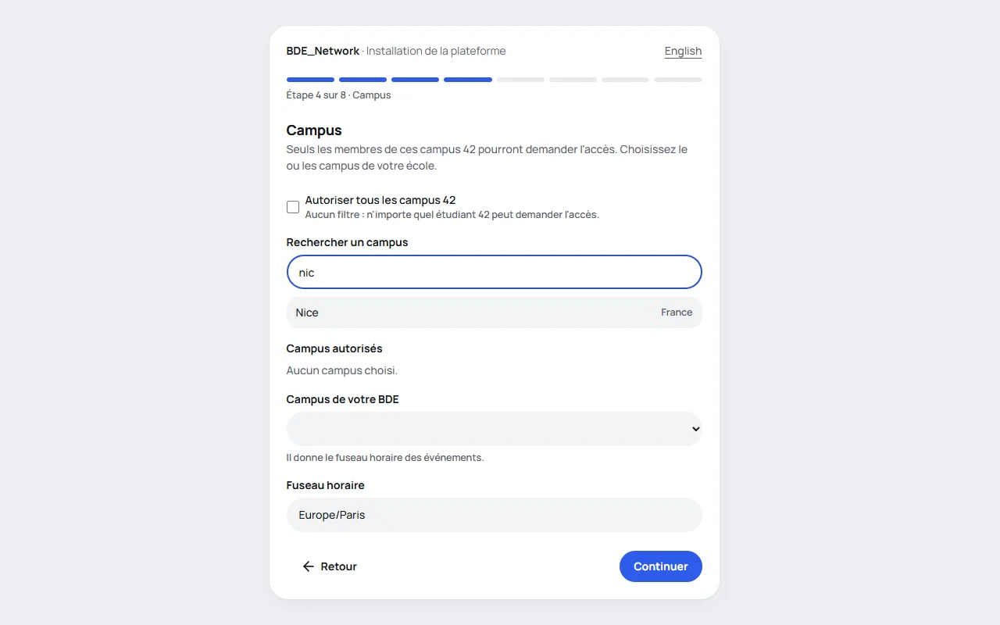

🇫🇷 Français · [🇬🇧 English](../en/installation.md)

# Installation

L'installation se fait **dans le navigateur**. Vous lancez une commande, vous ouvrez une adresse, et une
page vous guide pas à pas. Vous n'ouvrez aucun fichier de configuration et vous n'avez rien à créer avant.

Le seul prérequis est **Docker**. La commande est la même sous Windows, Linux et macOS, y compris sur un poste
où Docker tourne sans droits administrateur (comme les postes de l'école).



Pour un essai sur votre ordinateur, comptez dix minutes. Pour un vrai serveur, suivez aussi le
[guide de déploiement](deployment.md).

## À préparer

- Un compte sur l'**intra 42**, pour créer l'application OAuth du BDE (voir
  [plus bas](#créer-lapplication-sur-lintra-42)).
- Les **logins 42** des propriétaires : les personnes qui auront tous les droits.
- Facultatif : l'adresse d'un **webhook** Discord ou Slack, ou les réglages d'un serveur e-mail (SMTP), pour les
  [notifications](notifications.md). Tout cela peut aussi se régler plus tard, dans **Paramètres**.

## 1. Installer Docker et Git

| Outil  | Windows                                                                      | Linux                                                         | macOS                                                             |
| ------ | ---------------------------------------------------------------------------- | ------------------------------------------------------------- | ----------------------------------------------------------------- |
| Docker | [Docker Desktop](https://www.docker.com/products/docker-desktop/), avec WSL2 | `docker` et `docker compose` (paquet `docker-compose-plugin`) | [Docker Desktop](https://www.docker.com/products/docker-desktop/) |
| Git    | [git-scm.com](https://git-scm.com/) ou `winget install Git.Git`              | le gestionnaire de paquets de votre distribution              | `brew install git` ou les Xcode Command Line Tools                |

Sous Windows et macOS, **lancez Docker Desktop** et attendez qu'il indique qu'il tourne. Sous Windows, si Docker
Desktop le demande, activez WSL2 (`wsl --install` dans un PowerShell administrateur, puis redémarrez).

Vérifiez :

```text
git --version
docker compose version
```

Vous n'avez pas besoin de Node.js.

## 2. Récupérer le code

```text
git clone https://github.com/edouardbautz/BDE_Network.git
cd BDE_Network
```

Vous avez forké le projet ? Clonez plutôt votre fork. Voir [Mettre à jour](upgrading.md) pour la suite.

## 3. Démarrer la plateforme

Depuis le dossier `BDE_Network` (PowerShell, Terminal macOS ou Linux : c'est identique) :

```text
docker compose up
```

**Sans `-d` la première fois.** Le terminal reste ouvert et montre ce que fait la plateforme : c'est là que
s'affiche le code d'installation. La première fois, Docker télécharge l'image de la plateforme, ce qui prend une ou deux minutes.
Puis le terminal affiche un encadré :

```text
╔════════════════════════════════════════════════════════════════════════════╗
║  INSTALLATION DE LA PLATEFORME  ·  PLATFORM SETUP                          ║
║                                                                            ║
║  1. Ouvrez / Open :              http://localhost:3000                     ║
║  2. Code d'installation / Code : K7QM-4XPD                                 ║
║                                                                            ║
║  (Ce code change à chaque démarrage. / This code changes at every start.)  ║
╚════════════════════════════════════════════════════════════════════════════╝
```

Vous avez fermé le terminal, ou lancé la commande avec `-d` ? Retrouvez l'encadré :

- dans **Docker Desktop**, onglet **Containers** : cliquez sur le conteneur `app`, puis sur **Logs** ;
- ou avec `docker compose logs app`.

## 4. Ouvrir la page et suivre les étapes

Ouvrez l'adresse de l'encadré, **exactement telle quelle** : `http://localhost:3000`, pas `127.0.0.1`, pas
`0.0.0.0`. Entrez le **code d'installation**. Il change à chaque redémarrage : prenez toujours le dernier.

Un sélecteur de langue permet de passer du français à l'anglais. Chaque étape a une barre de progression et un
bouton **Retour**.

| Étape             | Ce que vous indiquez                                                                     | Ce que fait la page                                                                                                                                                                                                                |
| ----------------- | ---------------------------------------------------------------------------------------- | ---------------------------------------------------------------------------------------------------------------------------------------------------------------------------------------------------------------------------------- |
| 1. Votre BDE      | Le nom, la couleur, la langue des messages envoyés, une adresse de contact (facultative) | Montre la couleur en thème clair et en thème sombre.                                                                                                                                                                               |
| 2. Adresse        | L'adresse de la plateforme                                                               | Propose celle que vous utilisez. Donne l'URL de redirection exacte à déclarer sur l'intra. Vous avertit si l'adresse n'est pas celle de votre navigateur, ou si elle commence par `http://` sur un vrai domaine. Refuse `0.0.0.0`. |
| 3. Application 42 | L'**UID** et la **clé secrète**                                                          | Donne le pas à pas et l'URL à copier. Vérifie tout de suite les identifiants auprès de 42.                                                                                                                                         |
| 4. Campus         | Les campus autorisés                                                                     | Propose la liste des campus 42 avec une recherche. En déduit le fuseau horaire.                                                                                                                                                    |
| 5. Propriétaires  | Les logins 42 des propriétaires                                                          | Vérifie que chaque login existe sur l'intra.                                                                                                                                                                                       |
| 6. Modules        | Le module Événements (activé par défaut)                                                 |                                                                                                                                                                                                                                    |
| 7. Notifications  | Les canaux que vous utilisez (Discord, Slack, e-mail), puis ce qui passe par lequel      | Avec un webhook ou un serveur SMTP, un bouton envoie un message de test.                                                                                                                                                           |
| 8. Récapitulatif  |                                                                                          | Montre tout (les secrets restent masqués). **Installer la plateforme** enregistre.                                                                                                                                                 |

Les réponses restent en mémoire pendant l'installation : recharger la page ne fait rien perdre. Les secrets
(clé 42, mot de passe SMTP, webhooks) **ne reviennent jamais au navigateur** et sont **chiffrés** dans la base. La
clé de session et le mot de passe de la base sont **créés automatiquement** : vous ne les voyez jamais.

À l'étape 7, configurez les canaux que vous utilisez (chacun a son test), puis cochez, dans un tableau, quelle
notification passe par quel canal : aucun, un ou plusieurs. Rien de coché n'envoie rien, et vous pourrez tout changer
plus tard dans Paramètres. Voir [Notifications](notifications.md#une-notification-plusieurs-canaux).

### Créer l'application sur l'intra 42

La connexion se fait uniquement avec des comptes 42. La plateforme a besoin d'une « application » déclarée sur
l'intra, qui donne un **UID** et une **clé secrète**. L'étape 3 affiche l'URL de redirection à copier ; voici le
détail du formulaire.

1. Connectez-vous à l'intra 42, ouvrez <https://profile.intra.42.fr/oauth/applications> et cliquez sur **Register a
   new App**.
2. Remplissez le formulaire. L'intra peut en changer l'aspect : ce qui compte, c'est le nom, l'URL de redirection et
   le scope.

   | Champ        | Valeur                                                                             |
   | ------------ | ---------------------------------------------------------------------------------- |
   | Name         | Le nom de votre BDE (il est montré aux membres quand ils autorisent la connexion). |
   | Redirect URI | **`https://bde.exemple.fr/api/auth/callback/42-school`**                           |
   | Scopes       | **`public`** seulement (c'est le défaut).                                          |

   Laissez les autres champs par défaut, ou renseignez-les comme vous voulez (un site web, une description).

3. **L'URL de redirection doit être exacte**, au caractère près : l'adresse de la plateforme (même `http` ou
   `https`, même domaine, même port) suivie de `/api/auth/callback/42-school`, sans barre oblique finale. Pour un
   essai : `http://localhost:3000/api/auth/callback/42-school`.
4. Validez avec **Submit**. Sur la page de l'application, copiez l'**UID** et le **SECRET** dans l'étape 3.

> **Le secret peut expirer ou être régénéré.** Le jour où 42 le refuse, plus personne ne peut se connecter. Un
> propriétaire connecté voit alors un bandeau d'alerte. Créez un nouveau secret sur la page de l'application, et
> collez-le dans **Paramètres**, section Application 42.

## 5. Finir

La page « Plateforme installée » s'affiche. Il reste deux choses.

1. **Passer en arrière-plan.** Si vous avez lancé `docker compose up` sans `-d`, appuyez sur `Ctrl+C` dans le
   terminal, puis lancez :

   ```text
   docker compose up -d
   ```

   La plateforme tourne alors sans terminal ouvert, et redémarre avec l'ordinateur. C'est la commande à utiliser
   désormais.

2. **Vous connecter avec 42.** Les propriétaires de la liste ont tous les droits dès leur première connexion. Les
   autres personnes demandent l'accès, et un propriétaire les approuve.

**Sauvegardez le volume `secrets`** avec `./scripts/backup.sh` (voir
[Sauvegardes](deployment.md#sauvegardes-et-restauration)). Il contient la clé qui déchiffre les secrets enregistrés.
Sans lui, après une restauration sur un autre serveur, il faut les ressaisir.

### Pourquoi un code d'installation ?

Tant que la plateforme n'est pas installée, quiconque joindrait l'adresse pourrait l'installer et se nommer
propriétaire. Trois protections l'empêchent.

- **Le code**, affiché dans les journaux du serveur, là où seule la personne qui lance la plateforme regarde. Il a
  8 caractères sans ambiguïté (pas de `0`/`O`, ni de `1`/`I`/`L`), change à chaque démarrage et n'est gardé qu'en
  mémoire.
- **Un verrouillage.** Cinq mauvais essais bloquent la saisie 30 secondes, puis de plus en plus longtemps, jusqu'à
  15 minutes. Redémarrer la plateforme donne un nouveau code.
- **Rien n'est montré sans le code.** Avant, le reste du site répond « pas installé ».

Une fois l'installation terminée, **la page d'installation disparaît pour toujours** et aucun bouton ne la rouvre.

## Après l'installation

Connectez-vous avec 42. Comme votre login est dans la liste des propriétaires, vous avez tous les droits.

1. **Paramètres** (le menu, propriétaires seulement) : tout ce que l'installateur a demandé se modifie ici,
   section par section, et s'applique tout de suite. Voir [Configuration](configuration.md).

   

2. **Rôles** : deux rôles existent, _Admin_ et _Membre_. Créez les vôtres (Président, Trésorier…) en cochant ce que
   chacun peut faire. Voir [Rôles et droits](roles.md).
3. **Membres** : chaque personne qui se connecte pour la première fois arrive « en attente ». Vous l'approuvez et
   vous choisissez son rôle.
4. **Événements** : créez le premier événement et proposez à chacun de synchroniser son agenda. Voir
   [Module Événements](events.md).

## Mise en production

Pour que les membres y accèdent, il faut un serveur, un nom de domaine et un proxy HTTPS (Caddy, Nginx…). La
plateforme n'écoute volontairement que sur la machine elle-même ; le proxy la montre au monde. Tout est dans le
[guide de déploiement](deployment.md).

## Arrêter ou réinitialiser

```text
docker compose down          # arrête la plateforme, garde les données
docker compose down -v       # arrête et SUPPRIME les données : la base ET les clés
```

Après `docker compose down -v`, tout est effacé. Au prochain `docker compose up`, la page d'installation revient
avec un nouveau code.

## Vous aviez une installation faite avec des fichiers ?

Une plateforme installée avec `.env` et `bde.config.yml` (avant l'installateur) n'a rien à refaire. Au premier
démarrage après la mise à jour, ces deux fichiers sont **copiés dans la base de données**, secrets chiffrés, et la
page **Paramètres** devient utilisable. Voir [Mettre à jour](upgrading.md).

## Un problème ?

Voir [Problèmes fréquents](troubleshooting.md) : le code d'installation refusé, des identifiants 42 refusés, une
page d'erreur 503, un port déjà utilisé, une connexion qui échoue.
