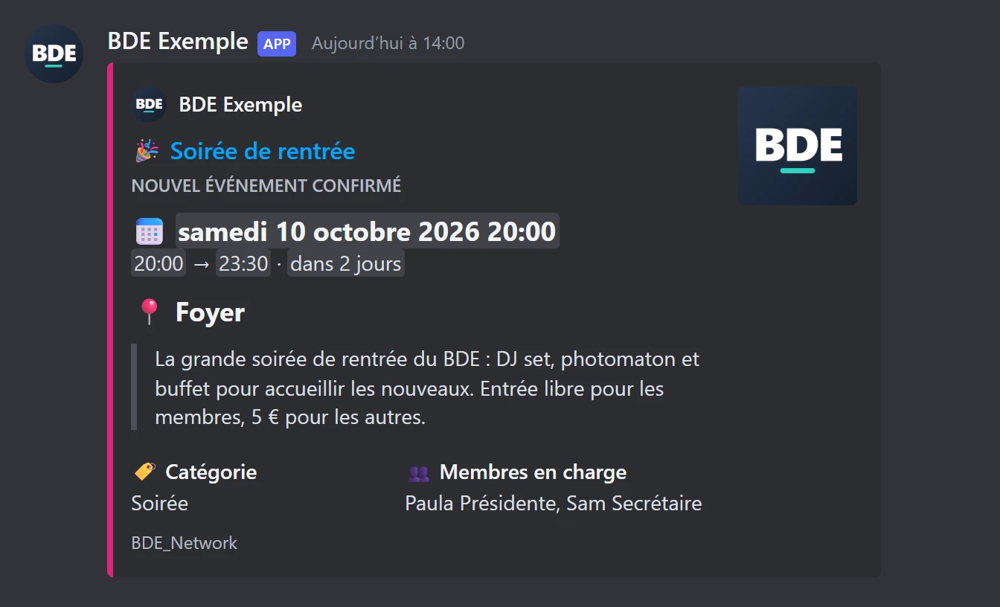
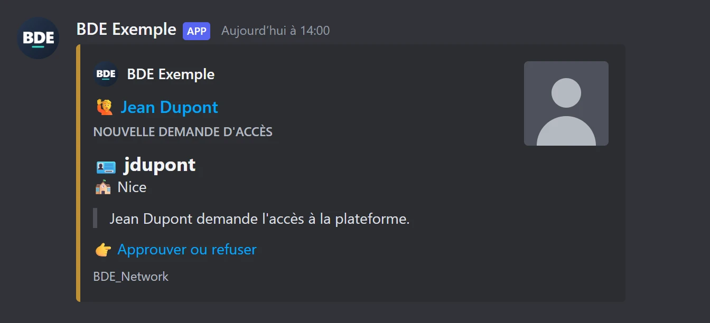
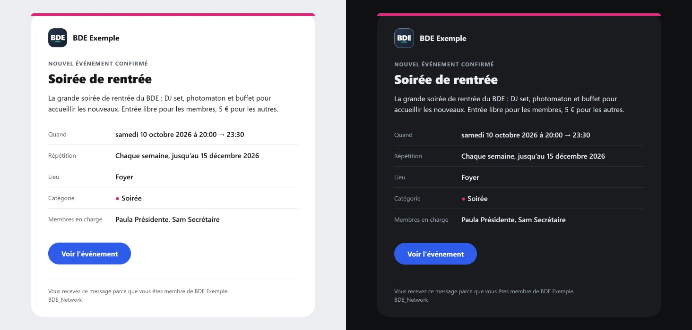

🇫🇷 Français · [🇬🇧 English](../en/notifications.md)

# Notifications

La plateforme peut prévenir le BDE par **e-mail**, par un salon **Discord**, par un salon **Slack**, ou pas du
tout, et **chaque type de notification peut passer par plusieurs de ces canaux à la fois** (par exemple Discord et
e-mail). **Discord est le plus simple à mettre en place.**

Les canaux (adresse du webhook, serveur e-mail) et **ce qui passe par lequel** se choisissent dans **Paramètres**,
section **Notifications**, et dans l'installateur, à l'étape 7. Ils s'appliquent tout de suite. Voir
[Une notification, plusieurs canaux](#une-notification-plusieurs-canaux).

| Notification                                | Quand                             | Qui est prévenu                                                                                              |
| ------------------------------------------- | --------------------------------- | ------------------------------------------------------------------------------------------------------------ |
| **Demande d'accès** (`memberPending`)       | un nouveau membre demande l'accès | E-mail : les propriétaires et ceux qui ont le droit « Gérer les membres ». Discord ou Slack : le salon.      |
| **Membre approuvé** (`memberApproved`)      | une demande est approuvée         | E-mail : le membre approuvé (son rôle, un lien de connexion). Discord ou Slack : le salon.                   |
| **Membre retiré** (`memberRemoved`)         | un membre est retiré du BDE       | Discord ou Slack : le salon. **Jamais d'e-mail** : la personne retirée ne reçoit rien.                       |
| **Événement confirmé** (`eventConfirmed`)   | un événement est confirmé         | Tous les membres approuvés (e-mail : un message par personne), ou le salon.                                  |
| **Rappel** (`eventReminder`)                | la veille d'un événement          | Les membres en charge (e-mail), sinon ceux qui valident les événements ; ou le salon.                        |
| **Événement proposé** (`eventProposed`)     | un événement est proposé          | E-mail : les propriétaires et ceux qui ont le droit « Valider les événements ». Discord ou Slack : le salon. |
| **Proposition approuvée** (`eventApproved`) | une proposition est approuvée     | E-mail : son auteur. Discord ou Slack : le salon.                                                            |
| **Proposition refusée** (`eventRefused`)    | une proposition est refusée       | E-mail : son auteur, avec le commentaire du validateur. Discord ou Slack : le salon.                         |

Sur chaque canal coché, la notification part comme le tableau ci-dessus le dit : un e-mail aux personnes
concernées, un message dans le salon pour Discord ou Slack.

Les messages sont envoyés **après** l'action. **Chaque canal part de son côté** : un salon Discord en panne ne retient
jamais les e-mails ni le message Slack, et n'annule rien de ce qui est déjà parti. Un envoi qui échoue n'empêche pas
non plus l'action : il est écrit dans les journaux du serveur (`docker compose logs app`), avec le nom du canal.

## Une notification, plusieurs canaux

Dans **Paramètres**, section **Notifications** (et dans l'installateur), deux blocs :

1. **Canaux.** Un panneau pour Discord, Slack et l'e-mail, avec ce qu'il demande (l'adresse du webhook, le serveur
   e-mail), un badge **Configuré** ou **Non configuré** et son **test**. Le test envoie la **vraie carte ou le vrai
   e-mail**, avec un événement inventé (« Soirée jeux (exemple) ») marqué « Message de test », par ce qui est tapé dans
   le panneau, enregistré ou non : vous voyez à quoi ressemblera votre canal, avec le nom, le logo et la couleur de
   votre BDE. **Retirer** oublie les réglages d'un canal et décoche ses cases (quand vous enregistrez).
2. **Qui est prévenu, et où.** Un tableau avec **une ligne par notification** et **une colonne par canal**. Cochez une
   case pour envoyer cette notification par ce canal ; cochez-en plusieurs sur une ligne pour l'envoyer par plusieurs.
   Une ligne **sans case cochée n'envoie rien**.
   - Une case ne se coche que si son **canal est configuré**. Avant, sa colonne est grisée et dit « Non configuré ».
   - Les **raccourcis** au-dessus du tableau cochent (ou décochent) toute une colonne en un clic : « Discord : tout
     cocher ». « Tout décocher » vide le tableau.
   - **Membre retiré** n'a pas de case e-mail : la personne retirée ne reçoit jamais rien.
   - Les lignes du module Événements ne s'affichent que si le module est activé (ce qu'elles contiennent est conservé).
   - Sur téléphone, chaque notification est un bloc dont les cases sont les unes sous les autres, d'au moins 44 px de
     haut : rien ne défile sur le côté.

Une configuration écrite avant la version 1.5.0, avec **un canal par notification**, est lue comme elle était voulue :
`discord` devient la case Discord cochée, `none` aucune case. Rien ne se perd, et rien ne change tant que vous
n'enregistrez pas depuis Paramètres (voir [Configuration](configuration.md#notifications)).

Les textes sont écrits dans la langue des messages choisie dans **Paramètres**, section Votre BDE.

## Configurer Discord

1. Dans Discord, ouvrez les paramètres du salon : **Intégrations** → **Webhooks** → **Nouveau webhook**.
2. Choisissez le salon, puis **Copier l'URL du webhook**.
3. Dans la plateforme : **Paramètres** → **Notifications** → **Discord**, collez l'adresse, puis utilisez
   **Envoyer un message de test**.

L'adresse du webhook est un secret : ne la publiez jamais. La plateforme la garde chiffrée et ne la montre plus.

> **Nom du BDE.** Discord refuse un nom d'expéditeur qui contient « discord » ou « clyde ». Dans ce cas, le
> message part sous le nom du webhook (celui défini dans les paramètres du salon).

## Le rendu sur Discord

Sur Discord, chaque notification est une **carte** (un _embed_), construite de la même façon pour les événements,
les rappels et les membres : **l'essentiel en grands titres, le secondaire en petits champs**.

_Illustrations dessinées à partir des vraies cartes envoyées par la plateforme. Discord les affiche avec sa propre
police, selon le thème de chaque lecteur._

- **L'essentiel, en titres, avec une icône devant chacun et une ligne vide entre eux** : le type de carte en petites
  capitales (« NOUVEL ÉVÉNEMENT CONFIRMÉ »), puis 📅 _quand_ (la date, l'heure de début et de fin, le compte à
  rebours), 📍 _où_, et la description de l'événement en citation. Pour un membre : 🪪 le login 42, 🏫 le campus, et
  ce qui s'est passé en citation.
- **Le secondaire, en champs côte à côte** : 🏷️ _Catégorie_ et 👥 _Membres en charge_ (une série ajoute une ligne
  🔁 _Répétition_). Pour un membre approuvé ou retiré : 🎭 _Rôle_ et **qui** a fait l'action (🤝 « Approuvé par … »,
  🚪 « Retiré par … »).
- **Les cartes de proposition** (📝 événement proposé, ✅ approuvée, ⛔ refusée) disent **qui a proposé** l'événement et, pour une réponse, **qui l'a donnée** ; un refus s'ouvre sur 💬 le **commentaire** du validateur, en citation. Un salon est lu par toute l'équipe : écrivez le commentaire en le sachant.
- **Une icône dans le titre** selon le type : 🎉 événement confirmé, ⏰ rappel de demain, 🔔 rappel du jour, 🙋 demande
  d'accès, ✅ membre approuvé, 👋 membre retiré.
- **Une barre de couleur** : celle de la catégorie pour un événement ; ambre, vert ou rouge pour une demande, une
  approbation, un retrait. Ces trois teintes restent lisibles sur les thèmes clair et sombre de Discord.
- **Un titre cliquable** vers la page concernée (l'événement, ou la page _Membres_), sans carte d'aperçu en double.
  Sans adresse de la plateforme, le titre n'est simplement pas un lien.
- **Une demande d'accès se termine par « 👉 Approuver ou refuser »**, un lien vers la page _Membres_ (seulement quand
  l'adresse de la plateforme est renseignée).
- **Des dates au format Discord** : chaque lecteur les voit **dans son fuseau horaire et sa langue**, avec un compte à
  rebours (« dans 3 jours ») qui se met à jour tout seul.
- **La signature du BDE** : le message arrive au nom du BDE avec son logo en avatar, et la carte porte son nom et son
  logo au-dessus du titre. Le logo sert aussi de **vignette** aux événements ; pour un membre, c'est sa **photo 42**
  (le logo à défaut). Si le logo n'est pas public, il n'y a ni icône ni vignette : le nom seul, jamais une image
  cassée.
- **Un pied de carte** discret : `BDE_Network`.
- **Le rappel** dit « Rappel · demain » en temps normal, et « Rappel · aujourd'hui » quand il part le jour même de
  l'événement (voir [le rappel de la veille](events.md#comment-fonctionne-le-rappel-de-la-veille)).

La description d'un événement est reprise **sur 350 caractères au plus**, coupée proprement avec « … » : la carte
est un avis, la page de l'événement a le détail. Plus généralement, tout texte trop long pour Discord est coupé
plutôt que de faire refuser le message.

### Sécurité des textes

Un titre, un lieu ou un nom viennent de membres : `@everyone`, `@here`, `<@123…>` ou `<!channel>` y sont rendus
**inoffensifs**. Ils s'affichent comme du texte et personne n'est notifié, dans la carte (la ligne du BDE comprise)
comme dans le nom de l'expéditeur. Chaque envoi interdit en plus toute mention. Un lieu ou un login tient sur
**une seule ligne** : il ne peut pas ouvrir un faux titre.

## Le logo de l'expéditeur

Discord va **chercher lui-même** l'image : elle doit donc être publique et dans un format qu'il accepte.

|                       |                                                                               |
| --------------------- | ----------------------------------------------------------------------------- |
| **Formats acceptés**  | PNG, JPEG, GIF, WebP. **Pas de SVG.**                                         |
| **Taille conseillée** | Un carré de 512 × 512 pixels (128 au minimum), moins de 2 Mo.                 |
| **Forme**             | Discord l'affiche **en rond** : gardez l'essentiel au centre, loin des coins. |

Pour mettre le logo de votre BDE : **Paramètres** → **Logo**. La plateforme choisit l'image ainsi :

1. le logo que vous avez envoyé dans Paramètres, s'il y en a un ;
2. sinon, le logo fourni avec la plateforme (un monogramme « BDE » neutre).

Si Discord ne peut pas récupérer l'image, **le message part quand même**, au nom du BDE et sans avatar : jamais
d'image cassée. C'est le cas quand :

- l'adresse de la plateforme n'est pas renseignée, ou n'est pas publique (`localhost`, un réseau privé : Discord ne
  les voit pas). Renseignez-la dans **Paramètres**, section Adresse de la plateforme ;
- le serveur ne répond pas, ou ne sert pas le fichier comme une image.

La plateforme vérifie l'image (une requête rapide, retenue dix minutes) avant d'envoyer, pour ne pas afficher un
avatar cassé.

Le **même logo** sert à l'en-tête des e-mails. Là, l'adresse n'a pas besoin d'être publique : c'est le logiciel de
messagerie de la personne qui charge l'image.

## Slack

> **Discord est plus simple** : un webhook se crée en deux clics, sans application. Slack demande de créer une petite
> application, que le pas à pas ci-dessous pré-remplit. Choisissez-le si votre BDE vit déjà sur Slack.

### Configurer Slack, pas à pas

1. Ouvrez ce lien, connecté à votre espace de travail Slack :
   **[Créer l'application BDE_Network](<https://api.slack.com/apps?new_app=1&manifest_yaml=display_information%3A%0A%20%20name%3A%20BDE_Network%0A%20%20description%3A%20Notifications%20du%20BDE%20(%C3%A9v%C3%A9nements%2C%20rappels%2C%20nouveaux%20membres)%0A%20%20background_color%3A%20'%231e293b'%0Afeatures%3A%0A%20%20bot_user%3A%0A%20%20%20%20display_name%3A%20BDE_Network%0A%20%20%20%20always_online%3A%20false%0Aoauth_config%3A%0A%20%20scopes%3A%0A%20%20%20%20bot%3A%0A%20%20%20%20%20%20-%20incoming-webhook%0Asettings%3A%0A%20%20org_deploy_enabled%3A%20false%0A%20%20socket_mode_enabled%3A%20false%0A%20%20token_rotation_enabled%3A%20false%0A>)**
   Il pré-remplit tout (nom `BDE_Network`, webhooks entrants activés, **aucune autre permission**) à partir de
   [`slack-app-manifest.yml`](../slack-app-manifest.yml). Choisissez votre espace de travail, vérifiez le résumé,
   cliquez sur **Create**.
2. Dans le menu de gauche, ouvrez **Incoming Webhooks**, puis **Add New Webhook to Workspace**, choisissez le salon
   où les messages doivent arriver, et **Allow**.
3. Copiez l'**URL du webhook** (elle commence par `https://hooks.slack.com/services/`). Dans la plateforme :
   **Paramètres** → **Notifications** → **Slack**, collez-la, puis **Envoyer un message de test**. Cette adresse est un
   secret : ne la publiez jamais.

Facultatif : dans **Basic Information** de l'application Slack, vous pouvez déposer le logo de votre BDE comme
icône.

Le lien est le même pour tous les BDE : le manifeste ne contient rien de personnel. S'il ne s'ouvre pas, allez sur
<https://api.slack.com/apps>, **Create New App**, **From a manifest**, et collez le contenu de
[`slack-app-manifest.yml`](../slack-app-manifest.yml).

### Le rendu sur Slack

Comme sur Discord, chaque notification est une **carte** (Block Kit).

- **Une barre de couleur** : celle de la catégorie pour un événement ; ambre, vert ou rouge pour une demande, une
  approbation, un retrait (comme sur Discord).
- **Un titre en en-tête**, puis la description (350 caractères au plus), _Quand_ sur toute la largeur, et _Lieu_,
  _Catégorie_, _Membres en charge_, _Répétition_ en colonnes.
- **Des dates au format Slack** : chaque lecteur les voit dans son fuseau horaire, avec « aujourd'hui » ou « demain »
  quand c'est le cas. Slack n'a pas de compte à rebours.
- **Un bouton** « Voir l'événement » (ou « Valider ou refuser » pour une demande d'accès).
- **Un pied** avec le logo du BDE (s'il est public, comme pour Discord), son nom et `BDE_Network`.
- **Pour un membre** : la photo 42 à côté du message, le rôle, et **qui** a approuvé ou retiré.
- **Une notification lisible sur téléphone** : un résumé (« Nouvel événement confirmé : Soirée de rentrée — samedi
  10 octobre 2026 à 20:00 · Foyer du campus »). Il n'apparaît jamais dans le salon, au-dessus de la carte.

Les mentions sont rendues inoffensives dans tous les textes, et chaque message respecte les limites de taille de
Slack. Le nom et l'icône de l'expéditeur sont ceux de **l'application Slack** (`BDE_Network`) : un webhook ne peut
pas les changer message par message.

## Les e-mails

Un e-mail est une vraie page mise en forme, avec une **version texte** pour les messageries qui n'affichent pas le
HTML.

_Confirmation d'un événement. À gauche en mode clair, à droite le même e-mail en mode sombre._

- **L'en-tête** : le logo du BDE et son nom (le nom seul, sans logo accessible).
- **Une barre et un bouton de la couleur de la catégorie** ; le texte du bouton est noir ou blanc selon la couleur,
  pour rester lisible.
- **Les lignes** _Quand_, _Répétition_, _Lieu_, _Catégorie_ (avec sa pastille de couleur) et _Membres en charge_, puis
  **un bouton** vers la page concernée (l'événement, ou la page _Membres_). Sans adresse de la plateforme, il n'y a
  pas de bouton.
- **Le texte d'aperçu**, que la boîte de réception montre à côté de l'objet.
- **Un pied discret** : pourquoi la personne reçoit ce message, et `BDE_Network`.
- **La confirmation d'un événement joint un fichier `.ics`** : les messageries proposent « Ajouter à l'agenda ». Il
  contient toutes les dates à venir d'une série, avec les mêmes identifiants que les agendas à abonnement : rien
  n'est ajouté en double. Le rappel n'en joint pas.
- **Pour un membre** : la demande d'accès (avec la photo 42) et l'approbation (un message de bienvenue avec son rôle
  et un bouton pour se connecter). Un retrait **n'envoie jamais d'e-mail**.

Tout ce qu'un membre a saisi est **échappé** avant d'entrer dans la page : il s'affiche comme du texte, jamais comme
du code. La mise en page est faite pour les messageries les plus difficiles : tableaux, styles écrits dans chaque
élément, bouton adapté à Outlook sur Windows, mode sombre pour Apple Mail, Gmail et Outlook, et affichage sur petit
écran.

### Configurer l'e-mail

Dans **Paramètres** → **Notifications** → **E-mail**, indiquez le serveur SMTP (serveur, port, identifiant et mot de
passe si besoin) et l'adresse d'expéditeur. Le mot de passe est chiffré et ne reparaît jamais. Utilisez le message
de test.

## Un problème ?

Un message n'arrive pas, pas d'avatar, un titre qui n'est pas un lien : voir
[Problèmes fréquents](troubleshooting.md#les-notifications).
