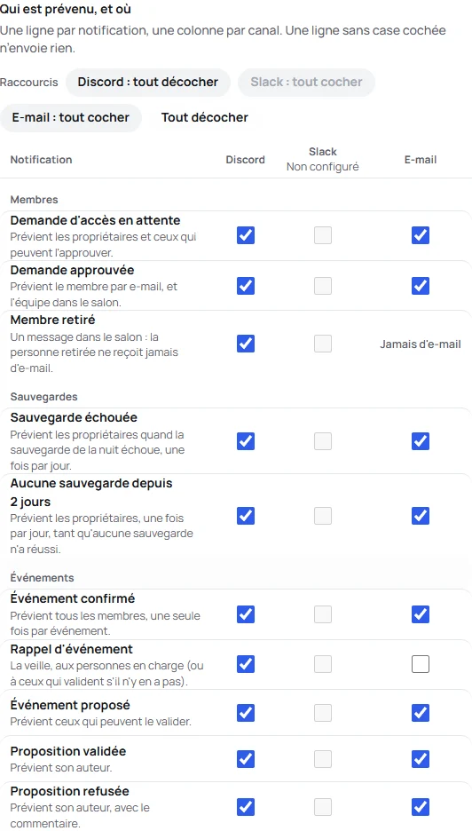
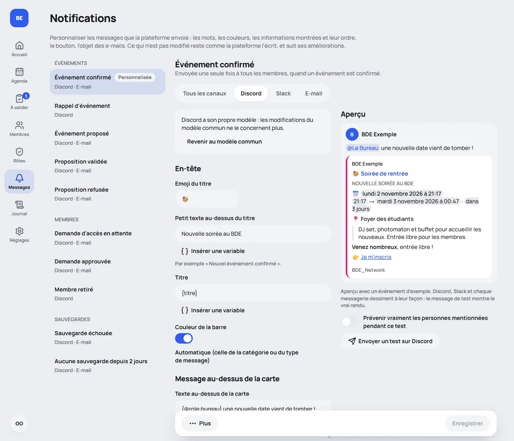
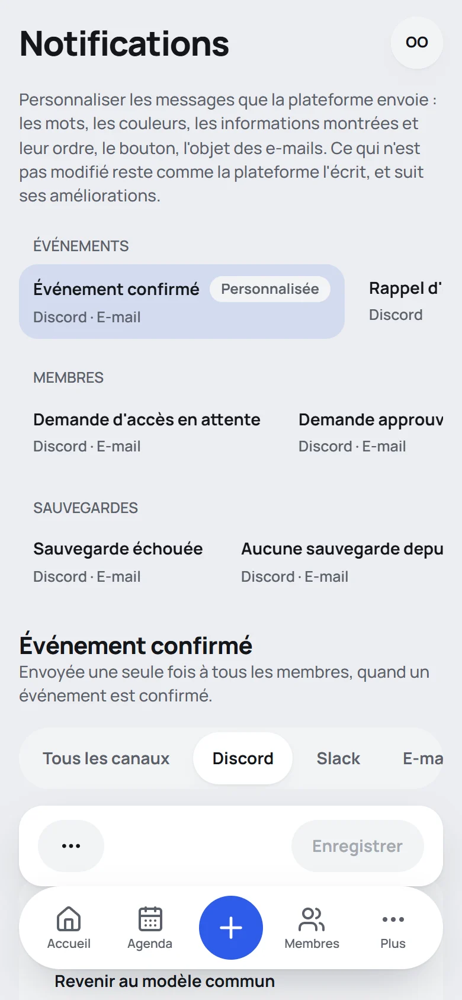

🇫🇷 Français · [🇬🇧 English](../en/notifications.md)

# Notifications

La plateforme peut prévenir le BDE par **e-mail**, par un salon **Discord**, par un salon **Slack**, ou pas du
tout, et **chaque type de notification peut passer par plusieurs de ces canaux à la fois** (par exemple Discord et
e-mail). **Discord est le plus simple à mettre en place.**

Les canaux (adresse du webhook, serveur e-mail) et **ce qui passe par lequel** se choisissent dans **Paramètres**,
section **Notifications**, et dans l'installateur, à l'étape 7. Ils s'appliquent tout de suite. Voir
[Une notification, plusieurs canaux](#une-notification-plusieurs-canaux).

| Notification                                | Quand                             | Qui est prévenu                                                                                              |
| ------------------------------------------- | --------------------------------- | ------------------------------------------------------------------------------------------------------------ |
| **Demande d'accès** (`memberPending`)       | un nouveau membre demande l'accès | E-mail : les propriétaires et ceux qui ont le droit « Gérer les membres ». Discord ou Slack : le salon.      |
| **Membre approuvé** (`memberApproved`)      | une demande est approuvée         | E-mail : le membre approuvé (son rôle, un lien de connexion). Discord ou Slack : le salon.                   |
| **Membre retiré** (`memberRemoved`)         | un membre est retiré du BDE       | Discord ou Slack : le salon. **Jamais d'e-mail** : la personne retirée ne reçoit rien.                       |
| **Événement confirmé** (`eventConfirmed`)   | un événement est confirmé         | Tous les membres approuvés (e-mail : un message par personne), ou le salon.                                  |
| **Rappel** (`eventReminder`)                | la veille d'un événement          | Les membres en charge (e-mail), sinon ceux qui valident les événements ; ou le salon.                        |
| **Événement proposé** (`eventProposed`)     | un événement est proposé          | E-mail : les propriétaires et ceux qui ont le droit « Valider les événements ». Discord ou Slack : le salon. |
| **Proposition approuvée** (`eventApproved`) | une proposition est approuvée     | E-mail : son auteur. Discord ou Slack : le salon.                                                            |
| **Proposition refusée** (`eventRefused`)    | une proposition est refusée       | E-mail : son auteur, avec le commentaire du validateur. Discord ou Slack : le salon.                         |

Sur chaque canal coché, la notification part comme le tableau ci-dessus le dit : un e-mail aux personnes
concernées, un message dans le salon pour Discord ou Slack.

Les messages sont envoyés **après** l'action. **Chaque canal part de son côté** : un salon Discord en panne ne retient
jamais les e-mails ni le message Slack, et n'annule rien de ce qui est déjà parti. Un envoi qui échoue n'empêche pas
non plus l'action : il est écrit dans les journaux du serveur (`docker compose logs app`), avec le nom du canal.

## Une notification, plusieurs canaux

Dans **Paramètres**, section **Notifications** (et dans l'installateur), deux blocs :

1. **Canaux.** Un panneau pour Discord, Slack et l'e-mail, avec ce qu'il demande (l'adresse du webhook, le serveur
   e-mail), un badge **Configuré** ou **Non configuré** et son **test**. Le test envoie la **vraie carte ou le vrai
   e-mail**, avec un événement inventé (« Soirée jeux (exemple) ») marqué « Message de test », par ce qui est tapé dans
   le panneau, enregistré ou non : vous voyez à quoi ressemblera votre canal, avec le nom, le logo et la couleur de
   votre BDE. **Retirer** oublie les réglages d'un canal et décoche ses cases (quand vous enregistrez).
2. **Qui est prévenu, et où.** Un tableau avec **une ligne par notification** et **une colonne par canal**. Cochez une
   case pour envoyer cette notification par ce canal ; cochez-en plusieurs sur une ligne pour l'envoyer par plusieurs.
   Une ligne **sans case cochée n'envoie rien**.
   - Une case ne se coche que si son **canal est configuré**. Avant, sa colonne est grisée et dit « Non configuré ».
   - Les **raccourcis** au-dessus du tableau cochent (ou décochent) toute une colonne en un clic : « Discord : tout
     cocher ». « Tout décocher » vide le tableau.
   - **Membre retiré** n'a pas de case e-mail : la personne retirée ne reçoit jamais rien.
   - Les lignes du module Événements ne s'affichent que si le module est activé (ce qu'elles contiennent est conservé).
   - Sur téléphone, chaque notification est un bloc dont les cases sont les unes sous les autres, d'au moins 44 px de
     haut : rien ne défile sur le côté.

Une configuration écrite avant la version 1.5.0, avec **un canal par notification**, est lue comme elle était voulue :
`discord` devient la case Discord cochée, `none` aucune case. Rien ne se perd, et rien ne change tant que vous
n'enregistrez pas depuis Paramètres (voir [Configuration](configuration.md#notifications)).

Les textes sont écrits dans la langue des messages choisie dans **Paramètres**, section Votre BDE.

## Messages sur la publication sur l'intra

Quand la plateforme **publie les événements sur l'intra** (un propriétaire l'active dans Paramètres, Événements ; voir
[Événements](events.md#publier-sur-lintra)), cinq notifications de plus apparaissent, dans le tableau des Paramètres et
dans la page de personnalisation, sous **Publication sur l'intra**. Elles sont éteintes tant que vous ne les cochez pas.

| Notification                                       | Quand                                                                                     | Qui est prévenu                                                                              |
| -------------------------------------------------- | ----------------------------------------------------------------------------------------- | -------------------------------------------------------------------------------------------- |
| **Publication demandée** (`intraRequested`)        | un événement est confirmé (ou quelqu'un redemande sa publication)                         | **Le staff** : e-mail à ceux qui ont le droit de publier sur l'intra ; le salon du staff.    |
| **Événement modifié sur l'intra** (`intraChanged`) | un événement qui est sur l'intra change                                                   | **Le staff**, avec ce que contient l'intra et ce que l'événement est devenu.                 |
| **Événement retiré** (`intraCancelled`)            | un événement qui était sur l'intra repasse en brouillon, est supprimé ou n'a plus de date | **Le staff**, avec la raison. Rien n'est envoyé pour un événement qui n'a jamais été publié. |
| **Publié sur l'intra** (`intraPublished`)          | le staff répond « Publié sur l'intra »                                                    | E-mail : **l'auteur**. Discord ou Slack : **le salon du BDE**.                               |
| **Publication refusée** (`intraRefused`)           | le staff refuse une demande                                                               | E-mail : **l'auteur**, avec la raison. Discord ou Slack : **le salon du BDE**.               |

- **Qui est « le staff ».** Les membres dont le rôle **liste** le droit **Publier sur l'intra** (un rôle qui détient tous
  les droits, comme Admin, n'est pas le staff : il recevrait toutes les demandes). Quand personne n'a reçu ce droit, ce
  sont les **propriétaires** qui reçoivent les messages par e-mail.
- **Le salon du staff.** Le staff n'est pas forcément sur le Discord ou le Slack du BDE : dans Paramètres, Événements,
  **Salon du staff**, les propriétaires peuvent lui donner un webhook à lui (Discord et/ou Slack, chacun avec un message de
  test). Les trois messages pour le staff y vont ; sans webhook, ils vont dans le salon du BDE. Les messages pour l'auteur
  vont toujours dans le salon du BDE.
- **Mentionner le staff.** Dans la personnalisation des trois messages pour le staff, le menu **Mention** propose
  **`{@staff}`** : il notifie les membres du staff qui ont donné leur **identifiant Discord et/ou Slack** dans leur profil,
  et personne d'autre (Discord reçoit exactement cette liste). Il n'est lu que dans le message au-dessus de la carte, comme
  toute mention, et seulement dans ces trois messages. Un message de test montre `{@staff}` en texte simple, sauf si vous
  demandez des mentions réelles.
- Comme toute notification, elles partent **après** l'action, ne la bloquent jamais, et se personnalisent (mots,
  informations affichées, ordre, couleur, bouton) dans **Notifications**. La **date** affichée est la prochaine à venir ; une
  série dit combien elle a de dates, et la page du staff les liste.

## Messages sur les sauvegardes

Deux notifications pour les propriétaires, **éteintes tant que vous ne leur choisissez pas de canal** (**Paramètres**, section
**Notifications**, groupe « Sauvegardes » ; la section [Sauvegardes](backups.md) de la même page le dit tant qu'aucun n'est choisi) :

| Notification                                         | Quand                                          | Qui est prévenu                                                                          |
| ---------------------------------------------------- | ---------------------------------------------- | ---------------------------------------------------------------------------------------- |
| **Sauvegarde échouée** (`backupFailed`)              | la sauvegarde de la nuit échoue                | E-mail : **chaque propriétaire**. Discord ou Slack : le salon. Le premier échec du jour. |
| **Aucune sauvegarde depuis 2 jours** (`backupStale`) | aucune sauvegarde n'a réussi depuis deux jours | Les mêmes, une fois par jour tant que cela dure.                                         |

Chacune dit pourquoi, quand la dernière bonne sauvegarde a été faite et sa taille, et porte un bouton vers la section Sauvegardes de la
page Paramètres. Elles se personnalisent comme les autres, depuis la page **Notifications**. Au plus un message de chaque sorte par
jour : la plateforme réessaie 30 minutes après un échec (trois fois par jour au plus) et ne se répète pas. Une sauvegarde que vous
demandez avec **Sauvegarder maintenant** et qui échoue est montrée sur la page, pas envoyée.

## Personnaliser les messages

Les mots, les couleurs, les informations montrées et leur ordre, le bouton et l'objet des e-mails peuvent se
changer, pour chaque notification et chaque canal, depuis la page **Notifications** du menu. Pas de code, rien à
redémarrer : un changement s'applique au prochain message envoyé.

Qui peut le faire : les propriétaires, et les membres dont le rôle a le droit **Personnaliser les notifications**
(voir [Rôles et droits](roles.md)). Les canaux eux-mêmes (adresses des webhooks, serveur e-mail) restent aux
propriétaires, dans **Paramètres**.

### La page

- À gauche, **la liste des notifications** (celles du module Événements ne s'affichent que s'il est activé). Chacune
  dit où elle part et porte un badge **Personnalisée** quand vous l'avez modifiée.
- Un onglet **Tous les canaux** et un par canal. Ce que vous écrivez dans **Tous les canaux** s'applique à chaque
  canal qui le suit. Un canal qui a besoin d'autre chose est **personnalisé** : il part d'une copie du modèle commun
  et ne suit plus les modifications faites ensuite pour tous les canaux. **Revenir au modèle commun** annule cela.
  L'e-mail d'un membre approuvé s'adresse à cette personne seule : il a donc toujours son propre modèle.
- À droite, **l'aperçu**, dessiné par la plateforme avec un événement d'exemple et le code même qui écrit le vrai
  message. Une carte Discord et un message Slack sont des images de la réalité : le message de test (plus bas) montre
  le vrai rendu.
- Sur téléphone, les champs et l'aperçu sont deux affichages de la même page (**Modifier** et **Aperçu**), les champs
  de chaque ligne s'empilent, et rien ne défile sur le côté.

### Ce qui peut changer

| Section                           | Ce que vous pouvez faire                                                                                                                                                                                                             |
| --------------------------------- | ------------------------------------------------------------------------------------------------------------------------------------------------------------------------------------------------------------------------------------ |
| **En-tête**                       | Le petit texte au-dessus du titre, le titre, l'emoji devant lui (Discord), la couleur de la barre (automatique : celle de la catégorie ou du type de message).                                                                       |
| **Message au-dessus de la carte** | Un texte au-dessus de la carte (Discord et Slack), avec des [mentions](#les-mentions).                                                                                                                                               |
| **Informations montrées**         | Activer ou masquer chaque information, la monter ou la descendre avec les flèches, la renommer, lui donner un emoji (Discord), et ajouter jusqu'à 8 textes libres. Chaque canal garde son ordre tant que vous n'en déplacez pas une. |
| **Bouton**                        | Le montrer ou non, changer son texte, lui donner une adresse à vous (`https://` uniquement). Sans adresse, il ouvre la page de l'événement ou du membre sur la plateforme. Sur Discord, c'est une ligne de lien dans la carte.       |
| **Pied du message**               | La ligne en bas de la carte ou de l'e-mail.                                                                                                                                                                                          |
| **E-mail** (onglet E-mail)        | L'objet, la ligne affichée dans la boîte de réception après l'objet, et une note en bas du message.                                                                                                                                  |

Les champs montrent **ce que la plateforme écrit d'elle-même** tant que vous n'écrivez pas le vôtre. Seul ce que vous
avez changé est enregistré : le reste continue de suivre la plateforme (voir
[Quand la plateforme améliore un message](#quand-la-plateforme-améliore-un-message)).

Les **variables** mettent dans un texte ce qui est propre à un message : choisir **Insérer une variable** sous un
champ, ou taper le nom entre accolades, par exemple `{titre}`. Elles s'affichent par leur nom dans la langue de
l'interface (`{titre}`, `{catégorie}`) et s'écrivent de la même façon quelle que soit la langue dans laquelle vous
tapez. Le gras (`**texte**`) et l'italique (`_texte_`) fonctionnent dans les textes libres.

| Variable                                         | Ce qu'elle représente                                                                            |
| ------------------------------------------------ | ------------------------------------------------------------------------------------------------ |
| `{titre}` `{lieu}` `{catégorie}` `{description}` | Le titre, le lieu, la catégorie et la description de l'événement.                                |
| `{date}` `{heure}` `{fin}` `{quand}`             | Le jour en toutes lettres, l'heure de début, l'heure de fin, la date et les heures ensemble.     |
| `{responsables}` `{répétition}` `{lien}` `{bde}` | Les membres en charge, la phrase qui décrit une répétition, l'adresse de la page, le nom du BDE. |
| `{jour}`                                         | « aujourd'hui » ou « demain » (rappels uniquement).                                              |
| `{auteur}` `{valideur}` `{commentaire}`          | Qui a proposé, qui a répondu, le motif d'un refus (propositions uniquement).                     |
| `{nom}` `{login}` `{campus}` `{rôle}` `{acteur}` | Le nom d'un membre, son login 42, son campus et son rôle, et qui l'a approuvé ou retiré.         |

Une notification ne propose que les variables qu'elle a (un rappel a `{jour}`, un membre n'a pas de `{lieu}`).

### Les mentions

Une mention s'écrit dans **le message au-dessus de la carte**, et seulement là : Discord ne prévient pas pour une
mention à l'intérieur d'une carte. **Mentionner** en insère une :

- `@everyone` et `@here` (Discord et Slack) et `@channel` (Slack uniquement) ;
- les **personnes, rôles et groupes** que vous mettez dans la liste du canal, avec **Gérer les personnes et rôles…** :
  un nom lisible (« Le Bureau ») et l'identifiant que la plateforme lui donne. Sur Discord, activez le mode
  développeur (Paramètres, Avancés), puis faites un clic droit sur un rôle ou une personne et choisissez _Copier
  l'identifiant_. Sur Slack, l'identifiant d'un membre est dans son profil (_Copier l'identifiant du membre_), et celui
  d'un groupe commence par `S`. Les modèles n'écrivent jamais que le nom.

Ce que représente une **variable** (un titre, un lieu, un nom saisi par un membre) **ne mentionne jamais personne**,
quoi qu'il contienne : seul ce que vous avez écrit vous-même dans le modèle le peut. Un nom encore utilisé dans un
modèle ne peut pas être retiré de la liste. Un modèle pour tous les canaux ne peut mentionner que `@everyone` et
`@here` : les personnes appartiennent à une plateforme, il faut donc d'abord personnaliser le canal.

### L'essayer

**Envoyer un test sur Discord** (ou Slack, ou E-mail) envoie la notification **telle qu'elle est à l'écran,
enregistrée ou non**, par la vraie connexion du canal, marquée « Message de test », avec l'événement d'exemple.
L'e-mail part vers **votre propre adresse**.

- Un test est limité à **un toutes les dix secondes par canal**.
- Dans un test, **les mentions sont écrites en clair et ne préviennent personne**. Pour prévenir pour de vrai,
  activez l'interrupteur sous l'aperçu et confirmez.
- Un canal qui n'est pas configuré ne peut pas être testé : la page le dit, et un propriétaire le configure dans
  **Paramètres**.

### Enregistrer, historique, revenir en arrière

- **Enregistrer** enregistre l'onglet où vous êtes. Un modèle avec une erreur (une variable inconnue, un texte trop
  long, une adresse qui n'est pas en `https://`) est refusé avec l'endroit du problème, et l'aperçu le dit pendant
  que vous tapez. Si quelqu'un d'autre a enregistré le même modèle avant vous, la page vous le dit : recharger pour
  voir sa version plutôt que l'écraser.
- **Plus** ouvre l'**historique des versions** (les 50 dernières de l'onglet). **Restaurer** une version en crée une
  nouvelle : rien n'est perdu, et elle est revérifiée comme n'importe quelle autre.
- **Revenir au message de la plateforme** (un onglet) et **Tout remettre comme la plateforme** (tous les canaux
  d'une notification) reviennent à ce que la plateforme écrit d'elle-même. Ils demandent confirmation, et restent
  dans l'historique.
- Chaque changement est écrit dans le **journal d'audit** (qui, quoi, quelle version), jamais le texte lui-même.

Si un modèle enregistré ne peut pas être utilisé au moment d'un envoi (par exemple parce qu'il ne correspond plus à
ce que la plateforme accepte), **le message de la plateforme part à sa place** : une notification n'est donc jamais
perdue, et la page de cette notification le dit, avec la date et la raison, jusqu'à ce que vous corrigiez.

### Quand la plateforme améliore un message

Un modèle ne contient que ce que vous avez changé : une version plus récente de la plateforme qui améliore ses
messages améliore donc tout ce que vous n'avez pas touché. **Ce que vous avez écrit n'est jamais remplacé.** Quand un
message que vous avez modifié a été amélioré, la page vous dit ce qui a changé, et vous décidez : adapter votre
modèle, ou le marquer comme vu. Les variables ne sont jamais retirées dans une version mineure.

### Limites

| Élément                            | Au plus                       |
| ---------------------------------- | ----------------------------- |
| Petit texte, nom d'une information | 80, 40 caractères             |
| Titre, pied, objet, ligne d'aperçu | 200, 200, 150, 200 caractères |
| Texte libre                        | 500 caractères, 8 au plus     |
| Phrase d'introduction (membres)    | 300 caractères                |
| Texte du bouton, adresse du bouton | 60, 500 caractères            |
| Note sous un e-mail                | 300 caractères                |
| Message au-dessus de la carte      | 1000 caractères               |
| Informations dans la liste         | 24                            |

Discord et Slack ont leurs propres limites : la plateforme coupe ce qui les dépasse, comme elle l'a toujours fait.

### À savoir

- Les modèles sont dans **la base de données** : la sauvegarde de `scripts/backup.sh` les contient, et `restore.sh` les
  remet (voir [Mise à jour](upgrading.md) et [Déploiement](deployment.md)).
- Un modèle garde le **login** de celui qui l'a écrit (et de celui qui a ajouté une personne à la liste des
  mentions), en texte, même après la suppression de ce compte. Voir la politique de confidentialité.
- Rien de ce qui est tapé dans un modèle ne peut injecter de code dans un message : chaque texte est échappé pour le
  canal où il part, les liens du bouton doivent être en `https://`, et l'aperçu de l'e-mail s'affiche dans un cadre
  qui n'exécute rien.

## Configurer Discord

1. Dans Discord, ouvrez les paramètres du salon : **Intégrations** → **Webhooks** → **Nouveau webhook**.
2. Choisissez le salon, puis **Copier l'URL du webhook**.
3. Dans la plateforme : **Paramètres** → **Notifications** → **Discord**, collez l'adresse, puis utilisez
   **Envoyer un message de test**.

L'adresse du webhook est un secret : ne la publiez jamais. La plateforme la garde chiffrée et ne la montre plus.

> **Nom du BDE.** Discord refuse un nom d'expéditeur qui contient « discord » ou « clyde ». Dans ce cas, le
> message part sous le nom du webhook (celui défini dans les paramètres du salon).

## Le rendu sur Discord

Sur Discord, chaque notification est une **carte** (un _embed_), construite de la même façon pour les événements,
les rappels et les membres : **l'essentiel en grands titres, le secondaire en petits champs**.

_Illustrations dessinées à partir des vraies cartes envoyées par la plateforme. Discord les affiche avec sa propre
police, selon le thème de chaque lecteur._

- **L'essentiel, en titres, avec une icône devant chacun et une ligne vide entre eux** : le type de carte en petites
  capitales (« NOUVEL ÉVÉNEMENT CONFIRMÉ »), puis 📅 _quand_ (la date, l'heure de début et de fin, le compte à
  rebours), 📍 _où_, et la description de l'événement en citation. Pour un membre : 🪪 le login 42, 🏫 le campus, et
  ce qui s'est passé en citation.
- **Le secondaire, en champs côte à côte** : 🏷️ _Catégorie_ et 👥 _Membres en charge_ (une série ajoute une ligne
  🔁 _Répétition_). Pour un membre approuvé ou retiré : 🎭 _Rôle_ et **qui** a fait l'action (🤝 « Approuvé par … »,
  🚪 « Retiré par … »).
- **Les cartes de proposition** (📝 événement proposé, ✅ approuvée, ⛔ refusée) disent **qui a proposé** l'événement et, pour une réponse, **qui l'a donnée** ; un refus s'ouvre sur 💬 le **commentaire** du validateur, en citation. Un salon est lu par toute l'équipe : écrivez le commentaire en le sachant.
- **Une icône dans le titre** selon le type : 🎉 événement confirmé, ⏰ rappel de demain, 🔔 rappel du jour, 🙋 demande
  d'accès, ✅ membre approuvé, 👋 membre retiré.
- **Une barre de couleur** : celle de la catégorie pour un événement ; ambre, vert ou rouge pour une demande, une
  approbation, un retrait. Ces trois teintes restent lisibles sur les thèmes clair et sombre de Discord.
- **Un titre cliquable** vers la page concernée (l'événement, ou la page _Membres_), sans carte d'aperçu en double.
  Sans adresse de la plateforme, le titre n'est simplement pas un lien.
- **Une demande d'accès se termine par « 👉 Approuver ou refuser »**, un lien vers la page _Membres_ (seulement quand
  l'adresse de la plateforme est renseignée).
- **Des dates au format Discord** : chaque lecteur les voit **dans son fuseau horaire et sa langue**, avec un compte à
  rebours (« dans 3 jours ») qui se met à jour tout seul.
- **La signature du BDE** : le message arrive au nom du BDE avec son logo en avatar, et la carte porte son nom et son
  logo au-dessus du titre. Le logo sert aussi de **vignette** aux événements ; pour un membre, c'est sa **photo 42**
  (le logo à défaut). Si le logo n'est pas public, il n'y a ni icône ni vignette : le nom seul, jamais une image
  cassée.
- **Un pied de carte** discret : `BDE_Network`.
- **Le rappel** dit « Rappel · demain » en temps normal, et « Rappel · aujourd'hui » quand il part le jour même de
  l'événement (voir [le rappel de la veille](events.md#comment-fonctionne-le-rappel-de-la-veille)).

La description d'un événement est reprise **sur 350 caractères au plus**, coupée proprement avec « … » : la carte
est un avis, la page de l'événement a le détail. Plus généralement, tout texte trop long pour Discord est coupé
plutôt que de faire refuser le message.

### Sécurité des textes

Un titre, un lieu ou un nom viennent de membres : `@everyone`, `@here`, `<@123…>` ou `<!channel>` y sont rendus
**inoffensifs**. Ils s'affichent comme du texte et personne n'est notifié, dans la carte (la ligne du BDE comprise)
comme dans le nom de l'expéditeur. Chaque envoi interdit en plus toute mention. Un lieu ou un login tient sur
**une seule ligne** : il ne peut pas ouvrir un faux titre.

## Le logo de l'expéditeur

Discord va **chercher lui-même** l'image : elle doit donc être publique et dans un format qu'il accepte.

|                       |                                                                               |
| --------------------- | ----------------------------------------------------------------------------- |
| **Formats acceptés**  | PNG, JPEG, GIF, WebP. **Pas de SVG.**                                         |
| **Taille conseillée** | Un carré de 512 × 512 pixels (128 au minimum), moins de 2 Mo.                 |
| **Forme**             | Discord l'affiche **en rond** : gardez l'essentiel au centre, loin des coins. |

Pour mettre le logo de votre BDE : **Paramètres** → **Logo**. La plateforme choisit l'image ainsi :

1. le logo que vous avez envoyé dans Paramètres, s'il y en a un ;
2. sinon, le logo fourni avec la plateforme (un monogramme « BDE » neutre).

Si Discord ne peut pas récupérer l'image, **le message part quand même**, au nom du BDE et sans avatar : jamais
d'image cassée. C'est le cas quand :

- l'adresse de la plateforme n'est pas renseignée, ou n'est pas publique (`localhost`, un réseau privé : Discord ne
  les voit pas). Renseignez-la dans **Paramètres**, section Adresse de la plateforme ;
- le serveur ne répond pas, ou ne sert pas le fichier comme une image.

La plateforme vérifie l'image (une requête rapide, retenue dix minutes) avant d'envoyer, pour ne pas afficher un
avatar cassé.

Le **même logo** sert à l'en-tête des e-mails. Là, l'adresse n'a pas besoin d'être publique : c'est le logiciel de
messagerie de la personne qui charge l'image.

## Slack

> **Discord est plus simple** : un webhook se crée en deux clics, sans application. Slack demande de créer une petite
> application, que le pas à pas ci-dessous pré-remplit. Choisissez-le si votre BDE vit déjà sur Slack.

### Configurer Slack, pas à pas

1. Ouvrez ce lien, connecté à votre espace de travail Slack :
   **[Créer l'application BDE_Network](<https://api.slack.com/apps?new_app=1&manifest_yaml=display_information%3A%0A%20%20name%3A%20BDE_Network%0A%20%20description%3A%20Notifications%20du%20BDE%20(%C3%A9v%C3%A9nements%2C%20rappels%2C%20nouveaux%20membres)%0A%20%20background_color%3A%20'%231e293b'%0Afeatures%3A%0A%20%20bot_user%3A%0A%20%20%20%20display_name%3A%20BDE_Network%0A%20%20%20%20always_online%3A%20false%0Aoauth_config%3A%0A%20%20scopes%3A%0A%20%20%20%20bot%3A%0A%20%20%20%20%20%20-%20incoming-webhook%0Asettings%3A%0A%20%20org_deploy_enabled%3A%20false%0A%20%20socket_mode_enabled%3A%20false%0A%20%20token_rotation_enabled%3A%20false%0A>)**
   Il pré-remplit tout (nom `BDE_Network`, webhooks entrants activés, **aucune autre permission**) à partir de
   [`slack-app-manifest.yml`](../slack-app-manifest.yml). Choisissez votre espace de travail, vérifiez le résumé,
   cliquez sur **Create**.
2. Dans le menu de gauche, ouvrez **Incoming Webhooks**, puis **Add New Webhook to Workspace**, choisissez le salon
   où les messages doivent arriver, et **Allow**.
3. Copiez l'**URL du webhook** (elle commence par `https://hooks.slack.com/services/`). Dans la plateforme :
   **Paramètres** → **Notifications** → **Slack**, collez-la, puis **Envoyer un message de test**. Cette adresse est un
   secret : ne la publiez jamais.

Facultatif : dans **Basic Information** de l'application Slack, vous pouvez déposer le logo de votre BDE comme
icône.

Le lien est le même pour tous les BDE : le manifeste ne contient rien de personnel. S'il ne s'ouvre pas, allez sur
<https://api.slack.com/apps>, **Create New App**, **From a manifest**, et collez le contenu de
[`slack-app-manifest.yml`](../slack-app-manifest.yml).

### Le rendu sur Slack

Comme sur Discord, chaque notification est une **carte** (Block Kit).

- **Une barre de couleur** : celle de la catégorie pour un événement ; ambre, vert ou rouge pour une demande, une
  approbation, un retrait (comme sur Discord).
- **Un titre en en-tête**, puis la description (350 caractères au plus), _Quand_ sur toute la largeur, et _Lieu_,
  _Catégorie_, _Membres en charge_, _Répétition_ en colonnes.
- **Des dates au format Slack** : chaque lecteur les voit dans son fuseau horaire, avec « aujourd'hui » ou « demain »
  quand c'est le cas. Slack n'a pas de compte à rebours.
- **Un bouton** « Voir l'événement » (ou « Approuver ou refuser » pour une demande d'accès).
- **Un pied** avec le logo du BDE (s'il est public, comme pour Discord), son nom et `BDE_Network`.
- **Pour un membre** : la photo 42 à côté du message, le rôle, et **qui** a approuvé ou retiré.
- **Une notification lisible sur téléphone** : un résumé (« Nouvel événement confirmé : Soirée de rentrée — samedi
  10 octobre 2026 à 20:00 · Foyer du campus »). Il n'apparaît jamais dans le salon, au-dessus de la carte.

Les mentions sont rendues inoffensives dans tous les textes, et chaque message respecte les limites de taille de
Slack. Le nom et l'icône de l'expéditeur sont ceux de **l'application Slack** (`BDE_Network`) : un webhook ne peut
pas les changer message par message.

## Les e-mails

Un e-mail est une vraie page mise en forme, avec une **version texte** pour les messageries qui n'affichent pas le
HTML.

_Confirmation d'un événement. À gauche en mode clair, à droite le même e-mail en mode sombre._

- **L'en-tête** : le logo du BDE et son nom (le nom seul, sans logo accessible).
- **Une barre de la couleur de la catégorie** (ambre, vert ou rouge pour une demande, une approbation, un retrait) et **un
  bouton arrondi de la couleur de votre BDE**, comme sur la plateforme ; le texte du bouton est noir ou blanc selon la
  couleur, pour rester lisible. La page, la carte et le texte suivent la palette claire ou sombre de la plateforme.
- **Les lignes** _Quand_, _Répétition_, _Lieu_, _Catégorie_ (avec sa pastille de couleur) et _Membres en charge_, puis
  **un bouton** vers la page concernée (l'événement, ou la page _Membres_). Sans adresse de la plateforme, il n'y a
  pas de bouton.
- **Le texte d'aperçu**, que la boîte de réception montre à côté de l'objet.
- **Un pied discret** : pourquoi la personne reçoit ce message, et `BDE_Network`.
- **La confirmation d'un événement joint un fichier `.ics`** : les messageries proposent « Ajouter à l'agenda ». Il
  contient toutes les dates à venir d'une série, avec les mêmes identifiants que les agendas à abonnement : rien
  n'est ajouté en double. Le rappel n'en joint pas.
- **Pour un membre** : la demande d'accès (avec la photo 42) et l'approbation (un message de bienvenue avec son rôle
  et un bouton pour se connecter). Un retrait **n'envoie jamais d'e-mail**.

Tout ce qu'un membre a saisi est **échappé** avant d'entrer dans la page : il s'affiche comme du texte, jamais comme
du code. La mise en page est faite pour les messageries les plus difficiles : tableaux, styles écrits dans chaque
élément, bouton adapté à Outlook sur Windows, mode sombre pour Apple Mail, Gmail et Outlook, et affichage sur petit
écran.

### Configurer l'e-mail

Dans **Paramètres** → **Notifications** → **E-mail**, indiquez le serveur SMTP (serveur, port, identifiant et mot de
passe si besoin) et l'adresse d'expéditeur. Le mot de passe est chiffré et ne reparaît jamais. Utilisez le message
de test.

## Un problème ?

Un message n'arrive pas, pas d'avatar, un titre qui n'est pas un lien : voir
[Problèmes fréquents](troubleshooting.md#les-notifications).
