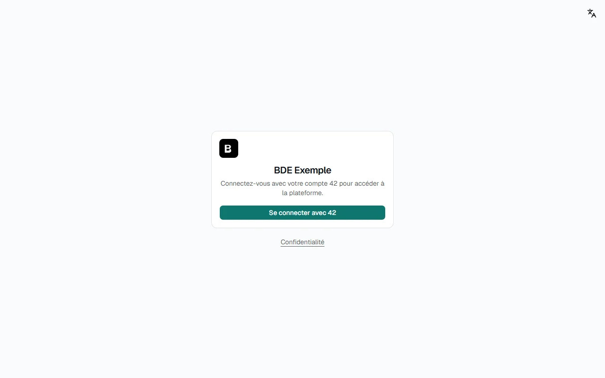
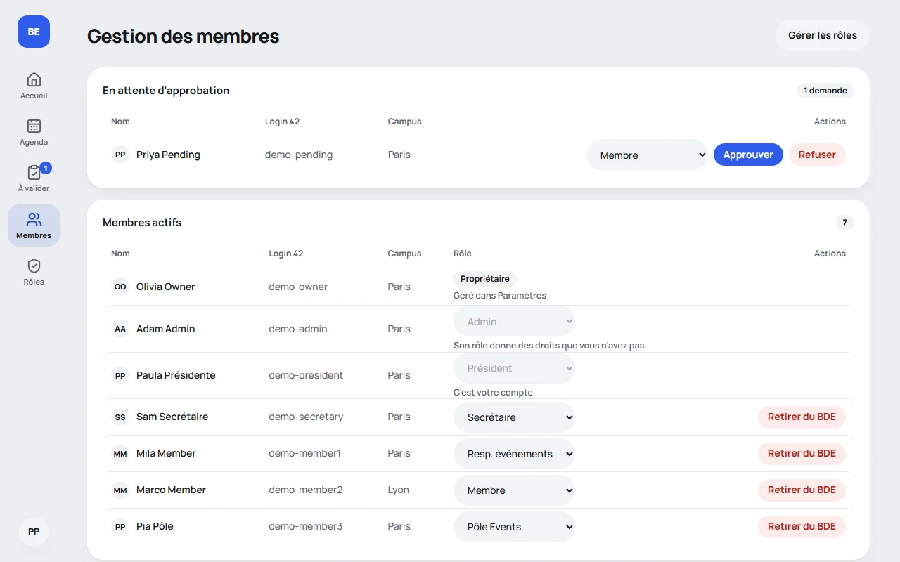

🇫🇷 Français · [🇬🇧 English](../en/user-guide.md)

# Guide utilisateur

Ce guide s'adresse aux membres du bureau qui utilisent la plateforme. Aucune connaissance technique n'est
nécessaire.

## Se connecter

Allez à l'adresse de votre plateforme (donnée par votre bureau) et cliquez sur **Se connecter avec 42**. Vous
arrivez sur l'intra 42 : autorisez l'accès, et vous revenez automatiquement sur la plateforme.

Il n'y a pas de mot de passe à retenir : la connexion passe uniquement par votre compte 42.

## Première connexion : la page d'attente

À la première connexion, votre compte est **en attente d'approbation**. Un membre du bureau qui a le droit
« Gérer les membres » (un propriétaire, ou un rôle comme Président ou Secrétaire) doit approuver votre accès et
vous donner un rôle.

Revenez un peu plus tard, ou contactez un responsable de votre BDE. En attendant, vous ne pouvez rien faire d'autre :
c'est normal.

## Une fois votre compte approuvé

Vous arrivez sur le **tableau de bord** : le prochain événement, ceux qui suivent, des raccourcis et votre compte.

### Se repérer

Sur ordinateur et sur tablette, le menu est une **colonne d'icônes à gauche**, chacune avec son nom dessous. Sur
téléphone, c'est une **barre en bas de l'écran** : Accueil, Agenda, un bouton rond **Créer**, Membres et **Plus** (le
reste de la plateforme, votre profil, le thème, la langue et la déconnexion). Il n'affiche que ce que **votre rôle**
permet :

| Entrée                | Qui la voit                                                         |
| --------------------- | ------------------------------------------------------------------- |
| **Accueil**           | Tout le monde.                                                      |
| **Agenda**            | Ceux qui peuvent consulter les événements, si le module est activé. |
| **À valider**         | Ceux qui peuvent valider les événements (elle les compte).          |
| **Membres**           | Ceux qui ont le droit « Gérer les membres ».                        |
| **Rôles**             | Ceux qui ont le droit « Gérer les rôles ».                          |
| **Journal** (d'audit) | Les propriétaires.                                                  |
| **Réglages**          | Les propriétaires.                                                  |

En bas de la colonne, votre **photo ronde ou vos initiales** ouvrent le menu de votre compte : votre nom et votre rôle,
**Mon profil**, le thème, la langue et **Se déconnecter**. Sur téléphone, la même photo est en haut à droite de la page,
et tout se trouve aussi sous **Plus**. Le lien **Confidentialité** est en bas de la page.

### Changer de langue

L'interface existe en français et en anglais. Ouvrez le menu de votre compte (et utilisez l'icône de langue sur les
pages publiques, comme la page de connexion), puis choisissez **Français** ou **English**. Vous restez sur la même
page, et votre choix est retenu pour la prochaine visite.

### Changer de thème

Le menu de votre compte choisit entre le thème **clair**, le thème **sombre**, ou le réglage de votre appareil.

### Les fenêtres de confirmation

Tout ce qui ne se rattrape pas (retirer un membre, refuser une demande, supprimer un rôle ou un événement,
annuler une date, remplacer un lien d'agenda) ouvre d'abord **une fenêtre au milieu de l'écran** qui explique ce
qui va se passer. Le bouton **Annuler** est sélectionné d'office : `Échap`, un clic à côté ou **Annuler** ferment
la fenêtre sans rien faire. Changer le rôle d'un membre et confirmer un événement demandent aussi confirmation,
mais le bouton n'est pas rouge : c'est réversible.

## Mon profil

Dans le menu de votre nom, **Mon profil** montre vos informations de compte et votre **lien d'agenda
personnel**, à ajouter à Google Agenda, Outlook ou Apple Calendar. Voir [Module Événements](events.md#ajouter-à-son-agenda).

Quand la plateforme publie les événements sur l'intra, le profil permet aussi de renseigner votre **identifiant Discord** et/ou
**Slack** (facultatif) : ils servent uniquement à vous mentionner dans les messages destinés au staff de l'école. La page dit où les
trouver. Une mention, un nom ou tout ce qui n'est pas un identifiant est refusé, et personne d'autre ne voit ce que vous saisissez.

## Pour celles et ceux qui gèrent le bureau

### Gérer les membres

Il faut le droit **Gérer les membres**. La page **Membres** montre deux listes.

- **En attente d'approbation** : les nouveaux comptes. À côté de chaque demande, un menu propose le **rôle à
  donner** (le rôle par défaut est choisi d'avance), puis **Approuver** ou **Refuser**.
- **Membres actifs** : tous les membres. Le menu de la colonne **Rôle** change le rôle d'un membre, après une
  confirmation qui rappelle l'ancien et le nouveau rôle.

**Approuver** donne l'accès avec le rôle choisi. **Refuser** supprime la demande. **Retirer du BDE** supprime le
compte d'un membre, qui pourra redemander l'accès en se reconnectant. Ces actions demandent une confirmation. Si
quelqu'un d'autre a déjà traité la demande, un message l'explique et la liste se met à jour.

Les propriétaires n'ont pas de menu de rôle : ils se gèrent dans **Paramètres**.

Vous n'agissez que dans la limite de vos propres droits. Un rôle qui donne un droit que vous n'avez pas est grisé,
et vous ne pouvez pas changer votre propre rôle, ni celui d'un membre qui a plus de droits que vous. Le message
affiché dit pourquoi. Voir [Rôles et droits](roles.md).

### Gérer les rôles

Il faut le droit **Gérer les rôles**. La page **Rôles** liste les rôles du BDE.

**Créer un rôle** : donnez-lui un nom (Trésorier, Secrétaire…) et cochez ce que ses membres pourront faire. Chaque
case a une phrase d'explication. Deux rôles existent dès l'installation, et on peut les modifier : **Admin**
(tous les droits, sauf le journal d'audit et les Paramètres, qui sont réservés aux propriétaires) et **Membre**
(consulter les événements).

Un rôle encore donné à des membres ne peut pas être supprimé : donnez d'abord un autre rôle à ces membres.

### Être prévenu des nouvelles demandes

Le BDE peut recevoir une alerte quand quelqu'un demande l'accès, quand une demande est approuvée (le membre reçoit
alors un e-mail) et quand un membre est retiré (un message dans le salon Discord ou Slack, jamais d'e-mail). Un
propriétaire règle cela dans **Paramètres**, section Notifications. Voir [Notifications](notifications.md). Les
propriétaires, et les membres dont le rôle le permet, peuvent aussi changer ce que disent les messages et leur
apparence, depuis la page **Notifications** ([Personnaliser les messages](notifications.md#personnaliser-les-messages)).

### Le journal d'audit (propriétaires)

**Journal d'audit** liste, en lecture seule, les actions sensibles : qui a approuvé qui, qui a été retiré, quel rôle
a changé, quel réglage a été modifié… Chaque ligne a la date, l'auteur, l'action et la cible. Il ne peut être ni
modifié ni supprimé depuis l'interface.

### Les réglages de la plateforme (propriétaires)

**Paramètres** regroupe tout ce que l'installateur a demandé, plus le logo, les catégories d'événements et l'heure du
rappel. Chaque section a son bouton **Enregistrer** et s'applique tout de suite. Voir
[Configuration](configuration.md#la-page-paramètres).

## Les événements

Si le module est activé, **Événements** montre le calendrier du bureau, en vue calendrier ou en liste, avec des
filtres. Vous pouvez ajouter un événement à votre agenda ou vous abonner à un flux qui se met à jour tout seul. Si
votre rôle permet de proposer ou de valider des événements, vous les créez et les modifiez ici (une proposition attend
un validateur). Voir [Module Événements](events.md).

## Sur téléphone

La plateforme s'utilise sur téléphone. Le menu s'ouvre avec le bouton « ☰ ». Les événements s'ouvrent en liste ;
la vue Calendrier montre des pastilles de couleur par jour.

## Vos données personnelles

La page **Confidentialité** (lien en bas de la page de connexion et des pages de la plateforme) explique quelles
données sont collectées et pourquoi. Une fois connecté, vous pouvez y **télécharger une copie de toutes vos
données** au format JSON.

## Se déconnecter

Ouvrez le menu de votre compte, puis cliquez sur **Se déconnecter**.

## Si quelque chose ne marche pas

- **« Page introuvable »** : l'adresse n'existe pas, ou l'élément a été supprimé. Le bouton _Retour au tableau de
  bord_ vous ramène à l'accueil.
- **« Quelque chose s'est mal passé »** : une erreur est survenue côté serveur. Vos données ne sont pas perdues.
  Essayez _Réessayer_. Si cela continue, donnez à la personne qui gère le serveur la **référence de l'erreur**
  affichée sous le message : elle permet de retrouver la cause dans les journaux.
- Pour tout le reste, voir la [foire aux questions](faq.md).
